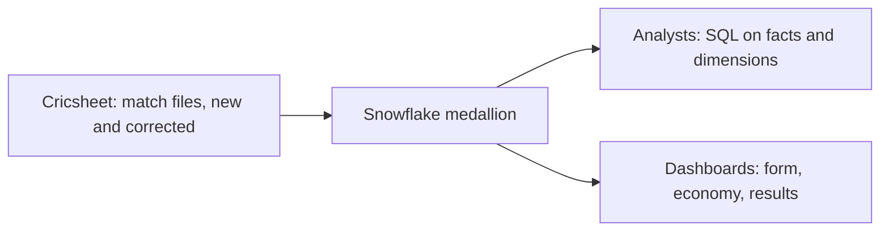

# 1. Problem

## Business Context

A sports analytics startup wants to offer ODI statistics: player form, bowling economy, team results, toss effects. Its analysts know SQL, not JSON. The data arrives as one JSON file per match from Cricsheet, a volunteer project that also publishes corrections to old matches.

The team needs a warehouse model that analysts can query directly, that loads new matches without reprocessing history, and that applies corrections when a match file is republished.



## Source Data

| Property | Value |
| --- | --- |
| Delivery | One ZIP with one JSON file per match; about 3,200 ODIs, about 590 MB uncompressed |
| File name | Cricsheet match id, for example `997995.json` |
| Typical file | About 185 KB, one JSON document |
| Versioning | `meta.revision`; corrected matches are republished with the same file name |

Structure of one match (trimmed):

```json
{
  "meta": { "data_version": "1.3.0", "created": "2016-08-20", "revision": 2 },
  "info": {
    "dates": ["2016-08-16"],
    "teams": ["Scotland", "United Arab Emirates"],
    "venue": "Grange Cricket Club Ground, Raeburn Place, Edinburgh",
    "toss": { "decision": "bat", "winner": "United Arab Emirates" },
    "outcome": { "by": { "wickets": 7 }, "winner": "Scotland" },
    "players": { "Scotland": ["..."], "United Arab Emirates": ["..."] },
    "registry": { "people": { "AC Evans": "e9a870ed" } }
  },
  "innings": [
    {
      "team": "United Arab Emirates",
      "overs": [
        { "over": 0, "deliveries": [
          { "batter": "Rohan Mustafa", "bowler": "AC Evans", "non_striker": "L Sreekumar",
            "runs": { "batter": 3, "extras": 0, "total": 3 } },
          { "batter": "L Sreekumar", "bowler": "AC Evans", "non_striker": "Rohan Mustafa",
            "extras": { "wides": 1 }, "runs": { "batter": 0, "extras": 1, "total": 1 } }
        ] }
      ]
    }
  ]
}
```

Facts measured on 2023 to 2025 matches while writing this project: 606 matches, 573 with a winner, 24 no result, 9 ties, 12 super-over innings, and innings with 11 wicket entries because retirements are recorded as wickets.

## Functional Requirements

1. Load match files from a stage; only new or changed files are processed.
2. Keep each file as delivered (bronze).
3. Silver: one row per match, one row per player per match with registry id, one row per delivery.
4. Gold: batting and bowling facts at innings grain, a player dimension, team results.
5. A corrected file replaces the whole match in silver and gold.
6. One command runs the whole pipeline; each run is logged.

## Non-Functional Requirements

| Requirement | Target |
| --- | --- |
| Idempotency | Running the pipeline twice with no new files changes nothing in silver |
| Delta efficiency | A new year folder processes only its files |
| Corrections | A changed file updates exactly one match |
| Atomic silver | Silver tables never show a partially processed batch |
| Quality | All checks in `tests/data_quality_checks.sql` pass |
| Cost | Full history plus one delta run recorded in credits |

## Out of Scope

- T20 and Test matches (same format; an easy extension)
- Live match feeds
- Player name resolution beyond the Cricsheet registry
