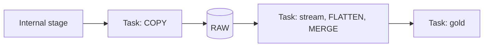
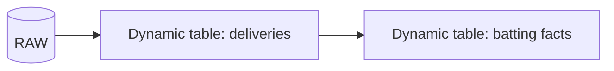
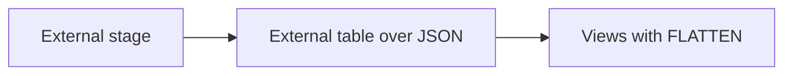
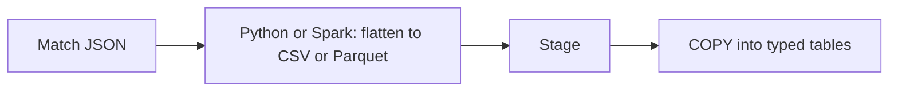

# 2. Architecture and Decisions

## Requirements That Drive the Design

| Driver | Consequence |
| --- | --- |
| Files arrive in batches, not continuously | `COPY INTO` from a task, not Snowpipe |
| No cloud storage account | Internal stage with `PUT` |
| Corrections reuse file names | Rely on `COPY` reloading changed files; handle revisions in silver |
| Several silver tables from one batch | Stream plus explicit transaction |
| Analysts want facts, not JSON | Gold at innings grain with player ids |

## Options

### Option 1: Task graph with COPY, stream, and SQL (chosen)

### Option 2: Dynamic tables for silver and gold

### Option 3: External tables, no load

### Option 4: Flatten before Snowflake

## Trade-Offs

| Criterion | 1 Task graph | 2 Dynamic tables | 3 External tables | 4 Flatten outside |
| --- | --- | --- | --- | --- |
| Handles corrections per match | Yes, explicit delete and insert | Yes, recomputes affected rows | Yes, files are read live | Yes, if reprocessed |
| Control over transactions | Full | Declarative, no control | None needed | In the external tool |
| Incremental flatten | Yes, via stream | Incremental refresh is limited for some constructs | No, every query reads files | Depends on tool |
| Query speed for analysts | Fast, native tables | Fast | Slow, files parsed each query | Fast |
| What you learn | Stages, COPY, streams, tasks, FLATTEN | Declarative pipelines | External tables | Mostly the external tool |
| Best when | Batch deliveries with corrections | Steady incremental pipelines with simple logic | Rarely queried archives | JSON too large or hostile for `VARIANT` |

## Why / Why Not

**Why `COPY` from a task and not Snowpipe?**
Files arrive as yearly or daily batches, not continuously, and there is no cloud storage to send events from. A scheduled or manually started `COPY` is simpler and cheaper.

**Why an internal stage?**
No storage account, no integration, no consent. `PUT` compresses and encrypts files on upload. The trade-off is that files live only inside Snowflake; there is no shared lake copy.

**Why query files with `$1` before loading?**
It answers "what is in these files" without designing a table first, and it catches format problems before any load.

**Why `COPY` and not Snowpipe semantics for corrections?**
`COPY` skips files whose name and checksum it has loaded; a republished file with new content has a new checksum and loads again. Snowpipe would ignore the same name. For a source that republishes corrections under the same name, that difference decides the design.

**Why one row per file version in RAW?**
Bronze keeps history: a corrected match appears twice. Silver decides which version wins (`meta.revision`, then load time).

**Why delete and insert deliveries per match instead of merging per ball?**
A correction can change the number of deliveries (a missed wide, a reordered over). Rebuilding the match's deliveries is simpler and always correct; merging per ball needs a stable ball key that the source does not guarantee.

**Why an explicit transaction in the silver task?**
Three tables are rebuilt from one batch. Without a transaction, the stream would advance after the first statement and a failure later would lose the batch for the other tables. With it, everything commits together or the batch stays in the stream.

**Why recompute gold fully?**
At ODI scale (about 1.6 million deliveries) a full recompute takes seconds on XS and has no incremental edge cases. The decision is revisited when volume or cost says so.

**Why join deliveries to players by name within a match?**
Deliveries carry names; the registry maps names to stable ids per match. Names are not unique across history (two players can share initials), but are unique within one match.

## Architecture Decision Records

### ADR-001: Internal stage, `PUT`, and `COPY` from a task graph

- **Decision:** files are uploaded with `PUT` into `year=YYYY/` folders; the root task refreshes the directory table and runs `COPY` with `ON_ERROR = SKIP_FILE`.
- **Consequences:** no cloud dependencies; deltas and corrections handled by load metadata; skipped files visible through the directory table.

### ADR-002: Silver in one transaction from a stream

- **Decision:** the silver task copies the stream into a batch table, then merges matches, rebuilds squads and deliveries for the batch, logs the run, and commits once.
- **Consequences:** atomic silver; failures leave the batch in the stream for the next run.

### ADR-003: Latest revision wins

- **Decision:** within a batch, the highest `meta.revision` (then latest load) wins; `MERGE` only updates when the incoming revision is not older.
- **Consequences:** out-of-order uploads cannot roll a match back.

### ADR-004: Gold recomputed in full

- **Decision:** `INSERT OVERWRITE` for player dimension and batting and bowling facts on every run.
- **Consequences:** simple and correct; costs a few seconds of serverless compute even when nothing changed.

## Failure Modes

| Failure | Detection | Recovery |
| --- | --- | --- |
| Malformed file | `COPY_HISTORY` `LOAD_FAILED`, `OPS.V_STAGE_FILES_NOT_LOADED` | Fix and re-upload; or `REMOVE` from stage |
| Silver task error | Graph run `FAILED`, first error task | Fix, rerun; batch still in stream |
| Corrected file uploaded without `OVERWRITE` | `PUT` reports skipped | Re-upload with `--overwrite` |
| Graph suspended for weeks | Stream `stale` | Recreate stream and rebuild silver from RAW |
| Duplicate names within a match | Data quality check on missing player ids | Inspect registry for that match |

## Cost Model

| Component | Driver |
| --- | --- |
| Serverless tasks | One graph run: COPY, flatten, gold recompute; seconds to a few minutes on first full load |
| Warehouse | Exploration and dashboards only |
| Storage | Compressed match files on the stage plus tables; small |

The full history is a few hundred MB uncompressed; credits for this project are small. Record them anyway: the habit matters more than the amount.
