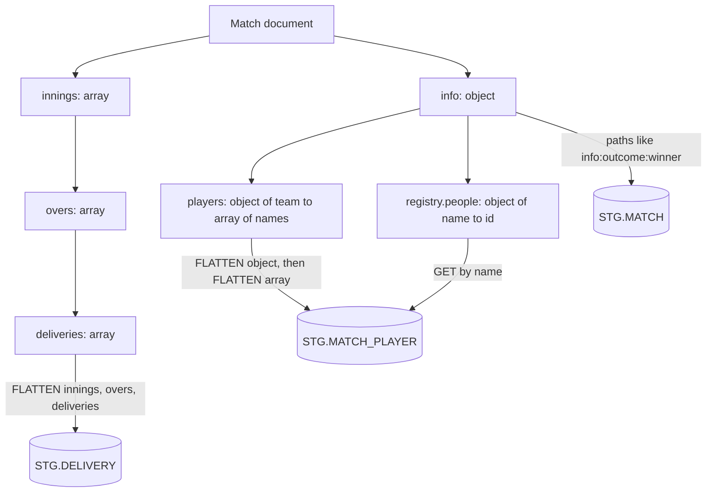
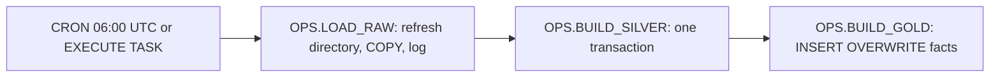
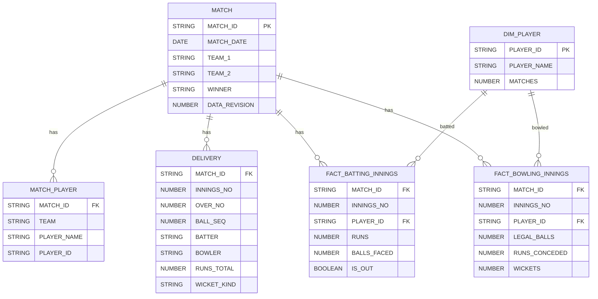

# 3. Snowflake Approach

## From Nested JSON to Rows



The key query shape:

```sql
FROM STG.MATCH_BATCH b,
  LATERAL FLATTEN(input => b.PAYLOAD:innings) inn,
  LATERAL FLATTEN(input => inn.value:overs) ov,
  LATERAL FLATTEN(input => ov.value:deliveries) d
```

`inn.index`, `ov.value:over`, and `d.index` give innings number, over number, and ball sequence; `d.value:runs:batter` and friends give the measures.

## Object Inventory

| Object | Type | Purpose |
| --- | --- | --- |
| `RAW.MATCH_STAGE` | Internal stage with directory table | Uploaded match files, `year=YYYY/` folders |
| `RAW.FF_MATCH_JSON` | File format | One JSON document per file |
| `RAW.MATCH_RAW` | Table, change tracking on | One row per loaded file version |
| `RAW.MATCH_RAW_STREAM` | Append-only stream | New file versions since the last silver run |
| `STG.MATCH_BATCH` | Table | The current batch, latest revision per match |
| `STG.MATCH`, `STG.MATCH_PLAYER`, `STG.DELIVERY` | Tables | Silver |
| `MART.DIM_PLAYER`, `MART.FACT_BATTING_INNINGS`, `MART.FACT_BOWLING_INNINGS` | Tables | Gold, recomputed |
| `MART.V_MATCH`, `MART.V_TEAM_RESULTS` | Views | Analyst-facing match and team views |
| `OPS.LOAD_RAW`, `OPS.BUILD_SILVER`, `OPS.BUILD_GOLD` | Serverless task graph | The pipeline, in that order; all in one schema, as a graph requires |
| `OPS.RUN_LOG`, `OPS.V_STAGE_FILES_NOT_LOADED` | Table, view | Run evidence and stage reconciliation |

## Task Graph



- All tasks of a graph must have the same owner and live in the same schema. Here they live in `OPS` and write to `RAW`, `STG`, and `MART`.
- Only the root has a schedule; children run when their predecessor succeeds.
- `SYSTEM$TASK_DEPENDENTS_ENABLE` resumes the whole graph; suspending the root pauses it.
- `INFORMATION_SCHEMA.COMPLETE_TASK_GRAPHS` shows one row per graph run with the first failing task.

## Data Model



## Domain Rules Encoded in SQL

| Rule | Where |
| --- | --- |
| Wides are not balls faced; no-balls are | `BALLS_FACED = COUNT_IF(WIDES IS NULL)` |
| Byes and leg byes are not charged to the bowler | `RUNS_CONCEDED = runs off bat + wides + no-balls` |
| Run outs and retirements are not bowler wickets | `WICKETS` counts only bowler-credited kinds |
| Retired hurt is not out | `IS_OUT` excludes `retired hurt` and `retired not out` |
| Super overs are not part of player statistics | `WHERE NOT IS_SUPER_OVER` |

## What This Project Teaches About Snowflake

- Stages are queryable: `$1` and `METADATA$` columns let you inspect before you load.
- `COPY` load metadata gives deltas for free and reloads changed files.
- `FLATTEN` turns arrays and objects into rows; chaining it walks a hierarchy.
- Streams plus explicit transactions make multi-table builds atomic.
- Task graphs are the native way to sequence batch steps.
