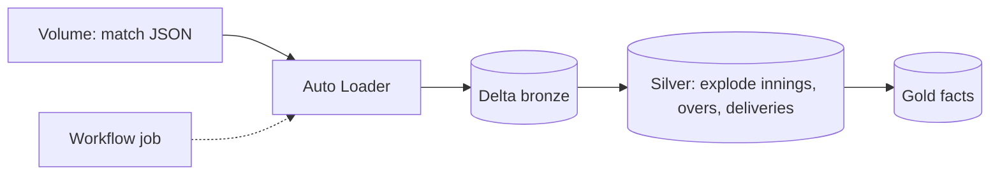
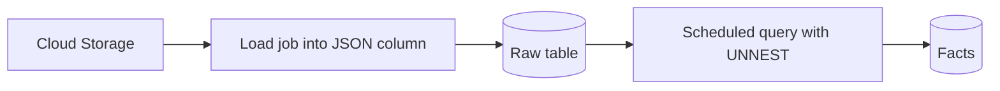
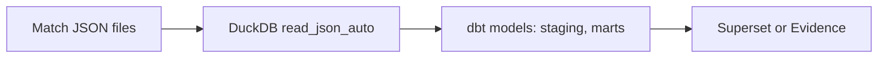
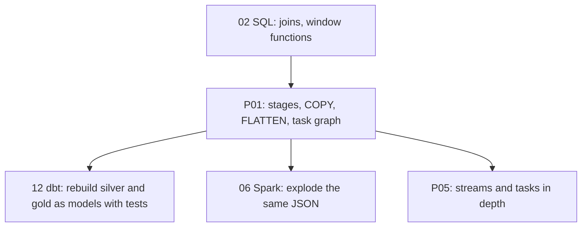

# 4. Alternative Stacks and Roadmap

The problem: nested JSON documents with corrections, delivered in batches, must become analyst-friendly facts and dimensions.

## Component Mapping

| Concern | Snowflake (this project) | Databricks | BigQuery | Open source |
| --- | --- | --- | --- | --- |
| File landing | Internal stage, `PUT` | Volume or cloud storage | Cloud Storage | Local disk or MinIO |
| Load with deltas | `COPY` load metadata | Auto Loader or `COPY INTO` (Delta) | Load jobs, or external tables | dbt plus DuckDB `read_json` |
| Nested arrays to rows | `LATERAL FLATTEN` | `explode`, `inline` | `UNNEST` | DuckDB `unnest` |
| Orchestration | Task graph | Workflows (jobs) | Scheduled queries, Workflows | Airflow or Dagster |
| Corrections | `MERGE` by revision, rebuild per match | `MERGE` on Delta | `MERGE` | dbt incremental with `unique_key` |

## Databricks

- `explode` and `inline` on nested structs replace `FLATTEN`; Auto Loader tracks files like `COPY` load metadata.
- Wins when the team already processes data in Spark or needs Python logic per ball.

## BigQuery

- `UNNEST` of nested repeated fields is natural; pay per bytes scanned.

## Local Open Source: DuckDB and dbt

- Free, runs on a laptop, excellent for prototyping the model before building it in Snowflake.
- Try it: `duckdb -c "SELECT info.teams, info.outcome FROM read_json_auto('batches/year=2024/*.json') LIMIT 5"`.

## When Each Alternative Wins

| Situation | Better choice |
| --- | --- |
| SQL team, batch deliveries, corrections | This project |
| Heavy per-record Python logic or ML features | Databricks |
| GCP organization | BigQuery |
| Prototyping the model, no cloud budget | DuckDB plus dbt |

## Learning Roadmap

| Step | Module | Focus |
| --- | --- | --- |
| SQL foundations | [02-sql](../../../../02-sql/README.md) | Window functions, aggregation by grain |
| dbt | [12-dbt](../../../../12-dbt/README.md) | Same layers as models, tests instead of handwritten checks |
| Spark | [06-spark-pyspark](../../../../06-spark-pyspark/README.md) | `explode` on nested JSON |
| Orchestration | [11-airflow](../../../../11-airflow/README.md) | When a task graph is not enough |

### Suggested Exercise

Rebuild `STG.DELIVERY` and `MART.FACT_BATTING_INNINGS` as dbt models on Snowflake, with `unique` and `not_null` tests and one custom test for "no more than 10 dismissals per innings excluding retirements". Compare effort and readability with the task graph.
