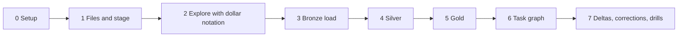

# 5. Step by Step on Snowflake

Every step: **what**, **why**, **verify**, **common errors**. Scripts are in [06_solution](06_solution/README.md).



---

## Phase 0: Setup

- **What:** `./run_sql.sh core/00_account_setup.sql core/01_bronze.sql`.
- **Why:** roles, one XS warehouse, monitor, database, schemas, file format, internal stage with a directory table, raw table with change tracking.
- **Verify:** `SHOW STAGES IN DATABASE P01_CRICKET;` shows `MATCH_STAGE` with directory enabled.

---

## Phase 1: Files and Stage

### 1.1 Prepare batches

```bash
cd prepare && python prepare_batches.py --data-dir "$P01_DATA_DIR" --from-year 2000
```

- **Why:** splitting by year lets you load history first and later years as deltas.
- **Verify:** the script prints a count per year folder.

### 1.2 Upload the first years

```bash
./upload_batch.sh 2000 2001 2002 2003 2004 2005 2006 2007 2008 2009 2010 2011 2012 2013 2014 2015 2016 2017 2018 2019 2020 2021 2022
```

- **Why:** `PUT` compresses locally and uploads in parallel; files land in `year=YYYY/`.
- **Verify:** `LIST @P01_CRICKET.RAW.MATCH_STAGE/year=2022/;`
- **Common errors:** `PUT` from Snowsight is not supported; use the CLI.

---

## Phase 2: Explore With `$` Notation

```sql
SELECT METADATA$FILENAME,
       $1:info:dates[0]::DATE  AS MATCH_DATE,
       $1:info:teams           AS TEAMS,
       $1:info:outcome         AS OUTCOME,
       ARRAY_SIZE($1:innings)  AS INNINGS
FROM @P01_CRICKET.RAW.MATCH_STAGE/year=2019/ (FILE_FORMAT => 'P01_CRICKET.RAW.FF_MATCH_JSON')
LIMIT 10;
```

- **Why:** design the silver tables from evidence: which paths exist, which are optional (`outcome.result` only for no result or tie, `super_over` only on super-over innings).
- **Try:** count deliveries per match directly on the stage with two `FLATTEN`s before writing any table.

---

## Phase 3: Bronze Load

- **What:** run the `COPY` from the root task body by hand once, or wait for Phase 6.
- **Why:** `METADATA$FILENAME`, `METADATA$FILE_LAST_MODIFIED`, `METADATA$START_SCAN_TIME` give lineage per row.
- **Verify:** `SELECT COUNT(*) FROM RAW.MATCH_RAW;` equals the number of uploaded files; running the same `COPY` again loads 0 files.

---

## Phase 4: Silver

- **What:** `./run_sql.sh core/20_silver.sql` (tables and stream); the logic lives in the silver task in `core/40_task_graph.sql`.
- **Why:**
  - the batch table freezes the stream contents for the run
  - `MERGE` with a revision condition protects against older versions
  - squads use `FLATTEN` on an object (`key` is the team) and then on an array; ids come from `GET(registry.people, name)`
  - deliveries are rebuilt per match
- **Verify** after a run: `SELECT COUNT(*) FROM STG.DELIVERY;` in the hundreds of thousands for a few decades of ODIs; `STG.MATCH` count equals distinct match files.

---

## Phase 5: Gold

- **What:** `./run_sql.sh core/30_gold.sql`; the recompute logic is in the gold task.
- **Why:** facts at innings grain answer most analyst questions; the player dimension resolves names to stable ids.
- **Verify:** top run scorers per year look plausible to anyone who follows cricket.

---

## Phase 6: Task Graph

- **What:** `./run_sql.sh core/40_task_graph.sql`, then `EXECUTE TASK P01_CRICKET.OPS.LOAD_RAW;`.
- **Verify:**

  ```sql
  SELECT ROOT_TASK_NAME, STATE, FIRST_ERROR_TASK_NAME, COMPLETED_TIME
  FROM TABLE(P01_CRICKET.INFORMATION_SCHEMA.COMPLETE_TASK_GRAPHS(ROOT_TASK_NAME => 'LOAD_RAW'))
  ORDER BY SCHEDULED_TIME DESC LIMIT 5;
  SELECT * FROM P01_CRICKET.OPS.RUN_LOG ORDER BY RUN_AT DESC;
  ```

- **Common errors:**
  - "Unable to update graph with root task ... since that root task is not suspended": suspend the root before changing any task.
  - Child task never runs: the graph was not enabled; use `SYSTEM$TASK_DEPENDENTS_ENABLE`.

Then run the dashboard queries and `tests/data_quality_checks.sql`.

---

## Phase 7: Deltas, Corrections, Drills

- `./upload_batch.sh 2023 2024 2025` and run the graph: only new files load.
- Work through [tests/failure_drills.md](06_solution/tests/failure_drills.md), especially the corrected-file drill.
- Pause: `./run_sql.sh core/90_pause.sql`. Teardown at the end: `./run_sql.sh teardown.sql`.
