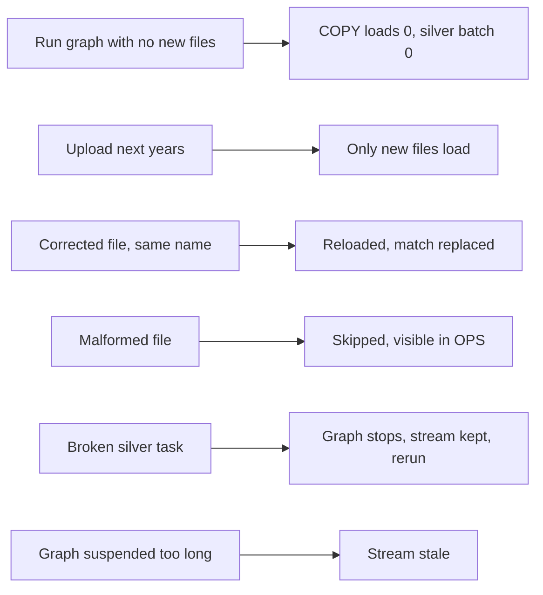

# P01 Failure Drills

Run after the first full graph run. Predict first, then run. Commands from `06_solution/`.



## D1 Re-run With Nothing New

```sql
EXECUTE TASK P01_CRICKET.OPS.LOAD_RAW;
```

- **Observe:** `COPY_HISTORY` shows no new files; `OPS.RUN_LOG` has `BUILD_SILVER` with batch size 0; gold still recomputes.
- **Discuss:** the gold step costs credits even with no new data. How would you skip it? (Hint: a `WHEN` condition only exists on the root; a child can check the batch size and return early.)

## D2 Delta Load

```bash
./upload_batch.sh 2024 2025
```

then `EXECUTE TASK OPS.LOAD_RAW;`.

- **Observe:** only the new year folders load; `STG.MATCH` grows by exactly the number of new files; gold totals grow.
- **Lesson:** COPY load metadata gives file-level incrementality for free on stages.

## D3 Corrected File With the Same Name

Edit one already-loaded match file locally (for example change `info.outcome.winner` to the other team and increase `meta.revision`), then:

```bash
./upload_batch.sh 2024 --overwrite
```

and run the graph.

- **Observe:** COPY loads the changed file again (its checksum changed), the stream delivers it, `MERGE` updates `STG.MATCH`, deliveries for that match are rebuilt, team results change.
- **Compare with P04:** Snowpipe ignores a re-uploaded name. `COPY` reloads it when the content changed. Same platform, different contract.
- **Undo:** restore the original file and re-upload with `--overwrite`.

## D4 Malformed File

```bash
mkdir -p "$P01_DATA_DIR/batches/year=2099" && echo '{"info": {"dates": ["2099-01-01"]' > "$P01_DATA_DIR/batches/year=2099/broken.json"
./upload_batch.sh 2099
```

Run the graph.

- **Observe:** `COPY_HISTORY` shows `LOAD_FAILED` for `broken.json.gz`; `OPS.V_STAGE_FILES_NOT_LOADED` lists it; the graph still succeeds.
- **Clean up:** `REMOVE @P01_CRICKET.RAW.MATCH_STAGE/year=2099/;`

## D5 Broken Silver Task

Recreate `OPS.BUILD_SILVER` with a deliberate error (for example a wrong column name), resume the graph, upload a new year, run the graph.

- **Observe:** `COMPLETE_TASK_GRAPHS` shows `FAILED` with `FIRST_ERROR_TASK_NAME = BUILD_SILVER`; `BUILD_GOLD` did not run; `SYSTEM$STREAM_HAS_DATA('P01_CRICKET.RAW.MATCH_RAW_STREAM')` is still `TRUE`.
- **Recover:** rerun `core/40_task_graph.sql`, run the graph; the batch is processed exactly once.
- **Lesson:** the explicit transaction keeps the stream offset until every silver table is rebuilt.

## D6 Suspended Too Long (Discussion)

If the graph is suspended longer than the raw table's data retention (extended for streams up to a limit), the stream becomes stale. Find `STALE_AFTER` in `SHOW STREAMS`. What would you do to recover, and what does that cost?

## Drill Log Template

| Drill | Prediction | Observed | Detected by | Recovery | Follow-up change |
| --- | --- | --- | --- | --- | --- |
| D1 | | | | | |
| D2 | | | | | |
| D3 | | | | | |
| D4 | | | | | |
| D5 | | | | | |
| D6 | | | | | |
