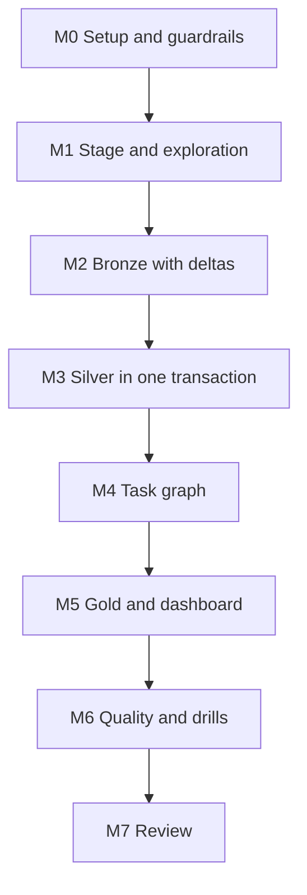

# 7. Build It Yourself

## Brief

Turn twenty-five years of ODI match files into a model analysts can query without touching JSON. New seasons must load as deltas, corrected matches must replace old versions, and the pipeline must run with one command. Show the numbers that prove it.

## Rules

| You may use | Only when stuck | Only after the milestone passes |
| --- | --- | --- |
| [01](01_problem.md) to [04](04_alternative_stacks.md), `_shared/`, deep dives, Snowflake documentation, the Cricsheet format description | [05](05_snowflake_step_by_step.md) | [06_solution/](06_solution/README.md) |

You may reuse `prepare_batches.py`; everything in Snowflake is yours.

## Milestones

### M0 Setup and Guardrails
- [ ] Owner and reader roles, XS warehouse with monitor, database
- [ ] Serverless task privileges granted deliberately

### M1 Stage and Exploration
- [ ] Internal stage with a directory table; history uploaded by year
- [ ] Five exploration queries on staged files with `$1`, including one that counts deliveries per match with `FLATTEN`
- [ ] A written list of optional paths you found and how you will handle them

### M2 Bronze With Deltas
- [ ] Raw table with file name, file timestamp, and load timestamp per row
- [ ] Running the load twice loads nothing the second time
- [ ] A malformed file is skipped and visible in a reconciliation query

### M3 Silver in One Transaction
- [ ] One row per match, per squad member with registry id, per delivery
- [ ] A failure in the middle of silver leaves no partial batch and keeps the batch for the next run
- [ ] A corrected file replaces exactly one match

**Hint:** what happens to a stream's offset after the first DML statement that reads it, if no explicit transaction is open?

### M4 Task Graph
- [ ] Root, silver, and gold tasks; one command runs the graph
- [ ] Graph runs are visible with their first failing task

### M5 Gold and Dashboard
- [ ] Batting and bowling facts at innings grain, player dimension, team results
- [ ] Domain rules encoded: wides vs balls faced, bowler-credited wickets, retirements, super overs
- [ ] Dashboard: top run scorers by year, most economical bowlers, team win rates, toss effect

### M6 Quality and Drills
- [ ] Checks: duplicates, dismissals per innings, winner is a team, runs reconcile between facts and deliveries
- [ ] Drills: no-new-data run, delta, corrected file, malformed file, broken silver task

### M7 Review
- [ ] One page: model diagram, decisions with rejected alternatives, credits for full load and for one delta run
- [ ] Teardown or pause

## Stretch Goals

- **Skip work when nothing changed:** make silver and gold return early when the batch is empty.
- **T20 and Tests:** add another Cricsheet archive with a `match_type` partition and compare scoring patterns.
- **dbt version:** rebuild silver and gold as dbt models with tests.
- **Dynamic tables:** replace gold with dynamic tables and compare refresh behavior and cost.
- **Partnerships:** derive batting partnerships from deliveries (the `non_striker` field makes it possible).

## Portfolio and Interview

**Resume bullet example:** Modeled 25 years of ball-by-ball cricket data from nested JSON into facts and dimensions in Snowflake, with stream-driven atomic silver builds, revision-aware corrections, and a serverless task graph.

**Questions you should be able to answer:**
1. Why does `COPY` reload a corrected file but Snowpipe does not?
2. Why rebuild deliveries per match instead of merging per ball?
3. What does the explicit transaction protect against?
4. When would you replace this task graph with dbt or dynamic tables?
