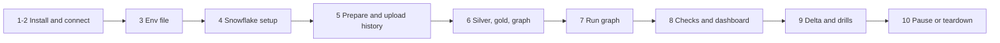

# P01 Quickstart

Numbered commands from an empty laptop to a loaded, checked, and paused cricket warehouse. Only a Snowflake account is needed. Details: [05_snowflake_step_by_step.md](05_snowflake_step_by_step.md).



### 1. Install

Python 3.12, Snowflake CLI ([setup guide](../../../../shared/environments/setup-guide/01_workstation_macos.md), [Snowflake CLI](../../../../shared/environments/setup-guide/02_cli_tools_and_auth.md#snowflake-cli)).

**Done when:** `snow --version` and `python3.12 --version` work.

### 2. Snowflake trial and connection

[Snowflake account guide](../../../../shared/environments/setup-guide/accounts/snowflake.md); add `[connections.p01]` to `~/.snowflake/config.toml`.

**Done when:** `snow sql -c p01 -q "SELECT CURRENT_USER()"` succeeds.

### 3. Env file

```bash
cd 16-cloud-databases/01-snowflake/end-to-end-projects/P01_cricket_json_medallion/06_solution
cp p01.env.example p01.env      # set P01_DATA_DIR to an absolute folder outside the repository
set -a; source p01.env; set +a
mkdir -p "$P01_DATA_DIR"
```

**Done when:** `echo $P01_DATA_DIR` prints an existing folder.

### 4. Snowflake setup

```bash
./run_sql.sh core/00_account_setup.sql core/01_bronze.sql
```

**Done when:** `snow sql -c p01 -q "SHOW STAGES IN DATABASE P01_CRICKET"` lists `MATCH_STAGE`.

### 5. Prepare and upload history

```bash
( cd prepare && python3.12 -m venv .venv && source .venv/bin/activate && pip install pytest && python -m pytest -q test_prepare_batches.py \
  && python prepare_batches.py --data-dir "$P01_DATA_DIR" --from-year 2000 )
./upload_batch.sh $(seq 2000 2022)
```

**Done when:** `snow sql -c p01 -q "LIST @P01_CRICKET.RAW.MATCH_STAGE/year=2022/"` lists files.

### 6. Silver, gold, task graph

```bash
./run_sql.sh core/20_silver.sql core/30_gold.sql core/40_task_graph.sql
```

**Done when:** `SHOW TASKS` in the script output shows three tasks in state `started`.

### 7. Run the graph

```bash
snow sql -c p01 -q "USE ROLE P01_OWNER; EXECUTE TASK P01_CRICKET.OPS.LOAD_RAW"
snow sql -c p01 -q "SELECT * FROM P01_CRICKET.OPS.RUN_LOG ORDER BY RUN_AT DESC LIMIT 5"
```

**Done when:** `RUN_LOG` shows `LOAD_RAW`, `BUILD_SILVER`, and `BUILD_GOLD` for this run (allow a few minutes on the first full load).

### 8. Checks and dashboard

```bash
./run_sql.sh tests/data_quality_checks.sql
./run_sql.sh core/50_ops_and_dashboard.sql
```

Build a Snowsight dashboard from the tile queries as `P01_READER`.

**Done when:** all checks `PASS`.

### 9. Delta and drills

```bash
./upload_batch.sh 2023 2024 2025
snow sql -c p01 -q "USE ROLE P01_OWNER; EXECUTE TASK P01_CRICKET.OPS.LOAD_RAW"
```

Then [tests/failure_drills.md](06_solution/tests/failure_drills.md).

**Done when:** `BUILD_SILVER` batch size in `RUN_LOG` equals the number of new files; drill log filled.

### 10. Pause or teardown

```bash
./run_sql.sh core/90_pause.sql
./run_sql.sh teardown.sql        # end of project
```

**Done when:** `SHOW WAREHOUSES LIKE 'P01_%'` returns nothing after teardown.
