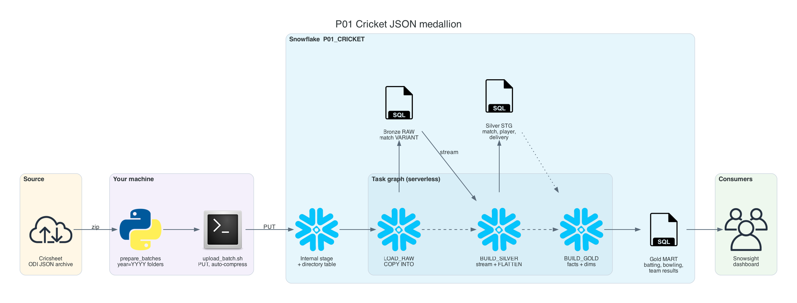
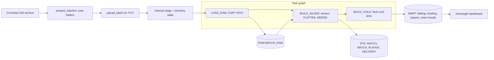

# P01 Cricket JSON Medallion

Load every One Day International since 2000 from Cricsheet, ball by ball, into a bronze-silver-gold model in Snowflake. Each match is one deeply nested JSON file: match info, two squads with player registry ids, and innings that contain overs that contain deliveries. You will explore files directly on a stage with `$` notation, flatten three levels of arrays, and run the whole pipeline as a task graph that loads deltas and handles corrected files.

No cloud account besides Snowflake is needed: files go to an internal stage with `PUT`.

## Target Architecture

Own diagram, generated from [assets/architecture.py](assets/architecture.py). Icons: vendor architecture icon sets bundled with the <a href="https://diagrams.mingrammer.com">diagrams</a> library.

Text version (Mermaid)

### Reference From the Source Article

ProjectPro lists this idea as "Build a Snowflake Data Pipeline for ODI Cricket Analytics" with an open-source implementation by DewduSendanayake on GitHub ([ODI-Cricket-Analytics](https://github.com/DewduSendanayake/ODI-Cricket-Analytics)). P01 keeps the medallion and task-tree idea and adds delta loads by year, corrected-file handling, a transactional silver step, and data quality checks.

Source: ProjectPro, <a href="https://www.projectpro.io/article/snowflake-projects/1168">13 End-to-End Snowflake Projects That Build Job-Ready Skills</a>.

## Skills

| Skill | Milestone |
| --- | --- |
| Internal stages, `PUT`, directory tables | M1 |
| Querying staged files with `$1` notation before loading | M1 |
| `COPY INTO` with metadata columns and load metadata for deltas | M2 |
| Three-level `LATERAL FLATTEN`, dynamic keys with `GET` | M3 |
| Streams plus an explicit transaction for multi-table silver builds | M3 |
| Task graphs: root, children, `SYSTEM$TASK_DEPENDENTS_ENABLE`, graph run history | M4 |
| Dimensional thinking: facts at innings grain, player ids vs names | M5 |
| Data quality rules that reflect domain knowledge | M6 |

## Prerequisites

- [Semi-structured data deep dive](../../learning-materials/deep-dives/Snowflake_semi_structured_data.md)
- Snowflake trial and Snowflake CLI: [setup guide](../../../../shared/environments/setup-guide/README.md)
- Python 3.10+, about 1 GB free disk space
- [Cost guardrails](../_shared/cost_guardrails.md): this project is cheap; the full history loads in minutes on XS

## Navigation

| Part | File |
| --- | --- |
| Quickstart: numbered commands from install to teardown | [QUICKSTART.md](QUICKSTART.md) |
| 1. Problem | [01_problem.md](01_problem.md) |
| 2. Architecture and decisions | [02_architecture_decisions.md](02_architecture_decisions.md) |
| 3. Snowflake approach | [03_snowflake_approach.md](03_snowflake_approach.md) |
| 4. Alternative stacks and roadmap | [04_alternative_stacks.md](04_alternative_stacks.md) |
| 5. Step by step on Snowflake | [05_snowflake_step_by_step.md](05_snowflake_step_by_step.md) |
| 6. Solved reference | [06_solution/README.md](06_solution/README.md) |
| 7. Build it yourself | [07_build_it_yourself.md](07_build_it_yourself.md) |

Recommended route: 1, 2, 3, 4, then **7** (build). Use 5 when stuck. Compare with 6 at the end.
