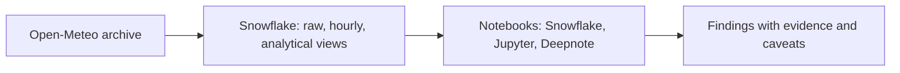

# 1. Problem

## Business Context

A small analytics team at an insurance company prices weather-related policies in six cities. Before building any model, they want to understand the data: how seasons differ between hemispheres, when in the day temperatures peak, how unusual recent heat waves were, and how often heavy rain happens. They work in notebooks, but the company wants the data to stay in Snowflake under its access rules rather than in CSV files on laptops.



## Source Data

| Property | Value |
| --- | --- |
| API | `https://archive-api.open-meteo.com/v1/archive`, free for non-commercial use, no key |
| Underlying data | Reanalysis (gridded model output), not station readings |
| Grain | Hourly, UTC (`timezone=UTC` requested) |
| Lag | A few days behind real time; the downloader stops seven days back |
| Variables | Temperature, relative humidity, precipitation, wind speed, cloud cover, weather code |
| Files | One per city per year, about 0.3 MB; `city=<slug>/year=YYYY/open_meteo_hourly.json` |

One response (trimmed). Values arrive as **parallel arrays**: position *i* in every array belongs to `hourly.time[i]`.

```json
{
  "latitude": 50.45, "longitude": 30.5, "timezone": "UTC",
  "hourly_units": { "temperature_2m": "°C", "precipitation": "mm" },
  "hourly": {
    "time": ["2024-01-01T00:00", "2024-01-01T01:00", "..."],
    "temperature_2m": [-1.9, -2.1, "..."],
    "precipitation": [0.0, 0.1, "..."]
  },
  "_source": { "city_slug": "kyiv", "year": 2024, "fetched_at": "2025-01-08T10:00:00+00:00" }
}
```

`_source` is added by the downloader for lineage; it is not part of the API.

## Functional Requirements

1. Download hourly history for six cities, 2016 to the most recent complete week.
2. Keep every API response as delivered.
3. One row per city per hour, with no duplicates after re-downloads.
4. Local-time daily and monthly aggregates, a per-day-of-year climatology, and daily anomalies.
5. A notebook that answers four questions: seasonal cycle, daily cycle, extremes, heavy rain.
6. The same notebook runs in Snowflake and outside it without code changes.

## Non-Functional Requirements

| Requirement | Target |
| --- | --- |
| Data stays governed | Notebooks read through roles; nothing is exported to files |
| Pushdown | Notebooks pull aggregates (hundreds of rows), never the hourly table |
| Reproducibility | One script rebuilds every table and view from the stage |
| Quality | All checks in `tests/data_quality_checks.sql` pass before any chart |
| Cost | Warehouse idle within one minute after a session ends |

## Out of Scope

- Forecasting and machine learning (P13 covers ML)
- Station data and gridded data comparison
- Scheduled refresh (P05 covers tasks; here data is loaded on demand)
