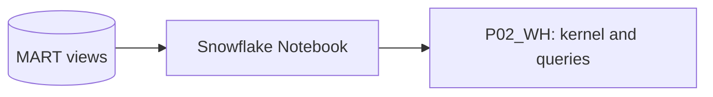
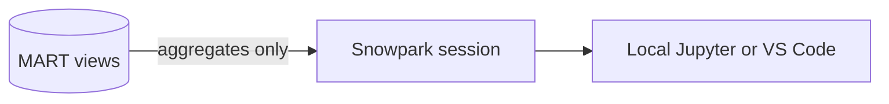
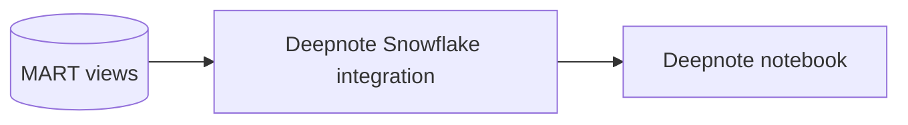
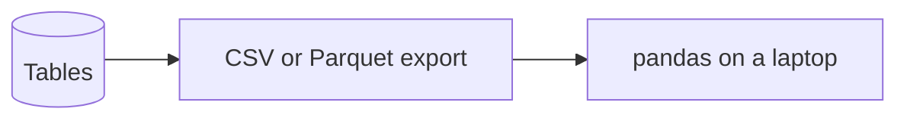

# 2. Architecture and Decisions

## Requirements That Drive the Design

| Driver | Consequence |
| --- | --- |
| Analysts explore, they do not run pipelines | On-demand load script, no tasks or pipes |
| Data must stay governed | Notebooks query Snowflake through roles; no CSV exports |
| Small data (about 0.5 million hourly rows) | Views for the analytical layer; one table for the unzipped hourly grain |
| Six time zones, two hemispheres | Store UTC, convert per city in a view |
| Several notebook tools in the team | Notebook code must not depend on where it runs |

## Options

### Option 1: Snowflake Notebook on the warehouse runtime (chosen as primary)

### Option 2: Local Jupyter with Snowpark (chosen as secondary)

### Option 3: Deepnote or another hosted notebook

### Option 4: Export to files, analyse in pandas

## Trade-Offs

| Criterion | 1 Snowflake Notebook | 2 Local Jupyter | 3 Deepnote | 4 Export |
| --- | --- | --- | --- | --- |
| Data leaves Snowflake | No | Only query results | Only query results | Yes, whole tables |
| Access control | Snowflake roles | Snowflake roles | Integration role plus Deepnote sharing | None after export |
| Setup | None beyond Snowflake | Python env, connection config | Account plus integration | Simple |
| Python packages | Anaconda channel (warehouse runtime) or pip (container runtime) | Anything | Anything | Anything |
| Collaboration | Snowsight sharing, Git integration | Git | Real-time, comments | Email attachments |
| Cost while idle | Warehouse while session is active | Warehouse only per query | Deepnote machine plus warehouse per query | None |
| Best when | Data team already in Snowflake, governance matters | Heavy local tooling, offline work | Mixed audience, live collaboration | Never for sensitive or large data |

## Why / Why Not

**Why a notebook at all, and not only SQL worksheets?**
EDA mixes queries, charts, and narrative. A notebook keeps the reasoning next to the evidence. Worksheets are fine for single questions; a notebook is the deliverable for a set of findings.

**Why model in SQL views instead of in the notebook?**
Views are shared, versioned in scripts, and reusable by a dashboard or another notebook. Logic hidden in notebook cells is copied and drifts. The notebook should contain questions and charts, not the definition of "a day".

**Why store UTC and convert in a view?**
UTC has no gaps or duplicate hours at daylight saving changes. Converting per city at read time keeps one storage format and makes the conversion explicit. Grouping by UTC date silently mixes two local days for Sydney or Tokyo.

**Why one file per city per year?**
Small enough to re-download one unit, large enough to avoid thousands of tiny files. The path carries the partition (`city=`, `year=`), so `LIST` and `COPY` can target a subset.

**Why keep every API response in RAW?**
Re-downloads happen (the current year grows). RAW keeps all versions; STG picks the latest per city and hour with `QUALIFY`. If a download is wrong, the previous version is still there.

**Why a table for hourly data but views for everything above it?**
Unzipping parallel arrays is the expensive step and only changes on load, so it is materialised once. Daily and monthly views over half a million rows run in under a second on XS. Materialise more only when a query is measurably slow.

**Why pull aggregates into pandas, not the hourly table?**
Moving data to the client is the slowest and least governed step. `to_pandas()` on a `GROUP BY` returns hundreds of rows; on `STG.WEATHER_HOURLY` it would return half a million and grow every year.

**Why the warehouse runtime and not the container runtime?**
The analysis needs pandas and Altair, both available on the warehouse runtime. The container runtime (compute pools) is for pip packages, GPUs, or long-running ML; it adds a compute pool to manage and pay for.

**Why does the climatology need at least five years per day of year?**
With fewer samples the standard deviation is unstable and z-scores explode. The threshold is stated in the view, not hidden in the notebook.

## Architecture Decision Records

### ADR-001: SQL views own the analytical definitions

- **Decision:** local time, daily grain, climatology, anomaly, and heavy rain thresholds are defined in `MART` views.
- **Consequences:** every notebook and dashboard uses the same definitions; changing a threshold is a reviewed SQL change.

### ADR-002: One portable notebook

- **Decision:** the notebook tries `get_active_session()` and falls back to a Snowpark session built from a named connection.
- **Consequences:** the same file runs in Snowflake, Jupyter, and Deepnote; credentials live in `config.toml` or the tool's secret store, never in cells.

### ADR-003: Latest download wins in STG

- **Decision:** `ROW_NUMBER() OVER (PARTITION BY city, hour ORDER BY LOADED_AT DESC) = 1`.
- **Consequences:** re-downloads are safe; RAW grows with each re-download, which is acceptable at this size.

### ADR-004: Short auto-suspend for an interactive warehouse

- **Decision:** `AUTO_SUSPEND = 60`, a daily resource monitor, a statement timeout.
- **Consequences:** idle cost after a session ends is at most one minute; a runaway query stops after 15 minutes.

## Failure Modes

| Failure | Detection | Recovery |
| --- | --- | --- |
| API rate limit or timeout | `fetch_weather.py` raises with HTTP status | Rerun for the missing city and year; increase `--pause-seconds` |
| Re-downloaded year | Two RAW rows for one city and year | Nothing to do; STG deduplicates |
| Missing hours | `missing_hours_within_city_year` check | Re-download that file |
| Wrong time zone or hemisphere | Seasonal chart peaks in the wrong months | Fix `STG.CITY`, rerun `20_load_and_model.sql` |
| Notebook session left open | `WAREHOUSE_METERING_HISTORY` shows credits without queries | End session; check idle timeout |
| Notebook pulls too much data | Slow cell, memory error | Push the aggregation into SQL |

## Cost Model

| Component | Driver |
| --- | --- |
| Warehouse | Load and model: under a minute on XS. Notebook: active session time plus auto-suspend |
| Storage | About 20 MB compressed for files and tables |
| External | Open-Meteo free tier; Deepnote free plan |

The interesting cost lesson is not the size but the shape: for interactive work, idle time costs more than queries.
