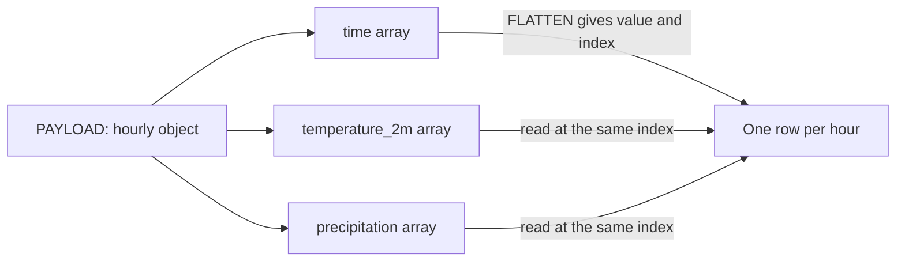
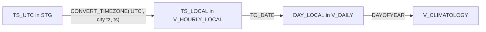
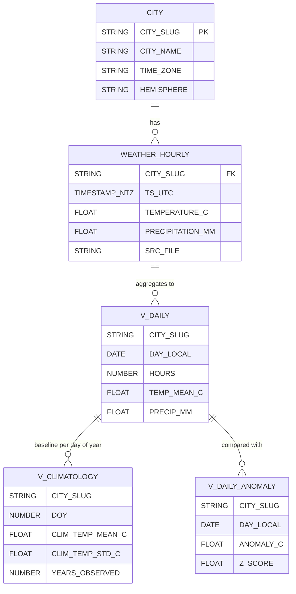
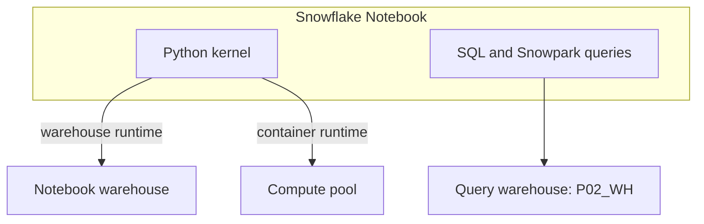

# 3. Snowflake Approach

## From Parallel Arrays to Rows

The API returns one array per variable. `FLATTEN` over `hourly.time` produces one row per hour with an `index`; every other array is read at that index.



```sql
SELECT
  r.PAYLOAD:_source:city_slug::STRING             AS CITY_SLUG,
  TO_TIMESTAMP_NTZ(t.value::STRING)               AS TS_UTC,
  r.PAYLOAD:hourly:temperature_2m[t.index]::FLOAT AS TEMPERATURE_C
FROM RAW.WEATHER_RAW r,
  LATERAL FLATTEN(input => r.PAYLOAD:hourly:time) t;
```

Flattening each array separately and joining on position would also work, but costs one `FLATTEN` per variable and a join; indexing is one pass.

## Time Zones



- `TS_UTC` is `TIMESTAMP_NTZ` holding UTC: no session time zone can shift it.
- The three-argument `CONVERT_TIMEZONE` returns a local wall-clock time without zone, exactly what grouping by local day needs.
- A local day has 23 or 25 hours on daylight saving changes; views filter on `HOURS = 24` where that matters.

## Object Inventory

| Object | Type | Purpose |
| --- | --- | --- |
| `RAW.WEATHER_STAGE` | Internal stage with directory table | API responses, `city=<slug>/year=YYYY/` |
| `RAW.FF_API_JSON` | File format | One JSON document per file |
| `RAW.WEATHER_RAW` | Table | One row per loaded file version |
| `STG.CITY` | Table | City, coordinates, IANA time zone, hemisphere |
| `STG.WEATHER_HOURLY` | Table | One row per city per UTC hour, latest load wins |
| `MART.V_HOURLY_LOCAL` | View | Adds local time and city attributes |
| `MART.V_DAILY` | View | Local-day aggregates with hour count |
| `MART.V_CLIMATOLOGY` | View | Mean and spread per city and day of year |
| `MART.V_DAILY_ANOMALY` | View | Daily anomaly and z-score against climatology |
| `MART.V_MONTHLY` | View | Monthly means, totals, heavy rain days |
| `ANALYSIS.NOTEBOOK_STAGE` | Internal stage | Uncompressed `.ipynb` source |
| `ANALYSIS.WEATHER_EDA` | Notebook | The notebook, owned by `P02_OWNER` |

## Data Model



## Snowflake Notebooks in Brief



- **Creation:** in Snowsight (import an `.ipynb`) or with `CREATE NOTEBOOK ... FROM '@stage' MAIN_FILE = ...`, then `ALTER NOTEBOOK ... ADD LIVE VERSION FROM LAST`.
- **Runtime:** the warehouse runtime runs the kernel on a warehouse with packages from the Snowflake Anaconda channel; the container runtime runs on a compute pool and allows `pip`.
- **Identity:** the notebook runs with the owner role's privileges, like a stored procedure with owner's rights. Anyone allowed to use the notebook sees what the owner sees.
- **Session cost:** while a session is active the warehouse stays resumed; end the session or rely on the idle timeout.
- **Version control:** a notebook can be created from a Git repository stage instead of an internal stage (the P16 capstone covers Git and CI/CD).

## Roles

| Role | Can | Cannot |
| --- | --- | --- |
| `P02_OWNER` | Load, model, own and run the notebook | Account-level changes |
| `P02_READER` | Query `STG` and `MART`, use `P02_WH` | Change data or the notebook |

External notebooks (Jupyter, Deepnote) should connect as `P02_READER`: analysis does not need write access.

## What This Project Teaches About Snowflake

- Parallel arrays are unzipped with one `FLATTEN` and positional access.
- Time zone handling belongs in the model, not in each analyst's head.
- Views are often enough for analytics at small scale; measure before materialising.
- Snowflake Notebooks keep analysis next to governed data; their cost model is session time.
- Snowpark lets the same notebook code run anywhere, as long as aggregation is pushed down.
