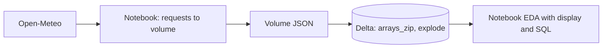
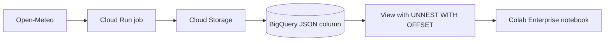
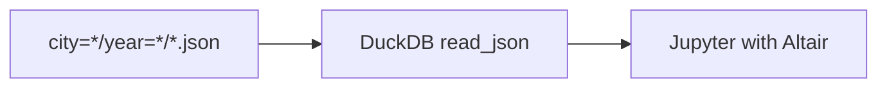
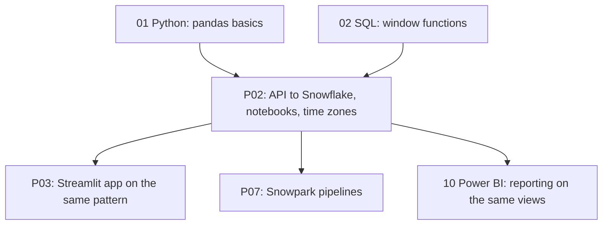

# 4. Alternative Stacks and Roadmap

The problem: pull a public API into governed storage, model it for analysis, and explore it in notebooks without moving raw data to laptops.

## Component Mapping

| Concern | Snowflake (this project) | Databricks | BigQuery | Open source |
| --- | --- | --- | --- | --- |
| Landing | Internal stage, `PUT` | Unity Catalog volume | Cloud Storage | Local folder or MinIO |
| Array unzip | `FLATTEN` with `index` | `arrays_zip` plus `explode` | `UNNEST ... WITH OFFSET` | DuckDB `unnest` on several lists |
| Time zones | `CONVERT_TIMEZONE` | `from_utc_timestamp` | `DATETIME(ts, tz)` | DuckDB `timezone()` |
| Notebook next to data | Snowflake Notebooks | Databricks notebooks | BigQuery Studio notebooks, Colab Enterprise | JupyterLab |
| External notebook | Snowpark from Jupyter or Deepnote | Databricks Connect | BigQuery client, `%%bigquery` | Not applicable |

## Databricks



- The whole flow, including the download, can live in notebooks on a cluster or serverless compute.
- Wins when the team also trains models and wants one workspace for data and ML.

## BigQuery



- `UNNEST(time) WITH OFFSET` plus `array[OFFSET(i)]` is the same idea as `FLATTEN` with `index`.
- On-demand pricing charges per bytes scanned; partition by date if the table grows.

## Local Open Source: DuckDB and Jupyter



- Zero cost and fast for this size; ideal for prototyping the views before writing them in Snowflake.
- Try it on the downloaded files:

  ```sql
  SELECT unnest(hourly.time) AS ts, unnest(hourly.temperature_2m) AS t
  FROM read_json('weather/city=kyiv/year=2024/*.json')
  LIMIT 5;
  ```

- No access control or sharing beyond the file system; not a team solution.

## Hosted Notebook Tools

| Tool | Strength | Watch out for |
| --- | --- | --- |
| Deepnote | Real-time collaboration, SQL blocks, scheduling | Credentials stored in a third party; machine billed while open |
| Hex | Notebooks that become apps, strong SQL plus Python mix | Paid beyond trial |
| Snowsight worksheets plus dashboards | No extra tool | Not a narrative format |

## When Each Alternative Wins

| Situation | Better choice |
| --- | --- |
| Data already in Snowflake, governance first | Snowflake Notebooks (this project) |
| Data science team with ML on the same data | Databricks |
| GCP organization | BigQuery Studio |
| Solo prototyping, no budget | DuckDB plus Jupyter |
| Mixed technical and business audience | Deepnote or Hex on top of Snowflake |

## Learning Roadmap



| Step | Module | Focus |
| --- | --- | --- |
| Python | [01-python](../../../../01-python/README.md) | pandas, HTTP clients, testing |
| SQL | [02-sql](../../../../02-sql/README.md) | Window functions, date and time functions |
| Spark | [06-spark-pyspark](../../../../06-spark-pyspark/README.md) | `arrays_zip`, `explode` on the same files |
| Power BI and Fabric | [10-powerbi-fabric](../../../../10-powerbi-fabric/README.md) | Reports on the `MART` views |

### Suggested Exercise

Write the same three views (hourly local, daily, anomaly) in DuckDB over the local files. Compare results with Snowflake for one city and one year; any difference points to a time zone or deduplication bug in one of the two.
