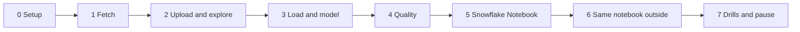

# 5. Step by Step on Snowflake

Every step: **what**, **why**, **verify**, **common errors**. Scripts are in [06_solution](06_solution/README.md).



---

## Phase 0: Setup

- **What:** `./run_sql.sh core/00_account_setup.sql core/01_raw.sql`.
- **Why:** owner and reader roles, XS warehouse with a monitor and statement timeout, database, four schemas, file format, two stages, raw table, city table.
- **Verify:** `SHOW STAGES IN DATABASE P02_WEATHER;` lists `WEATHER_STAGE` and `NOTEBOOK_STAGE`.

---

## Phase 1: Fetch

```bash
cd fetch && python fetch_weather.py --data-dir "$P02_DATA_DIR" --from-year 2016
```

- **Why:** one request per city per year, a pause between calls, `_source` lineage in every file.
- **Verify:** 6 cities times about 10 years of files; a full year prints 8760 or 8784 hours.
- **Common errors:** HTTP 429 means too many calls; wait and rerun for the missing city with `--cities`.

---

## Phase 2: Upload and Explore

```bash
./upload.sh data
```

```sql
SELECT METADATA$FILENAME,
       $1:_source:city_slug::STRING        AS CITY,
       $1:timezone::STRING                 AS TZ,
       ARRAY_SIZE($1:hourly:time)          AS HOURS,
       $1:hourly:temperature_2m[0]::FLOAT  AS FIRST_TEMP
FROM @P02_WEATHER.RAW.WEATHER_STAGE/city=kyiv/ (FILE_FORMAT => 'P02_WEATHER.RAW.FF_API_JSON');
```

- **Why:** confirm that all arrays have the same length and that the API really returned UTC before designing the table.
- **Try:** compare `ARRAY_SIZE` of `time` and `precipitation` for every file.

---

## Phase 3: Load and Model

- **What:** `./run_sql.sh core/20_load_and_model.sql`.
- **Why:** `COPY` with file name and load time, then one `FLATTEN` with positional access, then views for local time, daily, climatology, anomaly, monthly.
- **Verify:** the last query of the script shows each city with its first and last hour and hour count.
- **Common errors:** `Unknown timezone`: use IANA names exactly as in `STG.CITY`.

---

## Phase 4: Quality

- **What:** `./run_sql.sh tests/data_quality_checks.sql`.
- **Why:** missing hours, duplicates, physically impossible values, and unknown cities must be ruled out before any chart.
- **Verify:** all checks `PASS`.

---

## Phase 5: Snowflake Notebook

```bash
./upload.sh notebook
./run_sql.sh core/30_notebook.sql
```

- **Why:** the notebook is created from a staged file, so its source stays in the repository.
- **Then:** Snowsight, **Projects**, **Notebooks**, `WEATHER_EDA`. Add `altair` in **Packages** if the import fails. **Run all**.
- **Verify:** the coverage table shows full years; the seasonal chart has Sydney and Sao Paulo peaking in December to February.
- **Common errors:**
  - Notebook does not open after SQL creation: run `ALTER NOTEBOOK ... ADD LIVE VERSION FROM LAST`.
  - Notebook file uploaded compressed: `AUTO_COMPRESS = FALSE` is required for `.ipynb`.
- **End the session** when done; check that `P02_WH` suspends.

---

## Phase 6: Same Notebook Outside Snowflake

```bash
python3 -m venv .venv && source .venv/bin/activate
pip install snowflake-snowpark-python pandas altair jupyterlab
SNOW_CONNECTION=p02 jupyter lab notebooks/weather_eda.ipynb
```

- **Why:** the first cell falls back to a session from the named connection; nothing else changes.
- **Better:** create a `[connections.p02_reader]` with role `P02_READER` and use it here.
- **Deepnote:** [account guide](../../../../shared/environments/setup-guide/accounts/other_free_services.md#deepnote), upload the notebook, create the Snowflake integration with the reader role.
- **Compare:** startup time, package management, sharing, and what happens to the warehouse while each tool is idle.

---

## Phase 7: Drills and Pause

- Work through [tests/analysis_drills.md](06_solution/tests/analysis_drills.md).
- Pause: `./run_sql.sh core/90_pause.sql`. Teardown at the end: `./run_sql.sh teardown.sql`.
