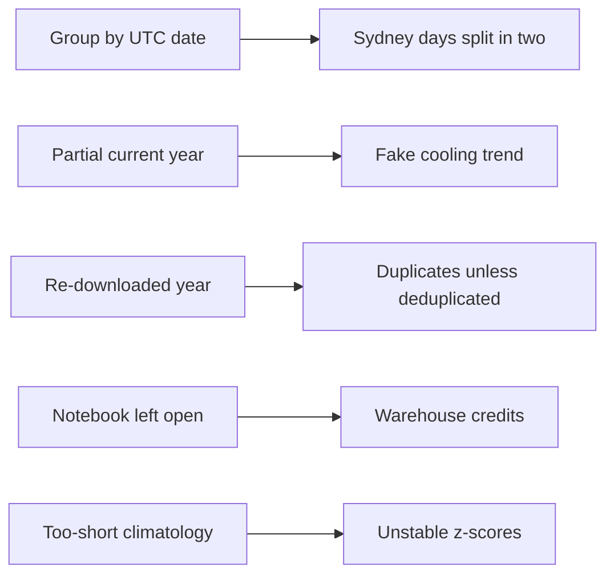

# P02 Analysis Drills

EDA fails quietly: a chart still renders when the data is wrong. These drills make the classic mistakes visible. Predict, run, compare.



## D1 UTC Day Instead of Local Day

```sql
SELECT CITY_SLUG, TO_DATE(TS_UTC) AS DAY_UTC, MAX(TEMPERATURE_C) AS TMAX
FROM P02_WEATHER.STG.WEATHER_HOURLY
WHERE CITY_SLUG = 'sydney' AND TS_UTC >= '2024-01-10' AND TS_UTC < '2024-01-13'
GROUP BY 1, 2 ORDER BY 2;
```

- **Compare** with `MART.V_DAILY` for the same days. Sydney is UTC+10 or +11: a UTC day mixes two local afternoons.
- **Lesson:** decide the grain's time zone before aggregating.

## D2 Partial Year Bias

```sql
SELECT CITY_NAME, YEAR(DAY_LOCAL) AS Y, AVG(TEMP_MEAN_C) AS T
FROM P02_WEATHER.MART.V_DAILY GROUP BY 1, 2 ORDER BY 1, 2;
```

- **Observe:** the current year looks unusually warm or cold depending on the month you run it.
- **Fix:** compare anomalies, or only full years (`HAVING COUNT(*) >= 365`).

## D3 Re-Downloaded Year

A few days after the first load, re-run `fetch_weather.py` for the current year of one city, then `./upload.sh data` and `./run_sql.sh core/20_load_and_model.sql`.

- **Observe:** `RAW.WEATHER_RAW` has two rows for that city and year (the file content changed, so COPY loads it again); `STG.WEATHER_HOURLY` has no duplicates because the latest load wins.
- **Why it reloads even for a past year:** `_source.fetched_at` changes the file content, so COPY load metadata sees a new checksum.
- **Experiment:** run `./upload.sh data` again without re-fetching, then the COPY. Predict first, then explain the result from the `COPY` output and `LIST` (`md5`, `last_modified`).
- **Try:** remove the `QUALIFY` and rerun; the duplicate check fails.

## D4 Notebook Left Open

Open the Snowflake Notebook, run one cell, leave it for 30 minutes.

- **Observe:** `WAREHOUSE_METERING_HISTORY` for `P02_WH` shows credits while the session stays active.
- **Lesson:** end notebook sessions explicitly; check the notebook's idle timeout setting.

## D5 Short Climatology

Change `YEARS_OBSERVED >= 5` in `MART.V_DAILY_ANOMALY` to `>= 1`, and load only two years.

- **Observe:** extreme z-scores appear everywhere because the standard deviation is tiny or undefined.
- **Lesson:** a baseline needs enough history; state its length next to every anomaly chart.

## Drill Log Template

| Drill | Prediction | Observed | Lesson in one sentence |
| --- | --- | --- | --- |
| D1 | | | |
| D2 | | | |
| D3 | | | |
| D4 | | | |
| D5 | | | |
