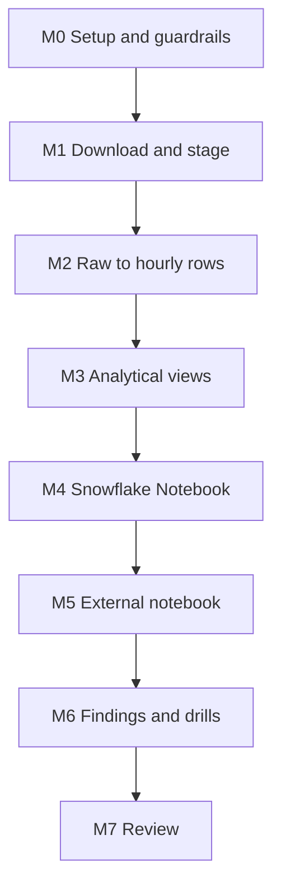

# 7. Build It Yourself

## Brief

The pricing team wants evidence, not opinions, about weather in six cities: seasons, daily cycles, extremes, and heavy rain. Load a public weather archive into Snowflake, model it so that "a day" and "unusual" mean the same thing for everyone, and deliver a notebook with findings that runs inside Snowflake and in one external tool. No raw data may leave Snowflake.

## Rules

| You may use | Only when stuck | Only after the milestone passes |
| --- | --- | --- |
| [01](01_problem.md) to [04](04_alternative_stacks.md), `_shared/`, deep dives, Snowflake and Open-Meteo documentation | [05](05_snowflake_step_by_step.md) | [06_solution/](06_solution/README.md) |

Write your own downloader; you may pick other cities or variables.

## Milestones

### M0 Setup and Guardrails
- [ ] Owner and reader roles, XS warehouse with short auto-suspend, monitor, statement timeout

### M1 Download and Stage
- [ ] One file per city per year with lineage fields; a polite pause between requests
- [ ] Unit test for URL building and date ranges
- [ ] Files on an internal stage in partition folders; three exploration queries on the stage

### M2 Raw to Hourly Rows
- [ ] Raw table with one row per file version
- [ ] Hourly table built with a single `FLATTEN`; no duplicates after re-downloading one year

**Hint:** what does `FLATTEN` return besides `value`?

### M3 Analytical Views
- [ ] Local time per city; daily grain by local date with an hour count
- [ ] Climatology per day of year with a minimum number of years; anomaly and z-score
- [ ] Quality checks pass

### M4 Snowflake Notebook
- [ ] Notebook created from a staged file, not by hand
- [ ] Data quality section first; every chart from an aggregate query

### M5 External Notebook
- [ ] The same file runs in Jupyter or Deepnote with a read-only role
- [ ] A short comparison: setup, packages, sharing, idle cost

### M6 Findings and Drills
- [ ] Three to five findings, each with its chart and one caveat
- [ ] Drills: UTC day, partial year, re-download, idle session, short climatology

### M7 Review
- [ ] One page: data flow, decisions with rejected alternatives, credits used by loading and by one notebook session
- [ ] Teardown or pause

## Stretch Goals

- **Scheduled refresh:** a task that loads the latest week daily; what changes in the design?
- **More variables:** wind gusts, snowfall; check units in `hourly_units`.
- **Materialise:** turn `V_DAILY` into a dynamic table and compare query time and cost.
- **Container runtime:** run the notebook on a compute pool with a pip-only package and compare startup time and cost.
- **DuckDB parity:** reproduce the views locally and reconcile the numbers.

## Portfolio and Interview

**Resume bullet example:** Built a governed EDA workflow in Snowflake for ten years of hourly weather in six cities: API ingestion with lineage, time-zone-correct analytical views, and a portable notebook that runs in Snowflake Notebooks and external tools with read-only access.

**Questions you should be able to answer:**
1. Why store UTC and convert at read time?
2. Why define anomalies in SQL views and not in notebook cells?
3. What does a Snowflake Notebook cost while you are reading a chart?
4. When would you choose the container runtime over the warehouse runtime?
5. Why is exporting tables to CSV for analysis a governance problem?
