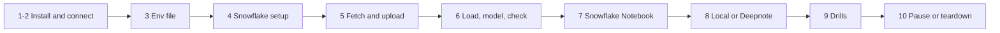

# P02 Quickstart

Numbered commands from an empty laptop to a modelled weather dataset and a running notebook. Only a Snowflake account is needed; Deepnote is optional. Details: [05_snowflake_step_by_step.md](05_snowflake_step_by_step.md).



### 1. Install

Python 3.12, Snowflake CLI ([setup guide](../../../../shared/environments/setup-guide/01_workstation_macos.md), [Snowflake CLI](../../../../shared/environments/setup-guide/02_cli_tools_and_auth.md#snowflake-cli)).

**Done when:** `snow --version` and `python3.12 --version` work.

### 2. Snowflake trial and connection

[Snowflake account guide](../../../../shared/environments/setup-guide/accounts/snowflake.md); add `[connections.p02]` to `~/.snowflake/config.toml`.

**Done when:** `snow sql -c p02 -q "SELECT CURRENT_USER()"` succeeds.

### 3. Env file

```bash
cd 16-cloud-databases/01-snowflake/end-to-end-projects/P02_weather_eda_notebooks/06_solution
cp p02.env.example p02.env      # P02_DATA_DIR: an absolute folder outside the repository
set -a; source p02.env; set +a
mkdir -p "$P02_DATA_DIR"
```

**Done when:** `echo $P02_DATA_DIR` prints an existing folder.

### 4. Snowflake setup

```bash
./run_sql.sh core/00_account_setup.sql core/01_raw.sql
```

**Done when:** `snow sql -c p02 -q "SHOW STAGES IN DATABASE P02_WEATHER"` lists `WEATHER_STAGE` and `NOTEBOOK_STAGE`.

### 5. Fetch and upload

```bash
( cd fetch && python3.12 -m venv .venv && source .venv/bin/activate && pip install pytest && python -m pytest -q test_fetch_weather.py \
  && python fetch_weather.py --data-dir "$P02_DATA_DIR" --from-year 2016 )
./upload.sh data
```

**Done when:** `snow sql -c p02 -q "LIST @P02_WEATHER.RAW.WEATHER_STAGE/city=sydney/"` lists one file per year.

### 6. Load, model, check

```bash
./run_sql.sh core/20_load_and_model.sql
./run_sql.sh tests/data_quality_checks.sql
```

**Done when:** six cities in the summary and all checks `PASS`.

### 7. Snowflake Notebook

```bash
./upload.sh notebook
./run_sql.sh core/30_notebook.sql
```

Snowsight, **Projects**, **Notebooks**, `WEATHER_EDA`, **Run all**. Add `altair` under **Packages** if needed. End the session when done.

**Done when:** all cells run and the seasonal chart shows the southern cities peaking in December to February.

### 8. Local Jupyter or Deepnote

```bash
python3.12 -m venv .venv && source .venv/bin/activate
pip install snowflake-snowpark-python pandas altair jupyterlab
SNOW_CONNECTION=p02 jupyter lab notebooks/weather_eda.ipynb
```

Deepnote: [account guide](../../../../shared/environments/setup-guide/accounts/other_free_services.md#deepnote).

**Done when:** the same notebook runs outside Snowflake without code changes.

### 9. Drills

[tests/analysis_drills.md](06_solution/tests/analysis_drills.md).

**Done when:** drill log filled.

### 10. Pause or teardown

```bash
./run_sql.sh core/90_pause.sql
./run_sql.sh teardown.sql        # end of project
```

**Done when:** `SHOW WAREHOUSES LIKE 'P02_%'` returns nothing after teardown.
