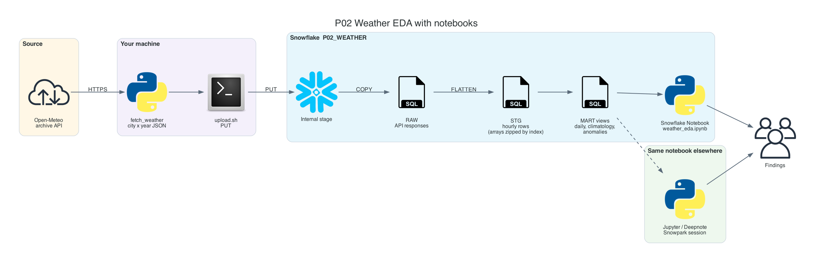
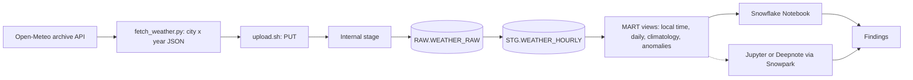

# P02 Weather EDA With Notebooks

Load ten years of hourly weather for six cities on four continents from the free Open-Meteo archive, model it in SQL, and explore it in a notebook that runs unchanged inside Snowflake, in local Jupyter, or in Deepnote. The project is about the analysis workflow: where the data lives, where the compute runs, and how to avoid the classic EDA mistakes such as UTC days, partial years, and notebooks that keep a warehouse running.

No cloud account besides Snowflake is needed: files go to an internal stage with `PUT`.

## Target Architecture

Own diagram, generated from [assets/architecture.py](assets/architecture.py). Icons: vendor architecture icon sets bundled with the <a href="https://diagrams.mingrammer.com">diagrams</a> library.

Text version (Mermaid)

### Reference From the Source Article

ProjectPro describes this idea as exploratory data analysis of weather data with Snowflake and Deepnote, following the Snowflake quickstart [Exploratory Data Analysis with Snowflake and Deepnote](https://quickstarts.snowflake.com/guide/exploratory_data_analysis_with_snowflake_and_deepnote/). P02 keeps the EDA goal, replaces the marketplace dataset with a free API you control end to end, and makes the notebook portable so you can compare Snowflake Notebooks with an external notebook tool.

Source: ProjectPro, <a href="https://www.projectpro.io/article/snowflake-projects/1168">13 End-to-End Snowflake Projects That Build Job-Ready Skills</a>.

## Skills

| Skill | Milestone |
| --- | --- |
| Pulling a public API into files with lineage | M1 |
| `PUT` into a partitioned internal stage, querying staged JSON | M1 |
| Parallel arrays to rows: `FLATTEN` plus index | M2 |
| Time zones: store UTC, analyse in local time with `CONVERT_TIMEZONE` | M3 |
| Analytical views: climatology, anomalies, z-scores | M3 |
| Snowflake Notebooks: creation from a stage, warehouse runtime, sessions | M4 |
| Snowpark from local Jupyter or Deepnote; pushing aggregation down | M5 |
| EDA discipline: data quality first, caveats next to every finding | M6 |

## Prerequisites

- [Semi-structured data guide](../../learning-materials/reference/01_semi_structured_data.md)
- Snowflake trial and Snowflake CLI: [setup guide](../../../../shared/environments/setup-guide/README.md)
- Python 3.10+; optional Deepnote account ([other free services](../../../../shared/environments/setup-guide/accounts/other_free_services.md))
- [Cost guardrails](../_shared/cost_guardrails.md): loading is seconds; the main cost risk is an open notebook session

## Navigation

| Part | File |
| --- | --- |
| Quickstart: numbered commands from install to teardown | [QUICKSTART.md](QUICKSTART.md) |
| 1. Problem | [01_problem.md](01_problem.md) |
| 2. Architecture and decisions | [02_architecture_decisions.md](02_architecture_decisions.md) |
| 3. Snowflake approach | [03_snowflake_approach.md](03_snowflake_approach.md) |
| 4. Alternative stacks and roadmap | [04_alternative_stacks.md](04_alternative_stacks.md) |
| 5. Step by step on Snowflake | [05_snowflake_step_by_step.md](05_snowflake_step_by_step.md) |
| 6. Solved reference | [06_solution/README.md](06_solution/README.md) |
| 7. Build it yourself | [07_build_it_yourself.md](07_build_it_yourself.md) |

Recommended route: 1, 2, 3, 4, then **7** (build). Use 5 when stuck. Compare with 6 at the end.
