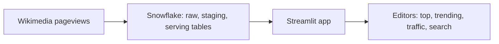

# 1. Problem

## Business Context

A Wikimedia community team supports editors in three language editions. Editors want to know every morning which articles readers opened most yesterday, which ones suddenly took off, and how overall traffic is moving, so they can check those articles for vandalism and outdated facts. The editors are not SQL users. They need a simple web app with a few filters, and the data team does not want to hand out database access to every editor.



## Source Data

| Property | Value |
| --- | --- |
| API | Wikimedia REST pageviews, `https://wikimedia.org/api/rest_v1/metrics/pageviews`, free, no key, User-Agent required |
| Top endpoint | `/top/{project}/all-access/{yyyy}/{mm}/{dd}`: up to 1000 most viewed pages for one day |
| Aggregate endpoint | `/aggregate/{project}/all-access/user/daily/{start}/{end}`: daily total views by human users |
| Publication | About one day after the day ends; unpublished days return HTTP 404 |
| Projects | `en.wikipedia`, `de.wikipedia`, `uk.wikipedia` |
| Files | One per project per day for top lists; one per project per run for totals |

Top list response (trimmed):

```json
{
  "items": [{
    "project": "uk.wikipedia", "access": "all-access",
    "year": "2024", "month": "03", "day": "01",
    "articles": [
      { "article": "Головна_сторінка", "views": 8620, "rank": 1 },
      { "article": "Спеціальна:Пошук", "views": 4100, "rank": 3 }
    ]
  }],
  "_source": { "kind": "top", "project": "uk.wikipedia", "day": "2024-03-01" }
}
```

Facts measured while writing this project: lists hold 987 to 1000 entries; the main page is rank 1 in every project; special, project, and file pages take 8 to 12 places per day; content titles can contain colons (`Ramayana:_Part_1`), so "contains a colon" is not a valid filter.

## Functional Requirements

1. Download the last 30 days of top lists and daily totals for three projects; re-runs skip days already downloaded.
2. Keep every response as delivered.
3. Exclude main pages and non-content namespaces per language.
4. Per project and day: top content articles with share of all views, trending articles, total traffic with a seven-day average.
5. An app with project and day filters, four views (top, trending, traffic, search), links to articles.
6. Editors can use the app without any access to tables.

## Non-Functional Requirements

| Requirement | Target |
| --- | --- |
| Least privilege | App owner reads only the serving layer; viewers reach only the app |
| Safety | User input never becomes SQL text |
| Responsiveness | Every screen reads at most a few thousand rows from a small table |
| Cost | Repeated views served from cache; warehouse suspends within a minute when unused |
| Deployability | One script deploys a new version of the app |

## Out of Scope

- Article-level history beyond the top 1000 (the per-article endpoint is a stretch goal)
- Scheduled refresh (P05 covers tasks)
- Public hosting outside Snowflake
