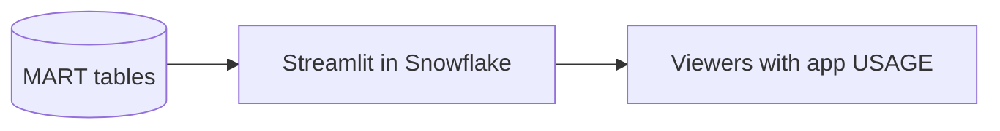
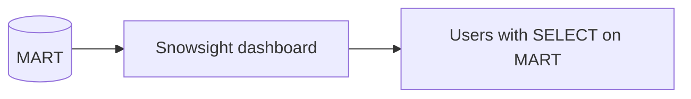
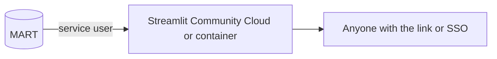
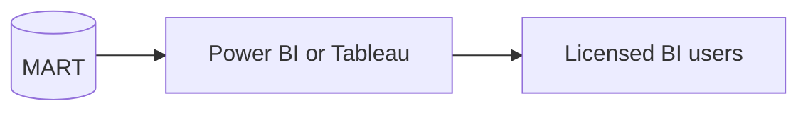

# 2. Architecture and Decisions

## Requirements That Drive the Design

| Driver | Consequence |
| --- | --- |
| Viewers are not database users | Deliver through an app; viewers get `USAGE` on the app only |
| The app must not see raw data | A separate app owner role with `SELECT` on `MART` only |
| Every screen is interactive | Small serving tables shaped for each screen, results cached |
| User input reaches queries | Bind parameters everywhere |
| Data changes once a day | Cache TTL of ten minutes is plenty; no streaming |

## Options

### Option 1: Streamlit in Snowflake on a serving layer (chosen)

### Option 2: Snowsight dashboard

### Option 3: Streamlit outside Snowflake

### Option 4: BI tool

## Trade-Offs

| Criterion | 1 Streamlit in Snowflake | 2 Snowsight dashboard | 3 External Streamlit | 4 BI tool |
| --- | --- | --- | --- | --- |
| Viewers need table access | No, owner's rights | Yes | No, service user | Depends on mode |
| Custom interaction (search, links, logic) | Full Python | Filters only | Full Python | Rich but tool-shaped |
| Secrets to manage | None | None | Service user key | Gateway or connector credentials |
| Viewer accounts | Snowflake users | Snowflake users | Any identity provider | BI licenses |
| Compute | Warehouse per active session | Warehouse per query | Host plus warehouse per query | Import or direct query |
| Best when | Internal users already in Snowflake | Analysts who can read SQL results | Public or external audiences | Enterprise reporting standards |

## Why / Why Not

**Why an app and not a dashboard?**
A dashboard needs viewers who may query the underlying tables. The editors only need answers, and the search box with article links is beyond a dashboard.

**Why three roles instead of one?**
`P03_OWNER` changes data, `P03_APP_OWNER` changes the app, `P03_VIEWER` uses it. A bug in the app cannot touch RAW or STG, because the app runs with a role that cannot see them. A viewer cannot run arbitrary SQL, because the only object they can use is the app.

**Why does the app owner own its own stage?**
The source of the app is part of the app. If the data team could overwrite it, they would effectively control code that runs with the app owner's rights.

**Why serving tables instead of views over STG?**
Each screen reads a small table filtered by project and day. Views over STG would recompute joins and window functions on every click. At this size the difference is seconds, not minutes, but the pattern matters when the data grows.

**Why `COPY GRANTS`?**
`CREATE OR REPLACE` creates a new object. Without `COPY GRANTS` the app loses `SELECT` until the grant is re-run, and viewers see an error in the meantime.

**Why namespace and main page tables instead of a regex?**
The rules differ per language and a colon is not a reliable signal. A small reference table is readable, testable, and extended by adding rows.

**Why a trending ratio with a known bias?**
Top lists only show articles above roughly a few thousand views. A day outside the list is unknown, not zero. The ratio uses only days inside the list, so it underestimates spikes. Showing the bias in the app is better than hiding a wrong precise number.

**Why bind parameters?**
The search box accepts any text. `session.sql(sql, params=[...])` sends text as a value; it is never parsed as SQL.

**Why `st.cache_data(ttl=600)`?**
Data changes once a day. Without caching, every widget change reruns the script and every query. With caching, repeated views cost nothing and the app feels instant.

**Why pin the Streamlit version?**
Without `environment.yml`, a new default version can change behaviour of a running app overnight.

## Architecture Decision Records

### ADR-001: Owner's rights app with three roles

- **Decision:** data owned by `P03_OWNER`; app and its stage owned by `P03_APP_OWNER` with `SELECT` on `MART` only; viewers get `USAGE` on the app.
- **Consequences:** least privilege by construction; adding a viewer is one grant; the app owner role must be protected like a service account.

### ADR-002: Serving layer rebuilt on load

- **Decision:** `MART.ARTICLE_DAILY`, `MART.TRENDING`, `MART.PROJECT_DAILY` rebuilt with `CREATE OR REPLACE ... COPY GRANTS` after each load.
- **Consequences:** simple and consistent; a full rebuild takes seconds at 30 days times 3 projects times 1000 rows.

### ADR-003: Deploy by re-creating the app

- **Decision:** `31_app_deploy.sql` runs `CREATE OR REPLACE STREAMLIT ... FROM` the stage, adds a live version, and re-grants viewer usage.
- **Consequences:** a deploy is explicit and repeatable; uploading files alone changes nothing.

### ADR-004: One warehouse for loading and the app

- **Decision:** `P03_WH` serves both, XS, auto-suspend 60 seconds.
- **Consequences:** cheapest for a learner. In production a separate app warehouse isolates editors from load jobs and makes app cost visible.

## Failure Modes

| Failure | Detection | Recovery |
| --- | --- | --- |
| Day not yet published | Fetch prints "not published" | Rerun the next day |
| App owner lost a grant | App shows "not authorized" for everyone | Re-run grants; prefer `COPY GRANTS` |
| New code uploaded but not deployed | App unchanged | Run `31_app_deploy.sql` |
| New namespace appears in top lists | Quality query shows unexpected removals or inclusions | Add a row to `STG.NON_CONTENT_NAMESPACE` |
| Many viewers at once | Warehouse queueing | Larger warehouse or multi-cluster; check cache hit rate first |

## Cost Model

| Component | Driver |
| --- | --- |
| Warehouse for the app | Warehouse runtime: each viewer session runs on the warehouse; it stays resumed while sessions are active |
| Warehouse for loading | Under a minute per daily load on XS |
| Storage | A few MB |

The cost to watch is open app tabs, not data volume. Measure credits for one hour of the app being open versus closed.
