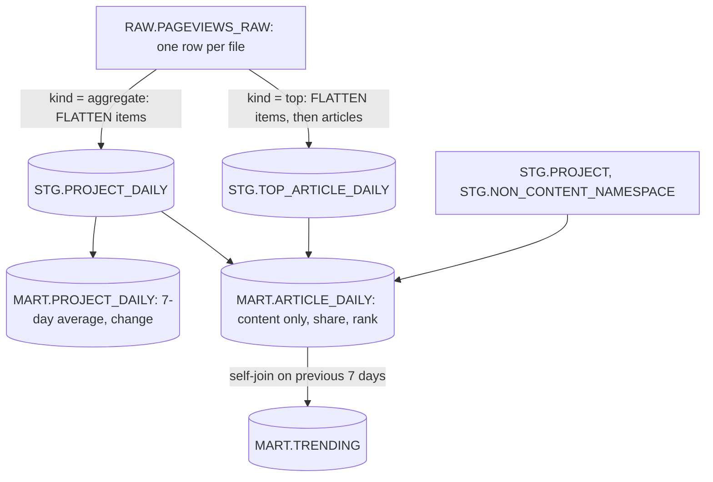
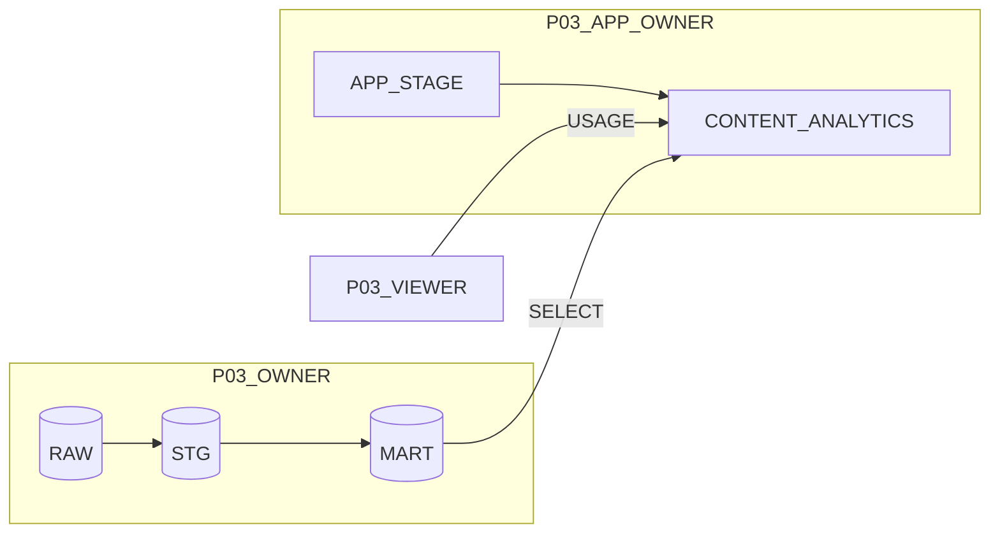

# 3. Snowflake Approach

## From API Responses to Serving Tables



The two-level flatten for top lists:

```sql
FROM RAW.PAGEVIEWS_RAW r,
  LATERAL FLATTEN(input => r.PAYLOAD:items) i,
  LATERAL FLATTEN(input => i.value:articles) a
WHERE r.PAYLOAD:_source:kind::STRING = 'top'
QUALIFY r.LOADED_AT = MAX(r.LOADED_AT) OVER (PARTITION BY PROJECT, DAY)
```

The `QUALIFY` keeps the whole latest list per day. Deduplicating per article instead would keep articles that a newer download no longer contains.

## Object Inventory

| Object | Owner | Purpose |
| --- | --- | --- |
| `RAW.PAGEVIEWS_STAGE`, `RAW.PAGEVIEWS_RAW` | `P03_OWNER` | Uploaded files and one row per loaded file |
| `STG.PROJECT`, `STG.NON_CONTENT_NAMESPACE` | `P03_OWNER` | Reference rules per language |
| `STG.TOP_ARTICLE_DAILY`, `STG.PROJECT_DAILY` | `P03_OWNER` | Typed rows, latest download wins |
| `MART.ARTICLE_DAILY`, `MART.TRENDING`, `MART.PROJECT_DAILY` | `P03_OWNER` | Serving tables, `SELECT` granted to the app owner |
| `MART.V_FRESHNESS` | `P03_OWNER` | Last load and date range, readable without access to RAW |
| `APP.APP_STAGE` | `P03_APP_OWNER` | App source: `streamlit_app.py`, `environment.yml` |
| `APP.CONTENT_ANALYTICS` | `P03_APP_OWNER` | The Streamlit app, `USAGE` granted to viewers |

## Three Roles



| Role | Has | Does not have |
| --- | --- | --- |
| `P03_OWNER` | Everything in the database | Ownership of the app |
| `P03_APP_OWNER` | `SELECT` on four `MART` objects, `CREATE STREAMLIT` and `CREATE STAGE` in `APP`, warehouse `USAGE` | Any access to RAW or STG |
| `P03_VIEWER` | `USAGE` on database, schema `APP`, and the app | Any table, any warehouse |

## Streamlit in Snowflake in Brief

- **Deploy:** `PUT` files to a stage with `AUTO_COMPRESS = FALSE`, then `CREATE STREAMLIT ... FROM '@stage' MAIN_FILE = 'streamlit_app.py' QUERY_WAREHOUSE = ...`, then `ALTER STREAMLIT ... ADD LIVE VERSION FROM LAST`.
- **Files are copied once** at `CREATE`; a new upload needs a new `CREATE OR REPLACE` (which drops grants, so re-grant).
- **Owner's rights:** queries run as the app owner role, regardless of who is viewing.
- **Runtime:** warehouse runtime (this project) runs the app on the query warehouse, one instance per viewer; container runtime runs a shared instance on a compute pool and installs packages with pip.
- **Dependencies:** `environment.yml` from the Snowflake Anaconda channel; pin Streamlit to a supported version.
- **Session:** `get_active_session()` returns a Snowpark session for the app owner; no credentials in code.

## The App

| Screen | Query | Cache |
| --- | --- | --- |
| Sidebar | Projects, freshness | 10 minutes |
| Metrics | `PROJECT_DAILY` for the project, top 1 article | 10 minutes |
| Top articles | `ARTICLE_DAILY` where project, day, rank up to 25 | 10 minutes per project and day |
| Trending | `TRENDING` where project, day, views over a threshold | 10 minutes per input combination |
| Traffic | `PROJECT_DAILY` for the project | shared with metrics |
| Search | `ARTICLE_DAILY` where title `ILIKE '%' \|\| ? \|\| '%'` | 10 minutes per text |

## What This Project Teaches About Snowflake

- Apps in Snowflake are securable objects with an owner and grants, like tables.
- Owner's rights let you give answers without giving data.
- `COPY GRANTS` matters whenever something reads objects you rebuild.
- A serving layer is a design decision: small, screen-shaped, rebuilt from the model.
- Interactive tools cost money per open session; caching is a cost control, not only a speed trick.
