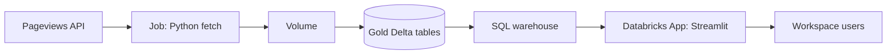
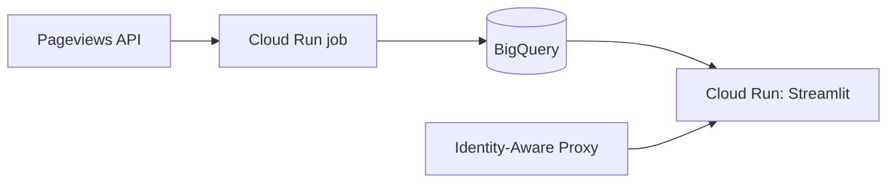
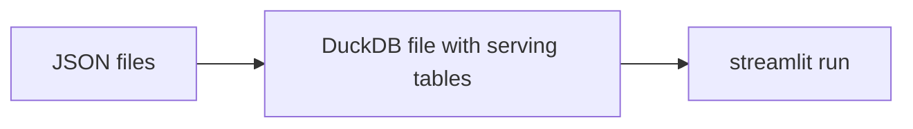
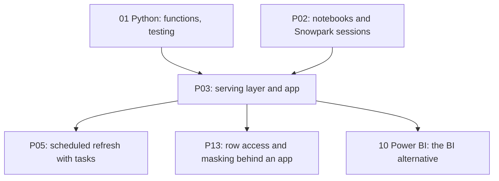

# 4. Alternative Stacks and Roadmap

The problem: give non-technical users an interactive view of curated data without giving them database access.

## Component Mapping

| Concern | Snowflake (this project) | Databricks | BigQuery | Open source |
| --- | --- | --- | --- | --- |
| App hosting | Streamlit in Snowflake | Databricks Apps (Streamlit, Dash, Gradio) | Cloud Run with Streamlit | Streamlit in Docker, Community Cloud |
| App identity | App owner role (owner's rights) | App service principal | Service account | Service user with key |
| Viewer access | `USAGE` on the app | App permissions | IAP or app auth | Reverse proxy or app login |
| Serving layer | `MART` tables | Gold Delta tables, SQL warehouse | BigQuery tables, BI Engine | Postgres or DuckDB file |
| Dashboards instead | Snowsight dashboards | Databricks AI/BI dashboards | Looker Studio | Superset, Metabase |

## Databricks

- The app runs with its own service principal; grant it only the gold tables, same idea as the app owner role.
- Wins when users already live in a Databricks workspace.

## BigQuery and Cloud Run

- More moving parts: container image, service account, proxy. Full control of the runtime and packages.
- Wikimedia pageviews are also available as a BigQuery public dataset, which removes the fetch step.

## Local Open Source: DuckDB and Streamlit

- Same `streamlit_app.py` structure, `duckdb.connect()` instead of a Snowpark session; bind parameters with `?` work the same way.
- Good for prototyping screens before deploying; no sharing or access control.

## External Hosting of This App

The same app can run outside Snowflake with a Snowpark session from a key-pair service user. Then you own secrets, hosting, and viewer authentication, and every visit can resume a paid warehouse. See the notes on [Streamlit Community Cloud](../../../../shared/environments/setup-guide/accounts/other_free_services.md#streamlit-community-cloud).

## When Each Alternative Wins

| Situation | Better choice |
| --- | --- |
| Internal users with Snowflake logins, data must stay governed | Streamlit in Snowflake (this project) |
| Users in Databricks | Databricks Apps |
| Public audience, custom auth, or custom runtime | External Streamlit on a container platform |
| Standard reporting with many consumers | BI tool on the serving layer |
| Prototype in an afternoon | DuckDB plus local Streamlit |

## Learning Roadmap

| Step | Module | Focus |
| --- | --- | --- |
| Python | [01-python](../../../../01-python/README.md) | Packaging, tests, type hints |
| SQL | [02-sql](../../../../02-sql/README.md) | Self-joins over date ranges, window functions |
| Docker | [03-docker](../../../../03-docker/README.md) | Packaging the external version of the app |
| Power BI and Fabric | [10-powerbi-fabric](../../../../10-powerbi-fabric/README.md) | Same serving layer, BI delivery |

### Suggested Exercise

Run the app locally against DuckDB: load the same JSON files with `read_json`, build the three serving tables, and replace `get_session().sql(...)` with `duckdb` calls behind the same `query()` function. Note what changed and what did not: that boundary is the app's real dependency on Snowflake.
