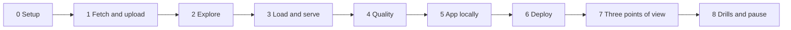

# 5. Step by Step on Snowflake

Every step: **what**, **why**, **verify**, **common errors**. Scripts are in [06_solution](06_solution/README.md).



---

## Phase 0: Setup

- **What:** `./run_sql.sh core/00_account_setup.sql core/01_raw.sql`.
- **Why:** three roles, warehouse with a monitor, database, four schemas, stage, raw table, reference tables, and the grants that define the app boundary.
- **Verify:** `SHOW GRANTS TO ROLE P03_APP_OWNER;` lists `USAGE` on `MART` and `APP`, `CREATE STREAMLIT` and `CREATE STAGE` on `APP`, and nothing on `RAW` or `STG`.

---

## Phase 1: Fetch and Upload

```bash
cd fetch && python fetch_pageviews.py --data-dir "$P03_DATA_DIR" --days 30 && cd ..
./upload.sh data
```

- **Why:** one file per project per day; existing days are skipped, so a daily rerun fetches one new day.
- **Verify:** the script prints "top fetched 30" per project on the first run and "kept 30" on the second.
- **Common errors:** requests without a descriptive User-Agent can be rejected or throttled; HTTP 404 for days not yet published (counted as "not published").

---

## Phase 2: Explore

```sql
SELECT METADATA$FILENAME,
       $1:items[0]:project::STRING             AS PROJECT,
       ARRAY_SIZE($1:items[0]:articles)        AS ARTICLES,
       $1:items[0]:articles[0]:article::STRING AS RANK_1
FROM @P03_CONTENT.RAW.PAGEVIEWS_STAGE/kind=top/ (FILE_FORMAT => 'P03_CONTENT.RAW.FF_API_JSON')
LIMIT 20;
```

- **Why:** see that rank 1 is always the main page and that lists are not always exactly 1000 long.
- **Try:** list every title with a colon in one file and decide which ones are content.

---

## Phase 3: Load and Serve

- **What:** `./run_sql.sh core/20_load_and_model.sql`.
- **Why:** `COPY`, two `FLATTEN` levels, latest list per day, then the serving tables with `COPY GRANTS`.
- **Verify:** the final query shows about 30 days per project and roughly 990 content rows per day.

---

## Phase 4: Quality

- **What:** `./run_sql.sh tests/data_quality_checks.sql`.
- **Verify:** all checks `PASS`; the second result shows how many entries the filter removed per day (typically 8 to 13).

---

## Phase 5: App Locally

```bash
python3.12 -m venv .venv && source .venv/bin/activate
pip install "streamlit==1.45.1" snowflake-snowpark-python pandas pytest
python -m pytest -q tests/test_app_smoke.py
SNOW_CONNECTION=p03_app streamlit run app/streamlit_app.py
```

- **Why:** iterate on screens without deploying; the smoke test needs no Snowflake at all.
- **Connection:** `[connections.p03_app]` in `~/.snowflake/config.toml` with `role = "P03_APP_OWNER"`, `warehouse = "P03_WH"`, so local runs have the same rights as the deployed app.
- **Verify:** all four tabs work; search for a word from today's top article.

---

## Phase 6: Deploy

```bash
./run_sql.sh core/30_app_stage.sql
./upload.sh app
./run_sql.sh core/31_app_deploy.sql
```

- **Why:** the app owner creates its stage, uploads code uncompressed, creates the app, adds a live version, and grants viewers.
- **Verify:** Snowsight, **Projects**, **Streamlit**, **Wikipedia content analytics** opens.
- **Common errors:**
  - "Insufficient privileges" on `CREATE STREAMLIT`: missing `CREATE STREAMLIT` on schema `APP` or `USAGE` on `P03_WH` for the app owner.
  - App says the main file is missing: the file was uploaded compressed (`.py.gz`).
  - Package error at startup: the Streamlit version in `environment.yml` is not in the supported list.

---

## Phase 7: Three Points of View

In Snowsight switch roles and repeat:

| Role | Try | Expected |
| --- | --- | --- |
| `P03_VIEWER` | Open the app | Works |
| `P03_VIEWER` | `SELECT * FROM P03_CONTENT.MART.ARTICLE_DAILY` | Not authorized |
| `P03_APP_OWNER` | `SELECT * FROM P03_CONTENT.STG.TOP_ARTICLE_DAILY` | Not authorized |
| `P03_APP_OWNER` | `SELECT * FROM P03_CONTENT.MART.V_FRESHNESS` | Works, although the view reads RAW and STG |

---

## Phase 8: Drills and Pause

- Work through [tests/failure_drills.md](06_solution/tests/failure_drills.md).
- Pause: `./run_sql.sh core/90_pause.sql`. Teardown at the end: `./run_sql.sh teardown.sql`.
