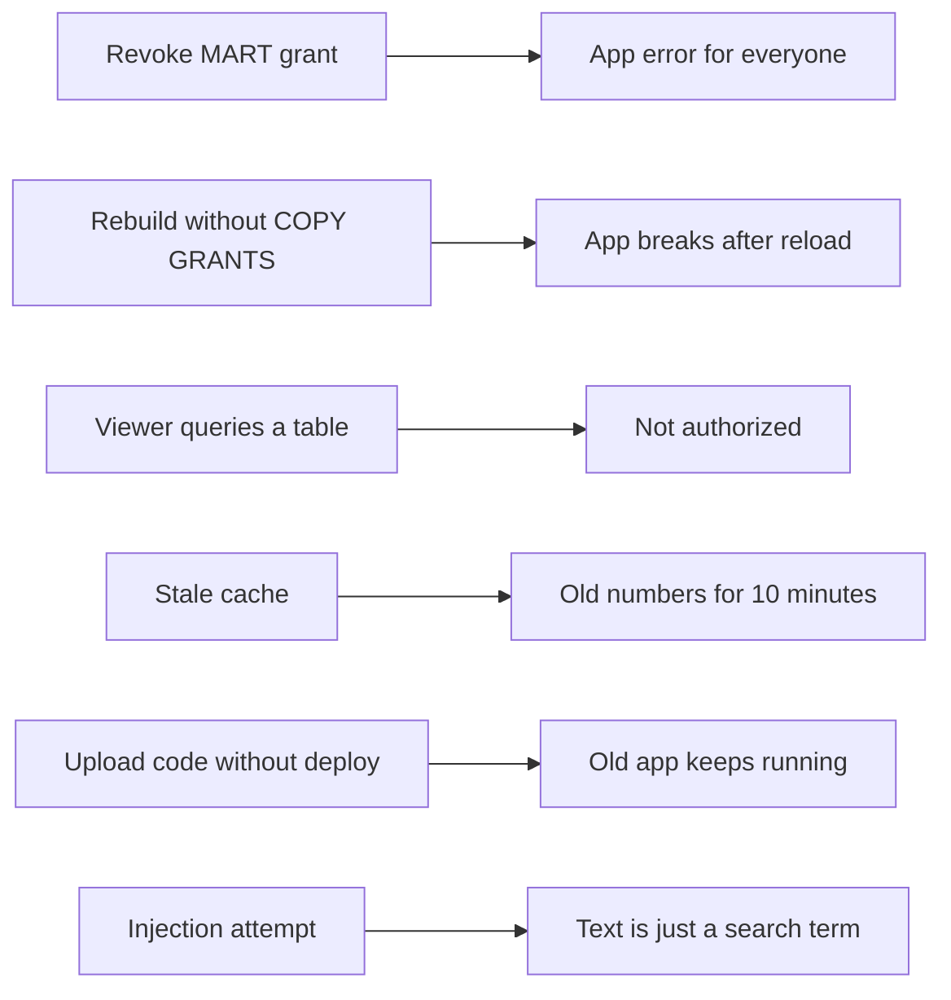

# P03 Failure Drills

Each drill breaks one thing the app depends on. Predict what the viewer sees, run it, then restore.



## D1 App Owner Loses Access

```sql
USE ROLE P03_OWNER;
REVOKE SELECT ON TABLE P03_CONTENT.MART.TRENDING FROM ROLE P03_APP_OWNER;
```

- **Observe:** open the app as `P03_VIEWER`; the Trending tab fails, the rest works. The viewer's own grants did not change.
- **Lesson:** the app runs with its owner's rights. Access is decided by `P03_APP_OWNER`, not by the person looking at it.
- **Restore:** `GRANT SELECT ON TABLE P03_CONTENT.MART.TRENDING TO ROLE P03_APP_OWNER;`

## D2 Rebuild Without COPY GRANTS

Remove `COPY GRANTS` from `MART.ARTICLE_DAILY` in a copy of `20_load_and_model.sql`, and remove the explicit grant at the end. Run it.

- **Observe:** the app fails with "does not exist or not authorized" until the grant is restored.
- **Lesson:** `CREATE OR REPLACE` creates a new object; grants belong to the old one.

## D3 Viewer Tries the Data Directly

```sql
USE ROLE P03_VIEWER;
SELECT * FROM P03_CONTENT.MART.ARTICLE_DAILY LIMIT 1;
```

- **Observe:** not authorized; the app still works for the same role.
- **Lesson:** an app is a controlled interface. Viewers get answers, not tables.

## D4 Stale Cache

Rerun the fetch for one extra day, upload, and run `20_load_and_model.sql` while the app is open.

- **Observe:** the app shows the old last day until the cache expires (ten minutes) or you use **Clear cache** in the app menu.
- **Lesson:** caching trades freshness for cost and speed. Choose the TTL from how often the data changes.

## D5 Upload Without Deploy

Change the app title in `streamlit_app.py`, run `./upload.sh app`, and reload the app.

- **Observe:** the old title remains.
- **Lesson:** `CREATE STREAMLIT ... FROM` copies files once. Deploying is `31_app_deploy.sql`, not the upload.

## D6 Injection Attempt

Type `x' OR 1=1 --` into the article search.

- **Observe:** "No article with this text"; query history shows the SQL with `?` placeholders and the text as a bind value.
- **Lesson:** bind parameters keep user input out of the SQL text. `tests/test_app_smoke.py` checks this offline.

## Drill Log Template

| Drill | Prediction | Observed | Lesson in one sentence |
| --- | --- | --- | --- |
| D1 | | | |
| D2 | | | |
| D3 | | | |
| D4 | | | |
| D5 | | | |
| D6 | | | |
