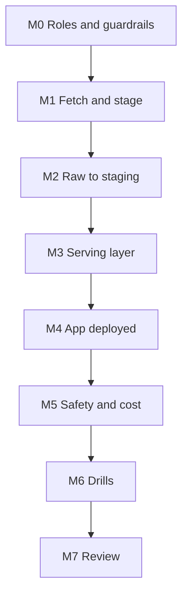

# 7. Build It Yourself

## Brief

Wikipedia editors in three languages want a morning app: yesterday's most read articles, what suddenly took off, how traffic is moving, and a search box. They must not get database access. Build the pipeline, the serving layer, and the app, and prove that the access boundary holds.

## Rules

| You may use | Only when stuck | Only after the milestone passes |
| --- | --- | --- |
| [01](01_problem.md) to [04](04_alternative_stacks.md), `_shared/`, Snowflake and Streamlit documentation, Wikimedia API documentation | [05](05_snowflake_step_by_step.md) | [06_solution/](06_solution/README.md) |

Write your own fetcher and app. You may choose other projects (languages) or a different trending definition.

## Milestones

### M0 Roles and Guardrails
- [ ] Data owner, app owner, and viewer roles with a written table of what each can and cannot do
- [ ] XS warehouse, monitor, statement timeout

### M1 Fetch and Stage
- [ ] User-Agent set; unpublished days handled; existing days skipped
- [ ] Unit tests for URL building and date ranges
- [ ] Files staged by kind and project

### M2 Raw to Staging
- [ ] One row per project, day, and article; one row per project and day for totals
- [ ] A re-downloaded day replaces the whole list
- [ ] Main pages and non-content namespaces excluded by data, not by hard-coded SQL conditions

**Hint:** which titles in the English list contain a colon but are real articles?

### M3 Serving Layer
- [ ] Tables shaped for each screen; share of project views; seven-day average
- [ ] A trending measure, with its bias written down
- [ ] Rebuilding the tables does not break the app's access

### M4 App Deployed
- [ ] App source on a stage owned by the app owner; app created by script, live version added
- [ ] Viewer role can open it and cannot query any table

### M5 Safety and Cost
- [ ] All user input passed as bind parameters, with a test that proves it
- [ ] Caching with a TTL you can justify
- [ ] Credits measured: one hour with the app open versus closed

### M6 Drills
- [ ] Revoked grant, rebuild without `COPY GRANTS`, stale cache, upload without deploy, injection attempt

### M7 Review
- [ ] One page: role diagram, decisions with rejected alternatives, cost observations
- [ ] Teardown or pause

## Stretch Goals

- **Per-article history:** call the per-article endpoint for the top trending titles and show full history, not only top-list days.
- **Separate warehouse** for the app and compare cost attribution.
- **Row-level filtering:** a row access policy so that one viewer role sees only one language, and observe how it interacts with owner's rights.
- **Scheduled refresh:** a task that loads yesterday at 06:00 UTC (pairs with P05).
- **Git deploy:** create the app from a Git repository stage instead of an internal stage.

## Portfolio and Interview

**Resume bullet example:** Delivered a Streamlit in Snowflake app over a curated serving layer of Wikipedia pageviews in three languages, with separated data, app, and viewer roles, parameterised queries, cached results, and a scripted deployment.

**Questions you should be able to answer:**
1. Whose privileges does a Streamlit in Snowflake app use, and why does that matter?
2. Why can the app owner read a view over tables it cannot read?
3. What breaks when a table the app reads is rebuilt, and how do you prevent it?
4. How do you prove that the search box is not an SQL injection point?
5. When would you host the app outside Snowflake instead?
