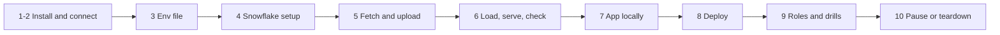

# P03 Quickstart

Numbered commands from an empty laptop to a deployed Streamlit app that viewers can open without table access. Only a Snowflake account is needed. Details: [05_snowflake_step_by_step.md](05_snowflake_step_by_step.md).



### 1. Install

Python 3.12, Snowflake CLI ([setup guide](../../../../shared/environments/setup-guide/01_workstation_macos.md), [Snowflake CLI](../../../../shared/environments/setup-guide/02_cli_tools_and_auth.md#snowflake-cli)).

**Done when:** `snow --version` and `python3.12 --version` work.

### 2. Snowflake trial and connections

[Snowflake account guide](../../../../shared/environments/setup-guide/accounts/snowflake.md). Add two connections to `~/.snowflake/config.toml`: `[connections.p03]` for setup (your admin user), and `[connections.p03_app]` with the same account and user plus `role = "P03_APP_OWNER"` and `warehouse = "P03_WH"` for local app runs (works after step 4).

**Done when:** `snow sql -c p03 -q "SELECT CURRENT_USER()"` succeeds.

### 3. Env file

```bash
cd 16-cloud-databases/01-snowflake/end-to-end-projects/P03_content_analytics_streamlit/06_solution
cp p03.env.example p03.env      # P03_DATA_DIR: an absolute folder outside the repository
set -a; source p03.env; set +a
mkdir -p "$P03_DATA_DIR"
```

**Done when:** `echo $P03_DATA_DIR` prints an existing folder.

### 4. Snowflake setup

```bash
./run_sql.sh core/00_account_setup.sql core/01_raw.sql
```

**Done when:** `snow sql -c p03 -q "SHOW GRANTS TO ROLE P03_APP_OWNER"` shows grants on `MART` and `APP` only.

### 5. Fetch and upload

```bash
python3.12 -m venv .venv && source .venv/bin/activate
pip install "streamlit==1.45.1" snowflake-snowpark-python pandas pytest
python -m pytest -q fetch/test_fetch_pageviews.py
( cd fetch && python fetch_pageviews.py --data-dir "$P03_DATA_DIR" --days 30 )
./upload.sh data
```

**Done when:** `snow sql -c p03 -q "LIST @P03_CONTENT.RAW.PAGEVIEWS_STAGE/kind=top/project=uk.wikipedia/"` lists 30 files.

### 6. Load, serve, check

```bash
./run_sql.sh core/20_load_and_model.sql
./run_sql.sh tests/data_quality_checks.sql
```

**Done when:** three projects with about 30 days each, and all checks `PASS`.

### 7. App locally

```bash
python -m pytest -q tests/test_app_smoke.py
SNOW_CONNECTION=p03_app streamlit run app/streamlit_app.py
```

**Done when:** the smoke tests pass and all four tabs work in the browser.

### 8. Deploy

```bash
./run_sql.sh core/30_app_stage.sql
./upload.sh app
./run_sql.sh core/31_app_deploy.sql
```

**Done when:** Snowsight, **Projects**, **Streamlit**, **Wikipedia content analytics** opens.

### 9. Roles and drills

Switch to `P03_VIEWER` in Snowsight: the app opens, `SELECT * FROM P03_CONTENT.MART.ARTICLE_DAILY` fails. Then [tests/failure_drills.md](06_solution/tests/failure_drills.md).

**Done when:** the viewer check behaves as described and the drill log is filled.

### 10. Pause or teardown

```bash
./run_sql.sh core/90_pause.sql
./run_sql.sh teardown.sql        # end of project
```

**Done when:** `SHOW WAREHOUSES LIKE 'P03_%'` returns nothing after teardown.
