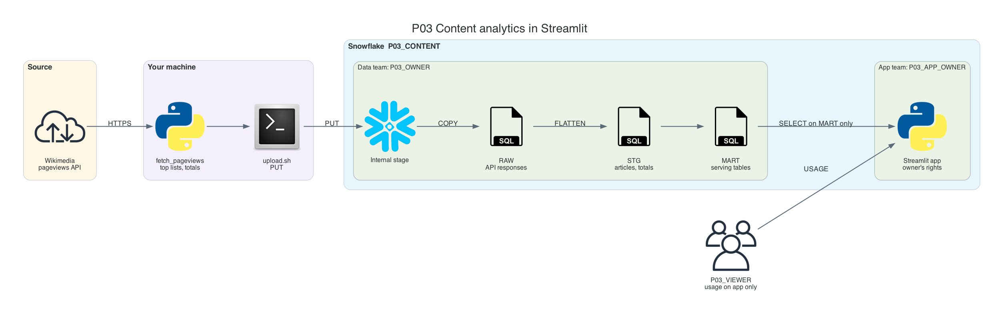
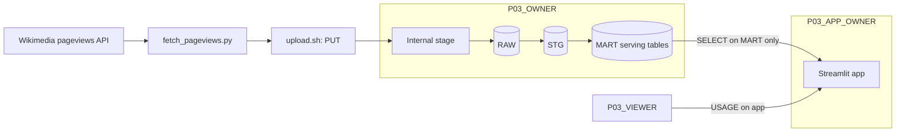

# P03 Content Analytics in Streamlit

Build a small content analytics product for Wikipedia editors: which articles are read most each day in English, German, and Ukrainian Wikipedia, what is trending, and how traffic moves over time. Data comes from the free Wikimedia pageviews API, lands in Snowflake, is shaped into a serving layer, and is delivered through a Streamlit app that runs inside Snowflake. The core lesson is the application boundary: who owns the data, who owns the app, and what a viewer can and cannot reach.

No cloud account besides Snowflake is needed: files go to an internal stage with `PUT`.

## Target Architecture

Own diagram, generated from [assets/architecture.py](assets/architecture.py). Icons: vendor architecture icon sets bundled with the <a href="https://diagrams.mingrammer.com">diagrams</a> library.

Text version (Mermaid)

### Reference From the Source Article

ProjectPro lists this idea as "Build a YouTube Analytics Dashboard with Snowflake Notebooks & Streamlit", based on the Snowflake quickstart [Build a Streamlit dashboard](https://quickstarts.snowflake.com/guide/streamlit-dashboard/index.html) with generated sample data. P03 keeps Streamlit in Snowflake as the delivery channel, swaps the sample data for real public pageviews in three languages, and adds what a production app needs: a serving layer, separated owner and viewer roles, bind parameters, caching, and a deployment step.

Source: ProjectPro, <a href="https://www.projectpro.io/article/snowflake-projects/1168">13 End-to-End Snowflake Projects That Build Job-Ready Skills</a>.

## Skills

| Skill | Milestone |
| --- | --- |
| Pulling a REST API politely: User-Agent, unpublished days, idempotent files | M1 |
| Two nested `FLATTEN`s; latest file wins per day | M2 |
| Reference tables that encode domain rules (main pages, namespaces) | M2 |
| Serving layer: small tables shaped for screens, `COPY GRANTS` | M3 |
| Streamlit in Snowflake: stage, `CREATE STREAMLIT`, live version, `environment.yml` | M4 |
| Owner's rights and three-role separation: data, app, audience | M4 |
| Bind parameters, caching with TTL, offline app tests | M5 |

## Prerequisites

- [Semi-structured data guide](../../learning-materials/reference/01_semi_structured_data.md)
- Snowflake trial and Snowflake CLI: [setup guide](../../../../shared/environments/setup-guide/README.md)
- Python 3.10+; basic Streamlit is helpful but not required
- [Cost guardrails](../_shared/cost_guardrails.md): every open app session keeps the warehouse running

## Navigation

| Part | File |
| --- | --- |
| Quickstart: numbered commands from install to teardown | [QUICKSTART.md](QUICKSTART.md) |
| 1. Problem | [01_problem.md](01_problem.md) |
| 2. Architecture and decisions | [02_architecture_decisions.md](02_architecture_decisions.md) |
| 3. Snowflake approach | [03_snowflake_approach.md](03_snowflake_approach.md) |
| 4. Alternative stacks and roadmap | [04_alternative_stacks.md](04_alternative_stacks.md) |
| 5. Step by step on Snowflake | [05_snowflake_step_by_step.md](05_snowflake_step_by_step.md) |
| 6. Solved reference | [06_solution/README.md](06_solution/README.md) |
| 7. Build it yourself | [07_build_it_yourself.md](07_build_it_yourself.md) |

Recommended route: 1, 2, 3, 4, then **7** (build). Use 5 when stuck. Compare with 6 at the end.
