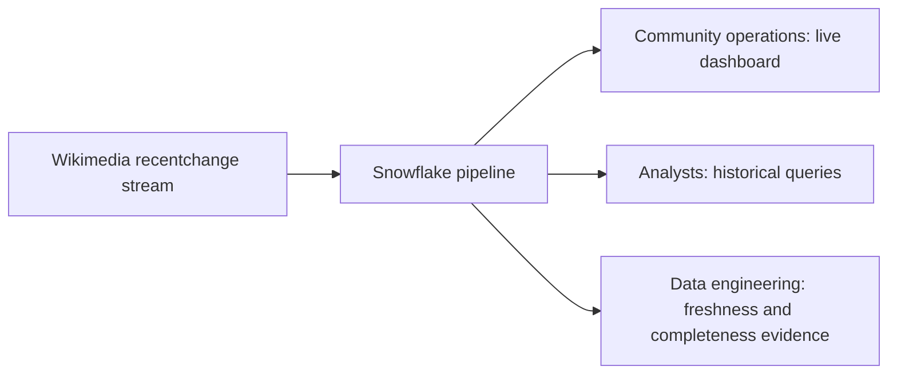

# 1. Problem

## Business Context

A community-operations team watches activity on a large collaborative platform. Today they see a daily batch report. When a page is hit by an edit storm, when a bot misbehaves, or when one language edition suddenly goes quiet because of an outage, the team learns about it the next morning.

They want a **near-real-time view of edit activity**: what changes, where, by humans or bots, and whether the picture is complete. Wikimedia's public `recentchange` stream is the stand-in for that platform. It is real, continuous, free, and noisy in realistic ways.



## Stakeholders

| Stakeholder | Need |
| --- | --- |
| Community operations | Edits per minute by wiki, bot share, hot pages in the last hour |
| Analysts | Clean, deduplicated history they can query with SQL |
| Data platform team | Proof that every delivered file was loaded exactly once, and how late the data is |
| Budget owner | A cost they can predict before the pipeline runs |

## Source Data

One event per change. A trimmed example:

```json
{
  "meta": {
    "id": "b6f3c3e0-2a8f-4a4e-9f3e-6d0c2f6a1b7c",
    "dt": "2026-11-09T14:05:01.123Z",
    "domain": "en.wikipedia.org",
    "stream": "mediawiki.recentchange"
  },
  "id": 1834567890,
  "type": "edit",
  "namespace": 0,
  "title": "Example page",
  "user": "ExampleUser",
  "bot": false,
  "minor": false,
  "wiki": "enwiki",
  "server_name": "en.wikipedia.org",
  "timestamp": 1794233101,
  "length": { "old": 10234, "new": 10301 }
}
```

| Property | Value |
| --- | --- |
| Delivery | Server-Sent Events over HTTPS, continuous |
| Unique key | `meta.id` |
| Event time | `meta.dt` (ISO-8601, UTC) |
| Volume | Varies by hour; measure it in milestone M1 instead of assuming |
| Quirks | `canary` monitoring events, optional fields that depend on `type`, reconnects can replay events |

The producer converts the stream into gzipped NDJSON files of one micro-batch each, plus one manifest file per data file.

## Functional Requirements

1. Load every event delivered by the producer into Snowflake without manual steps.
2. Keep the raw payload exactly as delivered, with its source file and row number.
3. Provide a typed, deduplicated table with one row per `meta.id`.
4. Serve edits per minute by wiki, change type, and bot flag.
5. Serve the most-edited pages of the last hour.
6. Show pipeline freshness and per-file reconciliation status.
7. Alert when the raw layer stops receiving data.

## Non-Functional Requirements

| Requirement | Target | How it is measured |
| --- | --- | --- |
| Freshness | p95 event time to staging at most 5 minutes while the pipeline runs | `OPS.V_LATENCY_LAST_HOUR` |
| Completeness | 100 % of manifested files reach status `OK`, or are explained | `OPS.V_FILE_RECONCILIATION` |
| Duplicates | 0 duplicate `event_id` in staging | data quality check |
| Replay | Any landing file from the last 7 days can be reloaded | drill in M7 |
| Security | No storage keys or SAS tokens in Snowflake or Git | review |
| Cost | Credits per running hour known and recorded | `cost_guardrails.md` queries |
| Operability | One script pauses everything, one script tears everything down | review |

The 5-minute target is deliberate. It is "near real time" and honest about what file-based ingestion delivers. Second-level freshness is a different architecture, covered in P14.

## Success Metrics

- Measured p50 and p95 latency for each hop: event to file, file to raw, raw to staging, staging to mart
- Reconciliation table with only `OK` rows after a normal run, and explained rows after the failure drills
- Recorded credits per hour of running pipeline
- A one-page architecture note you can present in five minutes

## Out of Scope

- Sub-second or exactly-once end-to-end delivery from the source (see P14)
- Content analysis of edit text or diffs
- Production-grade high availability of the producer
- Multi-region or disaster recovery design (see P16)
