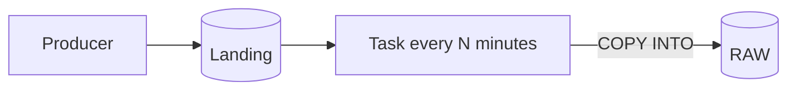
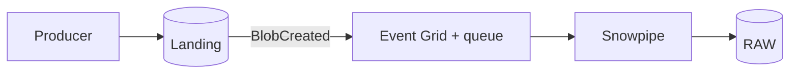
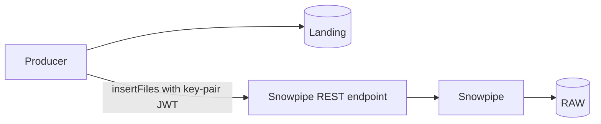
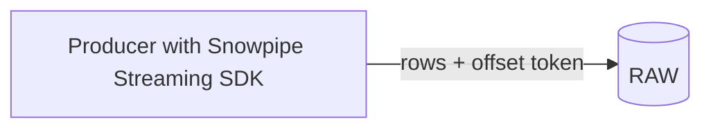
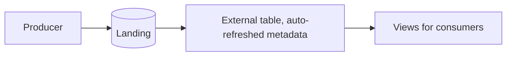
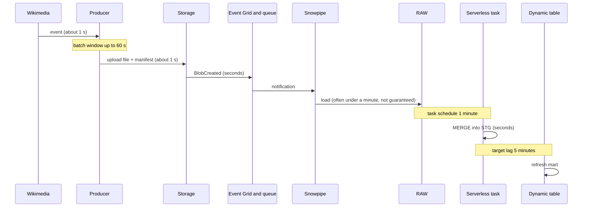
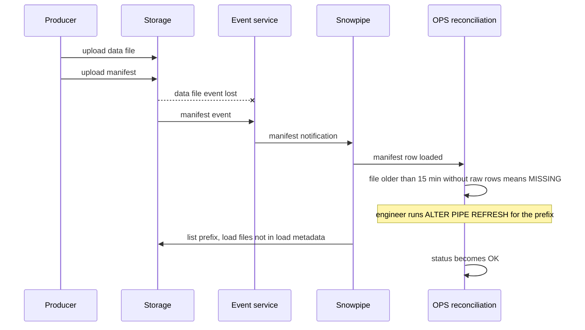
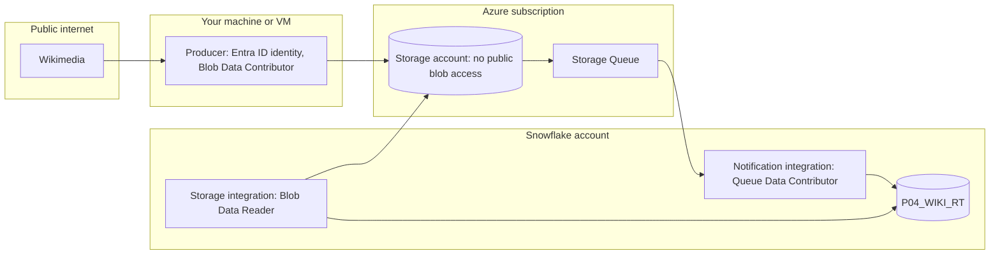

# 2. Architecture and Decisions

## Requirements That Drive the Design

| Driver | Consequence |
| --- | --- |
| Freshness in minutes, not seconds | File micro-batches are acceptable; row streaming is optional |
| Completeness must be provable | Producer writes a manifest; Snowflake reconciles against it |
| Replay of the last 7 days | Landing files are immutable and retained; loads are idempotent |
| Source can replay events after reconnect | Deduplicate on `meta.id` downstream, not only at file level |
| Predictable cost | Every scheduled or lag-driven object has a stated frequency and cost |
| No secrets | Storage and notification integrations, identity-based producer access |

## Options Considered

### Option 1: Scheduled `COPY INTO` from a task

### Option 2: Snowpipe auto-ingest (chosen)

### Option 3: Snowpipe REST API called by the producer

### Option 4: Snowpipe Streaming, no files

### Option 5: Query in place with external or Iceberg tables

## Trade-Offs

| Criterion | 1 Scheduled COPY | 2 Snowpipe auto-ingest | 3 Snowpipe REST | 4 Snowpipe Streaming | 5 External table |
| --- | --- | --- | --- | --- | --- |
| Typical freshness | Schedule interval plus load | About a minute after file, not guaranteed | Same as 2 | Seconds | Metadata refresh plus slow scans |
| Compute model | Warehouse; schedule keeps it awake | Serverless | Serverless | Serverless | Warehouse at query time |
| Cloud plumbing | None beyond storage | Event Grid and queue, or SQS | None beyond storage | None | Events for auto-refresh |
| Producer coupling | Loose | Loose | Producer needs Snowflake credentials | Tight: producer is a Snowflake client | Loose |
| Replay | Re-run `COPY` with `FORCE` or new names | `ALTER PIPE REFRESH` within 7 days, or re-upload with new names | Call `insertFiles` again for new names | Source or broker must replay | Files are the table |
| Duplicate protection | Load metadata, 64 days | Pipe load metadata, 14 days | Pipe load metadata | Offset tokens per channel | None |
| Small-file cost | Low: batched by schedule | Per-file overhead matters | Same as 2 | Not file-based | Very high on queries |
| Best when | Hourly or daily batch | Files arrive continuously, minutes are fine | No event service is available | Seconds matter, producer can run the SDK | Data must stay in the lake, queried rarely |

## Why / Why Not

**Why Snowpipe and not a task that runs `COPY INTO` every minute?**
A task every minute on a warehouse keeps that warehouse running all day; the frequency trap in [cost guardrails](../_shared/cost_guardrails.md) shows this. Snowpipe is serverless and event-driven: it loads when a file arrives and costs nothing when nothing arrives. A scheduled `COPY` is better for hourly batches with a clear batch boundary.

**Why files at all, when the source is already a stream?**
Files give an immutable, replayable copy outside Snowflake, a natural unit for reconciliation, and loose coupling: the producer needs storage rights only, not Snowflake rights. The price is minutes of latency and small-file overhead. P14 removes files and measures what that buys.

**Why not let the producer call the Snowpipe REST API?**
It removes Event Grid, but it puts Snowflake credentials into the producer and makes the producer responsible for notification retries. Auto-ingest keeps the producer ignorant of Snowflake. Choose REST when the storage account cannot emit events or when the producer must control exactly which files load.

**Isn't Snowpipe exactly-once?**
At file level, mostly: a pipe does not reload a file name it has loaded in the last 14 days. That says nothing about events. The source can replay events after a reconnect, and the same events can arrive in two different files. Business-level deduplication on `meta.id` in staging is still required.

**Why keep raw as `VARIANT` instead of typed columns?**
The source adds fields and some fields depend on the event type. `VARIANT` accepts every valid JSON document, so schema drift does not stop ingestion. Typing happens in staging with `TRY_` functions, where drift is visible as `NULL` counts instead of failed loads.

**Why `ON_ERROR = SKIP_FILE` and not `CONTINUE`?**
A file is the reconciliation unit. Partial files make row counts lie silently. With `SKIP_FILE`, a bad file is visibly missing in reconciliation, can be fixed, and is re-uploaded under a new name. `CONTINUE` fits sources where losing single bad rows is acceptable and rejects are tracked separately.

**Why a stream plus serverless task for staging, and a dynamic table for the mart?**
Staging must be idempotent under replays and duplicate files; an explicit `MERGE` on `event_id` makes that rule visible and testable. The mart is a pure aggregation of staging, which is exactly what dynamic tables do well. Using both also shows where each fits.

**Why a serverless task and not a warehouse task?**
The staging job runs every minute for a few seconds. On a warehouse, that pattern keeps the warehouse awake. Serverless tasks are billed for compute actually used.

**Why is the dynamic table lag 5 minutes and not 1 minute?**
Dynamic tables run on a warehouse. A 1-minute lag keeps the warehouse running continuously. The ops team's decisions do not change between minute 1 and minute 5. If they did, the mart would move to a serverless task or to P14's design.

**Why reconcile against a manifest instead of trusting `COPY_HISTORY`?**
`COPY_HISTORY` only knows about files Snowflake saw. A file whose event was lost is invisible there. The producer manifest is an independent record of what was sent, so missing files become visible.

**Why partition landing folders by delivery time?**
Late events then land in the current folder, and no folder is ever rewritten. Event-time questions are answered in Snowflake, not by the folder structure.

**What breaks first at 100 times the volume?**
Per-file overhead and file counts. The fix is bigger files (longer batch window or size-based flush), then reconsidering Snowpipe Streaming or Kafka (P14, P15). The `OPS` reconciliation view also needs to become an incremental table instead of a full scan.

## Architecture Decision Records

### ADR-001: File micro-batches with Snowpipe auto-ingest

- **Context:** minutes-level freshness, replay required, producer should not hold Snowflake credentials.
- **Decision:** the producer writes one gzipped NDJSON file per batch window (default 60 s); Snowpipe auto-ingest loads it.
- **Consequences:** about 1,440 data files per day per producer; per-file overhead is part of the cost; event service plumbing is required.
- **Rejected:** scheduled `COPY` (warehouse always on), REST API (credentials in producer), Snowpipe Streaming (moved to P14 for comparison).

### ADR-002: Schema-on-read raw layer

- **Decision:** `RAW.WIKI_RECENTCHANGE_RAW` stores `PAYLOAD VARIANT` plus `SRC_FILE`, `SRC_FILE_ROW`, `SRC_FILE_LAST_MODIFIED`, `LOADED_AT`.
- **Consequences:** ingestion survives schema drift; every row traces back to a file and line; typing cost moves to staging.

### ADR-003: Idempotent staging with stream, serverless task, and `MERGE`

- **Decision:** an append-only stream on raw feeds a serverless task every minute; the task deduplicates within the batch and merges on `event_id`, inserting only unseen events.
- **Consequences:** duplicate files and replayed events do not create duplicates; reprocessing raw is safe; the rule is explicit in SQL.

### ADR-004: Dynamic table mart with 5-minute lag

- **Decision:** `MART.EDITS_PER_MINUTE` is a dynamic table on staging, `TARGET_LAG = '5 minutes'`, incremental refresh. Rolling "last hour" logic lives in views because it depends on the current time.
- **Consequences:** no orchestration code for the mart; warehouse cost tied to the lag; time-relative logic is computed at query time.

### ADR-005: Manifest-based reconciliation

- **Decision:** the producer writes a manifest per data file (name, row count, checksum, timestamps) to `landing/wiki_manifest/`; a second pipe loads it into `OPS.PRODUCER_MANIFEST`; a view compares manifests with loaded rows.
- **Consequences:** missing, unexpected, and partially loaded files become visible; the manifest also gives the event-to-file latency.

### ADR-006: Identity-based access only

- **Decision:** Snowflake uses storage and notification integrations; the producer uses `DefaultAzureCredential` (or an AWS profile); no keys or SAS tokens anywhere.
- **Consequences:** consent and role assignments are one-time setup steps that need an administrator; nothing to rotate in the project.

## Latency Budget

| Hop | Expected | Controlled by |
| --- | --- | --- |
| Event to producer | about 1 s | Source |
| Batch window | 0 to 60 s | `--batch-seconds` |
| Upload and storage event | seconds | Cloud |
| Snowpipe load | often under a minute; Snowflake does not guarantee load latency | Snowflake, file size and count |
| Raw to staging | 0 to 60 s plus run time | Task schedule |
| **Event to staging p95 target** | **at most 5 minutes** | Sum of the above |
| Staging to mart | up to 5 minutes | `TARGET_LAG` |

Measure each hop. The point of the project is to replace these expectations with your numbers.

## Failure Modes

| Failure | Detection | Impact | Recovery |
| --- | --- | --- | --- |
| Producer stopped | Raw freshness alert, no new manifests | Data gap | Restart; the stream resumes from `Last-Event-ID` if the gap is short; otherwise accept and document the gap |
| Storage event lost or queue misconfigured | Manifest exists, reconciliation status `MISSING` | File not loaded | `ALTER PIPE ... REFRESH PREFIX = '...'` for files from the last 7 days |
| Malformed file | `COPY_HISTORY` status `LOAD_FAILED`, reconciliation `MISSING` | Whole file skipped | Fix and re-upload under a new name |
| Same file name re-uploaded with corrected content | Nothing: pipe ignores known names | Silent stale data | Never reuse names; corrected files get new names |
| Duplicate content under a new name | Raw row count higher than manifest total | None in staging | `MERGE` skips known `event_id`s |
| Schema drift (new field, changed type) | Staging `NULL` counts rise in data quality checks | Typed column becomes `NULL` | Raw keeps the value; update staging logic; reprocess from raw |
| Late events | Event time far behind load time | Old minutes change in the mart | Dynamic table recomputes affected groups; dashboards should expect late corrections |
| Task suspended or failing | `TASK_HISTORY` errors, staging freshness | Staging and mart stale | Fix, resume; the stream keeps unconsumed changes while within its retention |
| Credit spike | Resource monitor or budget notification | Cost | Pause script; review lag and schedule |

### Missed notification and recovery

## Cost Model

| Component | Driver | Notes |
| --- | --- | --- |
| Snowpipe | Compute per file loaded plus per-file overhead | About 2,880 files per day (data plus manifests) at a 60 s window. Snowpipe pricing has changed over time; check the current credit consumption table |
| Serverless task | Compute seconds per run, 1,440 runs per day | Small per run; no 60 s warehouse minimum |
| Dynamic table | Warehouse resumes about every 5 minutes | Roughly 12 resumes per hour, each billed at least 60 s on XS |
| Alert | Runs every 10 minutes on the same warehouse | Often overlaps with dynamic table refreshes |
| Dashboard | BI warehouse while someone looks | Auto-suspend 60 s |
| Storage | Raw growth, Time Travel | Small at this volume |
| Cloud | Blob storage, Event Grid operations, queue | Small at this volume |

Run the lab in bounded sessions, record credits per running hour, and pause afterwards. The cheapest freshness improvement is a shorter batch window. The most expensive one is a shorter dynamic table lag.

## Security and Trust Boundaries

- Untrusted input: event content is user-generated. Treat titles and comments as data, never as SQL or HTML.
- `STORAGE_ALLOWED_LOCATIONS` limits the integration to the landing container.
- Readers get `P04_READER`, which sees `MART` and `OPS`, not `RAW`.
