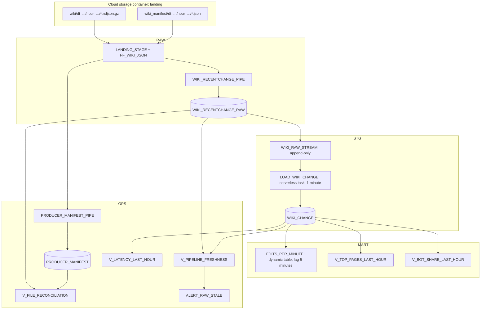
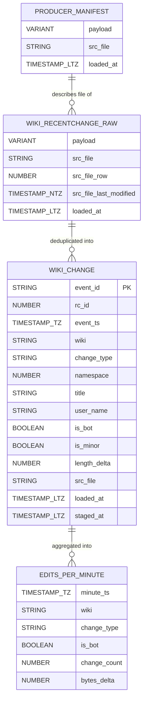
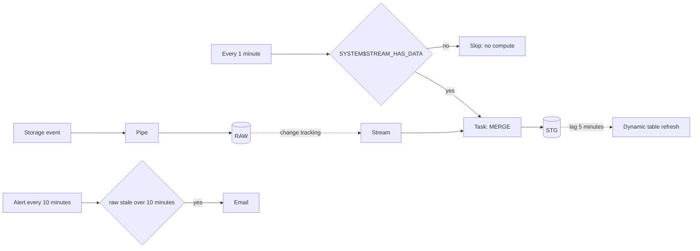

# 3. Snowflake Approach

## Layers and Objects

## Object Inventory

| Object | Type | Purpose |
| --- | --- | --- |
| `P04_OWNER`, `P04_READER` | Roles | Owner builds and runs; reader consumes `MART` and `OPS` |
| `P04_TRANSFORM_WH`, `P04_BI_WH` | Warehouses, XS | Dynamic table and alert; dashboards |
| `P04_RM` | Resource monitor | Daily credit cap for both warehouses |
| `P04_AZURE_STORAGE_INT` | Storage integration | Snowflake identity to read the landing container |
| `P04_AZURE_QUEUE_INT` | Notification integration | Receives Event Grid messages from the Storage Queue |
| `RAW.FF_WIKI_JSON` | File format | JSON, compression auto-detected, one document per line |
| `RAW.LANDING_STAGE` | External stage | Root of the landing container |
| `RAW.WIKI_RECENTCHANGE_PIPE` | Pipe, auto-ingest | Loads `wiki/` files into raw |
| `OPS.PRODUCER_MANIFEST_PIPE` | Pipe, auto-ingest | Loads `wiki_manifest/` files into the manifest table |
| `RAW.WIKI_RECENTCHANGE_RAW` | Table | Payload plus file metadata |
| `STG.WIKI_RAW_STREAM` | Stream, append-only | New raw rows since last consumption |
| `STG.LOAD_WIKI_CHANGE` | Serverless task | Deduplicating `MERGE` into staging |
| `STG.WIKI_CHANGE` | Table | Typed, one row per `event_id` |
| `MART.EDITS_PER_MINUTE` | Dynamic table | Minute-level aggregates by wiki, type, bot flag |
| `MART.V_TOP_PAGES_LAST_HOUR`, `MART.V_BOT_SHARE_LAST_HOUR` | Views | Time-relative serving logic |
| `OPS.PRODUCER_MANIFEST` | Table | What the producer says it sent |
| `OPS.V_FILE_RECONCILIATION` | View | Manifest vs loaded rows per file |
| `OPS.V_PIPELINE_FRESHNESS`, `OPS.V_LATENCY_LAST_HOUR` | Views | Freshness and latency evidence |
| `OPS.ALERT_RAW_STALE` | Alert | Email when raw stops growing |

## Feature Choices

| Need | Chosen feature | Rejected here | Why |
| --- | --- | --- | --- |
| Load files when they arrive | Snowpipe auto-ingest | Task with `COPY INTO` | Event-driven and serverless |
| Survive schema drift | `VARIANT` raw column | `MATCH_BY_COLUMN_NAME` into typed table | Drift should not stop ingestion |
| Trace rows to files | `METADATA$FILENAME`, `METADATA$FILE_ROW_NUMBER`, `METADATA$FILE_LAST_MODIFIED` | Nothing | Required for reconciliation and replay |
| Process only new rows | Append-only stream | Timestamp watermark | Exactly the rows not yet consumed, transactionally |
| Idempotent upsert | `MERGE ... WHEN NOT MATCHED` | `INSERT` | Duplicate files and replays are expected |
| Frequent small job | Serverless task | Warehouse task | No 60 s minimum per run |
| Declarative aggregation | Dynamic table, incremental | Second task | No orchestration code; refresh follows lag |
| Rolling time windows | View with `CURRENT_TIMESTAMP()` | Dynamic table | Time-relative logic cannot refresh incrementally |
| Freshness alerting | Snowflake alert plus email integration | External monitor | Fewer moving parts for a lab |

## Data Model

Grain:

- `WIKI_RECENTCHANGE_RAW`: one row per line per loaded file. Duplicates are possible by design.
- `WIKI_CHANGE`: one row per `event_id`. Snowflake does not enforce primary keys; the `MERGE` and a data quality check do.
- `EDITS_PER_MINUTE`: one row per minute, wiki, change type, and bot flag.

## Automation Graph

The `WHEN` condition is evaluated without starting compute, so minutes without new data cost nothing.

## What This Project Teaches About Snowflake

- Snowpipe is **file-level** idempotent, not event-level. Business deduplication stays your job.
- Load metadata makes **re-uploading a file with the same name a silent no-op**. Immutable, unique names are part of the contract.
- **Serverless versus warehouse** is a cost decision driven by run frequency and duration.
- Dynamic tables make freshness declarative, but the **lag is a cost dial**.
- Observability is not a feature you switch on. It is a set of tables and views you design: manifest, reconciliation, freshness, latency.
