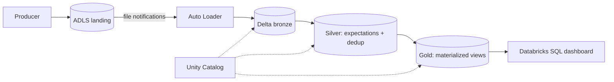
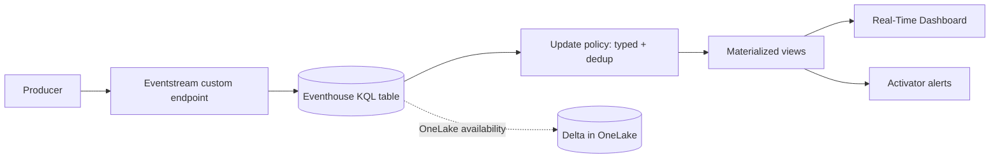
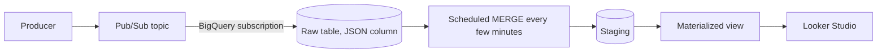
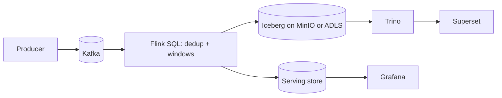
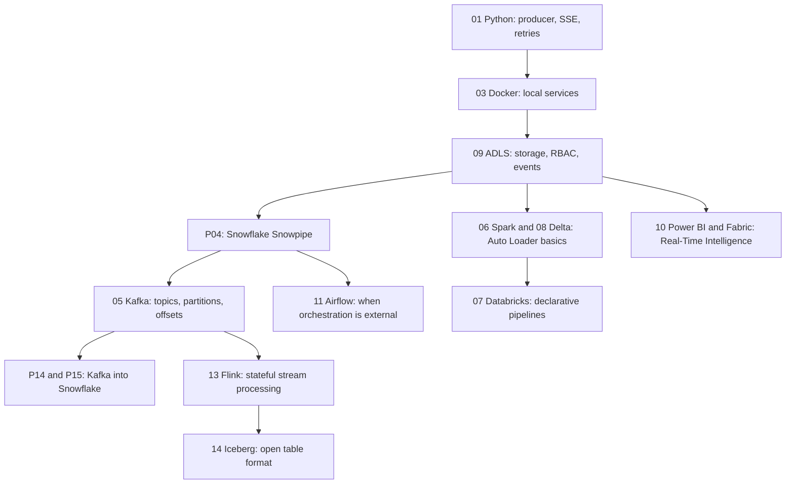

# 4. Alternative Stacks and Roadmap

The problem stays the same: continuous events, minutes-level freshness, provable completeness, replay, and a live dashboard. Only the platform changes. Comparing stacks is how you learn which parts of the design are Snowflake-specific and which are just good data engineering.

## Component Mapping

| Concern | Snowflake (this project) | Databricks on Azure | Microsoft Fabric | BigQuery | Open source |
| --- | --- | --- | --- | --- | --- |
| Landing | ADLS files | ADLS files | OneLake or ADLS shortcut, or no files | Pub/Sub, no files | Kafka topic |
| Arrival trigger | Event Grid to Snowpipe | Auto Loader with file notifications | Eventstream | Pub/Sub subscription | Consumer group |
| Raw storage | `VARIANT` table | Delta bronze table | Eventhouse (KQL) table | BigQuery table with `JSON` column | Iceberg table |
| Deduplication | Stream + task `MERGE` | Declarative pipeline with dedup or `MERGE` | Update policy or materialized view with `take_any` | `MERGE` in scheduled query | Flink SQL dedup with state TTL |
| Aggregation | Dynamic table | Materialized view in a declarative pipeline | Materialized view | Materialized view | Flink windowed aggregation |
| Serving | Snowsight, BI | Databricks SQL dashboard | Real-Time Dashboard, Power BI | Looker Studio | Trino plus Superset |
| Alerting | Snowflake alert | SQL alert | Activator | Cloud Monitoring | Grafana or Prometheus |
| Replay | Landing files plus `REFRESH` | Landing files plus checkpoint reset | Eventstream retention or source | Pub/Sub retention or seek | Kafka offsets reset |
| Typical freshness | Minutes | Seconds to minutes | Seconds | Seconds | Seconds |

## Databricks on Azure

- Same files and folder layout as P04. Auto Loader keeps its own checkpoint of discovered files, which plays the role of Snowpipe load metadata.
- Declarative pipelines (formerly Delta Live Tables) add data quality expectations as first-class objects.
- Wins when the team already runs Spark, needs Python-heavy transformations, or wants the lake in open Delta format as the system of record.
- Costs more operational knowledge: clusters or serverless compute, checkpoints, schema evolution modes.

## Microsoft Fabric Real-Time Intelligence

- No files and no event plumbing: the producer sends events, and seconds-level dashboards come built in.
- Wins for operational monitoring inside a Microsoft-centric organization with Power BI.
- Trade-off: KQL instead of SQL for the hot path, capacity-based pricing, and replay depends on retention.

## BigQuery

- A Pub/Sub BigQuery subscription writes messages straight to a table, so no producer-side files or loader code are needed.
- Wins on GCP, with serverless pricing that works well for spiky workloads.
- Trade-off: no landing files means replay depends on Pub/Sub retention or a separate archive subscription to Cloud Storage.

## Open Source Streaming Lakehouse

- Every component is replaceable and free to run locally in Docker, and you control state, ordering, and exactly-once settings.
- Wins when vendor independence matters or when the stream processor must also drive operational actions.
- Costs the most to operate: brokers, state backends, checkpoints, compaction, catalog, upgrades.
- A simpler variant for pure real-time analytics: Kafka into ClickHouse with materialized views and Grafana.

## When Each Alternative Wins

| Situation | Better choice |
| --- | --- |
| Minutes are fine, SQL team, Snowflake already in place | This project |
| Seconds matter and Snowflake stays the warehouse | P14: Snowpipe Streaming through the Kafka connector |
| Events must also feed other engines from a lake | P15: Kafka to lake to Snowpipe, or Databricks |
| Operations team lives in Power BI and needs seconds-level dashboards | Fabric Real-Time Intelligence |
| Organization is on GCP | BigQuery with Pub/Sub subscription |
| Vendor-neutral platform, strong streaming team | Kafka, Flink, Iceberg, Trino |

## Learning Roadmap

| Step | Module | What to take from it for this problem |
| --- | --- | --- |
| Producer | [01-python](../../../../01-python/README.md) | Streaming HTTP, retries with backoff, clean shutdown |
| Local services | [03-docker](../../../../03-docker/README.md) | Running Kafka, MinIO, Trino locally |
| Storage | [09-azure-data-lake-storage](../../../../09-azure-data-lake-storage/README.md) | Containers, hierarchical namespace, RBAC, Event Grid |
| Streaming backbone | [05-confluent-kafka](../../../../05-confluent-kafka/README.md) | Offsets, retention, consumer groups, connectors |
| Spark ingestion | [06-spark-pyspark](../../../../06-spark-pyspark/README.md), [08-delta-lake](../../../../08-delta-lake/README.md) | File streaming source, checkpoints, `MERGE` on Delta |
| Databricks | [07-databricks](../../../../07-databricks/README.md) | Auto Loader, declarative pipelines, Unity Catalog |
| Stream processing | [13-flink](../../../../13-flink/README.md) | Deduplication with state, windows, watermarks |
| Open tables | [14-iceberg](../../../../14-iceberg/README.md) | Snapshots, compaction, catalogs |
| Microsoft analytics | [10-powerbi-fabric](../../../../10-powerbi-fabric/README.md) | Eventstream, Eventhouse, Real-Time Dashboard |
| Orchestration | [11-airflow](../../../../11-airflow/README.md) | When a scheduler should own the pipeline instead |

### Suggested Exercise

After finishing P04, pick one alternative and write a one-page design for it. Use the same requirements from [01_problem.md](01_problem.md) and the same trade-off table format as [02_architecture_decisions.md](02_architecture_decisions.md). Then state which one you would choose for a real team, and why.
