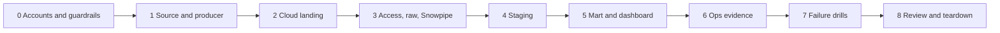

# 5. Step by Step on Snowflake

This guide walks through the whole build in the order that reduces debugging. Every step says **what** to do, **why**, **how to verify**, and the **common errors**. Script names point to [06_solution](06_solution/README.md); try writing each piece yourself first and open the script only to compare.

Phases match the milestones in [07_build_it_yourself.md](07_build_it_yourself.md).



---

## Phase 0: Accounts and Guardrails

### 0.1 Create the Snowflake account on Azure

- **What:** start a Snowflake trial and choose Microsoft Azure and the region closest to you, for example West Europe. Note the region; storage goes into the same one.
- **Why:** same cloud and region means no egress charges and the lowest latency. The cloud cannot be changed later for that account.
- **Verify:** `SELECT CURRENT_REGION();` returns something like `AZURE_WESTEUROPE`.

### 0.2 Prepare local tools

- **What:** install `az` CLI and Python 3.10+, run `az login`, and select the subscription you will use (`az account set --subscription <id>`).
- **Verify:** `az account show` displays the right subscription; `python3 --version`.

### 0.3 Account setup script

- **What:** run [core/00_account_setup.sql](06_solution/core/00_account_setup.sql) as `ACCOUNTADMIN` after replacing the email placeholder with the email of your Snowflake user.
- **Why:** roles, warehouses, a resource monitor, and the database exist before anything else. All later work runs as `P04_OWNER`, not `ACCOUNTADMIN`.
- **Verify:**

  ```sql
  SHOW WAREHOUSES LIKE 'P04_%';      -- XSMALL, auto_suspend 60, resource_monitor P04_RM
  SHOW GRANTS TO ROLE P04_OWNER;     -- OWNERSHIP on database, EXECUTE TASK, EXECUTE MANAGED TASK, EXECUTE ALERT
  ```

- **Common errors:** email notification integration rejects the address: the recipient must be a verified email of a user in the account (verify it in your Snowsight profile first).

### 0.4 Read the cost guardrails

- **What:** read [cost guardrails](../_shared/cost_guardrails.md) and set a budget alert on the Azure subscription or resource group.
- **Why:** the resource monitor does not stop Snowpipe or serverless tasks.

---

## Phase 1: Source and Producer

### 1.1 Look at the raw stream

- **What:**

  ```bash
  curl -sN -H "User-Agent: p04-learning/1.0 (your-email@example.com)" \
    https://stream.wikimedia.org/v2/stream/recentchange | head -n 20
  ```

- **Why:** see the Server-Sent Events format (`event:`, `id:`, `data:` lines) before writing a parser.
- **Verify:** `data:` lines contain JSON with `meta.id`, `meta.dt`, `wiki`, `type`.

### 1.2 Measure volume

- **What:** count events over 60 seconds, for example with a short Python loop or by running the producer with `--sink local --batch-seconds 60 --duration-minutes 1`.
- **Why:** batch window, file size, and Snowpipe cost depend on the event rate. Measure it; do not assume.
- **Verify:** note events per minute and gzipped bytes per minute in your project log.

### 1.3 Run the producer locally

- **What:** run [producer/producer.py](06_solution/producer/producer.py) with `--sink local`, then the tests.

  ```bash
  python producer.py --source wikimedia --sink local --batch-seconds 30 --duration-minutes 2
  python -m pytest -q test_producer.py
  ```

- **Why:** you can verify the file layout, unique names, and manifests without any cloud cost.
- **Verify:** `landing_local/wiki/dt=.../hour=.../*.ndjson.gz` and matching `landing_local/wiki_manifest/...json`; `gunzip -c <file> | wc -l` equals the manifest `row_count`.
- **Common errors:** HTTP 403 from Wikimedia: set a descriptive `User-Agent`.

---

## Phase 2: Cloud Landing

### 2.1 Provision Azure resources

- **What:** run [azure/01_provision.sh](06_solution/azure/01_provision.sh) with `P04_RG`, `P04_LOCATION`, and `P04_STORAGE_ACCOUNT` set.
- **Why:** one resource group holds everything, so cleanup is one command. The Event Grid subscription forwards only `BlobCreated` events in the `landing` container to the queue.
- **Verify:**

  ```bash
  az storage account show -n "$P04_STORAGE_ACCOUNT" -g "$P04_RG" --query "{hns:isHnsEnabled, publicBlob:allowBlobPublicAccess}"
  az eventgrid event-subscription list --source-resource-id "$(az storage account show -n "$P04_STORAGE_ACCOUNT" -g "$P04_RG" --query id -o tsv)" -o table
  ```

- **Common errors:** `Microsoft.EventGrid` provider not registered (the script registers it, which can take a minute); storage account name already taken.

### 2.2 Write a few files to Azure

- **What:** `python producer.py --source synthetic --rate 20 --batch-seconds 30 --duration-minutes 2 --sink azure`.
- **Why:** proves your identity can write, and puts files in place before Snowflake exists.
- **Verify:**

  ```bash
  az storage blob list --account-name "$P04_STORAGE_ACCOUNT" -c landing --auth-mode login --prefix wiki/ -o table
  az storage message peek --queue-name snowpipe-p04 --account-name "$P04_STORAGE_ACCOUNT" --auth-mode key --num-messages 3
  ```

  The queue holds `Microsoft.Storage.BlobCreated` messages whose `subject` points at your files.
- **Common errors:** `AuthorizationPermissionMismatch`: the Blob Data Contributor assignment has not propagated yet; wait a few minutes.

---

## Phase 3: Snowflake Access, Raw Layer, Snowpipe

### 3.1 Schemas and raw tables

- **What:** run [core/01_schemas_and_raw.sql](06_solution/core/01_schemas_and_raw.sql).
- **Why:** the raw table stores `PAYLOAD VARIANT` plus file name, row number, file modification time, and load time. These four columns make reconciliation and replay possible.
- **Verify:** `DESC TABLE RAW.WIKI_RECENTCHANGE_RAW;`

### 3.2 Integrations and consent

- **What:** run [azure/10_integrations.sql](06_solution/azure/10_integrations.sql) as `ACCOUNTADMIN`. From each `DESC INTEGRATION` result, open `AZURE_CONSENT_URL` and accept, and copy `AZURE_MULTI_TENANT_APP_NAME`. Then run [azure/02_grant_snowflake_access.sh](06_solution/azure/02_grant_snowflake_access.sh) with both app names.
- **Why:** Snowflake gets its own identity in your tenant. You grant that identity read access to blobs and read/delete access to the queue. No keys or SAS tokens exist anywhere.
- **Verify:** `az role assignment list --scope <storage id> -o table` shows `Storage Blob Data Reader` for the Snowflake service principal; the queue scope shows `Storage Queue Data Contributor`.
- **Common errors:** service principal not found: consent was not completed or was done in a different tenant.

### 3.3 Stage and smoke tests

- **What:** run the stage part of [azure/11_stage_and_pipes.sql](06_solution/azure/11_stage_and_pipes.sql) and the `LIST` and `SELECT ... FROM @stage` queries.
- **Why:** querying staged files directly checks access and file format before any loading.
- **Verify:** `LIST` shows your files; the `SELECT` returns event ids and wikis.
- **Common errors:** `Failed to access remote file: access denied`: role assignment still propagating, or `STORAGE_ALLOWED_LOCATIONS` does not cover the URL (check the trailing `/landing/`).

### 3.4 Pipes and first load

- **What:** create both pipes, then run `ALTER PIPE ... REFRESH` for each.
- **Why:** files written before the pipe existed were never notified to it. `REFRESH` queues files from the last 7 days that are not in the pipe's load metadata.
- **Verify:**

  ```sql
  SELECT COUNT(*), COUNT(DISTINCT SRC_FILE) FROM RAW.WIKI_RECENTCHANGE_RAW;
  SELECT COUNT(*) FROM OPS.PRODUCER_MANIFEST;
  SELECT * FROM TABLE(INFORMATION_SCHEMA.COPY_HISTORY(
    TABLE_NAME => 'RAW.WIKI_RECENTCHANGE_RAW', START_TIME => DATEADD('hour', -1, CURRENT_TIMESTAMP())));
  ```

### 3.5 Prove auto-ingest

- **What:** run the producer for 3 minutes. Note the time each file is written, then watch `COPY_HISTORY` and `SYSTEM$PIPE_STATUS`.
- **Why:** this is the moment the architecture becomes event-driven. Measure the gap between file write and `LAST_LOAD_TIME`.
- **Verify:** new files appear in `COPY_HISTORY` without any manual command; `lastReceivedMessageTimestamp` in the pipe status advances.
- **Common errors:** nothing loads but `REFRESH` works: the notification path is broken. Check the queue URI in the notification integration, the queue role assignment, and that the Event Grid subscription filter matches the container.

---

## Phase 4: Staging

### 4.1 Stream, table, serverless task

- **What:** run [core/20_staging.sql](06_solution/core/20_staging.sql).
- **Why:**
  - the append-only stream returns exactly the raw rows not yet consumed, and advances only when the consuming transaction commits
  - `SHOW_INITIAL_ROWS = TRUE` makes the first run pick up rows loaded before the stream existed
  - `QUALIFY ROW_NUMBER()` removes duplicates inside one batch; the `MERGE` removes duplicates across batches
  - `TRY_` functions turn bad values into `NULL` instead of failing the task
- **Verify:**

  ```sql
  SELECT COUNT(*), COUNT(DISTINCT EVENT_ID) FROM STG.WIKI_CHANGE;  -- equal
  SELECT SYSTEM$STREAM_HAS_DATA('P04_WIKI_RT.STG.WIKI_RAW_STREAM');
  SELECT * FROM TABLE(INFORMATION_SCHEMA.TASK_HISTORY(TASK_NAME => 'LOAD_WIKI_CHANGE')) ORDER BY SCHEDULED_TIME DESC LIMIT 10;
  ```

- **Common errors:** task never runs: it was not resumed, or the role lacks `EXECUTE MANAGED TASK`. Runs show `SKIPPED`: the `WHEN` condition found no data, which is correct and free.

### 4.2 Understand stream retention

- **What:** read `SHOW STREAMS` output columns `stale` and `stale_after`.
- **Why:** if a stream is not consumed within the table's data retention window (extended up to a limit for streams), it becomes stale and must be recreated, which means a staging rebuild from raw. Suspending the task for weeks has a consequence.

---

## Phase 5: Mart and Dashboard

### 5.1 Dynamic table and views

- **What:** run [core/30_mart.sql](06_solution/core/30_mart.sql).
- **Why:** the minute aggregate is a pure function of staging, ideal for a dynamic table. "Last hour" questions depend on the current time, so they stay in views.
- **Verify:**

  ```sql
  SHOW DYNAMIC TABLES IN SCHEMA MART;          -- refresh_mode INCREMENTAL, target_lag 5 minutes
  SELECT * FROM TABLE(INFORMATION_SCHEMA.DYNAMIC_TABLE_REFRESH_HISTORY(NAME => 'P04_WIKI_RT.MART.EDITS_PER_MINUTE'))
  ORDER BY REFRESH_START_TIME DESC LIMIT 5;
  ```

- **Common errors:** creation fails with `REFRESH_MODE = INCREMENTAL`: the query uses a construct that cannot refresh incrementally. Simplify the query instead of switching to `FULL`.

### 5.2 Snowsight dashboard

- **What:** create a dashboard with tiles from [core/50_dashboard_and_ops_queries.sql](06_solution/core/50_dashboard_and_ops_queries.sql), running as `P04_READER` on `P04_BI_WH`.
- **Why:** consumers use the reader role, which proves the grants. If a tile fails, a grant is missing.
- **Verify:** line chart of edits per minute, bot share bars, hot pages table, freshness and latency scorecards.

### 5.3 First cost check

- **What:** run the credits query at the end of the `50` script after one hour of running.
- **Why:** you now have a real cost per running hour to compare with the model in [02_architecture_decisions.md](02_architecture_decisions.md#cost-model).

---

## Phase 6: Operational Evidence

### 6.1 Reconciliation, freshness, latency, alert

- **What:** run [core/40_ops.sql](06_solution/core/40_ops.sql) after replacing the email placeholder.
- **Why:** these views are the evidence that the pipeline meets the requirements in [01_problem.md](01_problem.md#non-functional-requirements).
- **Verify:**

  ```sql
  SELECT RECON_STATUS, COUNT(*) FROM OPS.V_FILE_RECONCILIATION GROUP BY 1;
  SELECT * FROM OPS.V_PIPELINE_FRESHNESS;
  SELECT * FROM OPS.V_LATENCY_LAST_HOUR;
  SELECT * FROM OPS.V_FILE_LATENCY_LAST_HOUR;
  ```

### 6.2 Test the alert

- **What:** stop the producer and wait for more than 10 minutes.
- **Verify:** an email arrives; `INFORMATION_SCHEMA.ALERT_HISTORY` shows `TRIGGERED`. Restart the producer and confirm the alert stops triggering.

### 6.3 Data quality checks

- **What:** stop the producer, wait one task run plus the dynamic table lag, run [tests/data_quality_checks.sql](06_solution/tests/data_quality_checks.sql).
- **Verify:** all checks `PASS`.

---

## Phase 7: Failure Drills

- **What:** work through [tests/failure_drills.md](06_solution/tests/failure_drills.md): duplicate content, malformed line, schema drift, late events, same-name overwrite, missed notification.
- **Why:** a pipeline you have never seen fail is a pipeline you cannot operate. Predict before you run.
- **Verify:** the drill log table is filled in, and every drill has a detection method and a recovery.

---

## Phase 8: Review and Teardown

### 8.1 Write the review

- Measured latency per hop vs the budget in `02`
- Credits per running hour, by component
- Which drill surprised you, and what you would change
- Which alternative from [04_alternative_stacks.md](04_alternative_stacks.md) you would choose for a team, and why

### 8.2 Pause or tear down

- End of every session: [core/90_pause.sql](06_solution/core/90_pause.sql), and stop the producer.
- End of project: [teardown.sql](06_solution/teardown.sql), then `az group delete --name "$P04_RG" --yes`.
- **Verify:** `SHOW WAREHOUSES LIKE 'P04_%'` returns nothing; the Azure resource group is gone; the credits query a day later shows no new P04 usage.
