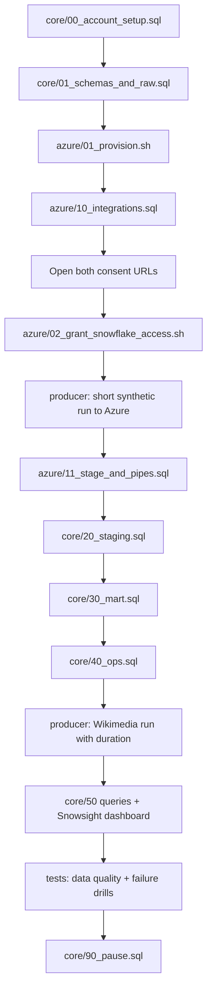

# P04 Solution

Reference implementation for [P04](../README.md). Read it after building your own version with [07_build_it_yourself.md](../07_build_it_yourself.md), or when a milestone stays blocked after trying [05_snowflake_step_by_step.md](../05_snowflake_step_by_step.md).

To run it end to end, follow [QUICKSTART.md](../QUICKSTART.md): copy `p04.env.example` to `p04.env`, then `./run_sql.sh <script.sql>` fills the placeholders and runs each script with the Snowflake CLI.

## Layout

```text
06_solution/
  core/
    00_account_setup.sql           ACCOUNTADMIN: roles, warehouses, monitor, database, account grants, email integration
    01_schemas_and_raw.sql         schemas, file format, raw and manifest tables, reader usage
    20_staging.sql                 stream, staging table, serverless task with MERGE
    30_mart.sql                    dynamic table and serving views
    40_ops.sql                     reconciliation, freshness, latency views, alert
    50_dashboard_and_ops_queries.sql  dashboard tiles and operational queries
    90_pause.sql / 91_resume.sql   end and start a lab session
  azure/
    01_provision.sh                resource group, ADLS account, container, queue, Event Grid subscription
    10_integrations.sql            storage and notification integrations
    02_grant_snowflake_access.sh   role assignments for Snowflake service principals (after consent)
    11_stage_and_pipes.sql         stage, smoke tests, two auto-ingest pipes
  aws/
    01_provision.sh                bucket, IAM role with placeholder trust
    10_integration.sql             storage integration
    11_stage_and_pipes.sql         stage, pipes, SQS ARN
    02_connect_snowflake.sh        final IAM trust and bucket notification
    *.json                         policy and notification templates
  producer/
    producer.py                    Wikimedia or synthetic source -> files + manifests -> local, Azure, S3
    chaos.py                       failure drill files
    test_producer.py               offline tests
  tests/
    data_quality_checks.sql
    failure_drills.md
  teardown.sql
```

## Run Order (Azure)



Writing a few files before step H gives the stage smoke tests something to list and shows why the initial `ALTER PIPE ... REFRESH` is needed.

### Producer

```bash
cd producer
python3 -m venv .venv && source .venv/bin/activate
pip install -r requirements.txt
python -m pytest -q test_producer.py

az login
export P04_AZURE_ACCOUNT_URL=https://<storage-account>.blob.core.windows.net
export WIKI_USER_AGENT="p04-learning/1.0 (your-email@example.com)"

# Smoke test with synthetic data
python producer.py --source synthetic --rate 20 --batch-seconds 30 --duration-minutes 3 --sink azure

# Real stream, bounded
python producer.py --source wikimedia --batch-seconds 60 --duration-minutes 60 --sink azure
```

## Run Order (AWS)

`core/00`, `core/01`, `aws/01_provision.sh`, `aws/10_integration.sql`, `aws/11_stage_and_pipes.sql` up to `SHOW PIPES`, `aws/02_connect_snowflake.sh <iam user arn> <external id> <sqs arn>`, rest of `aws/11`, then `core/20` onwards. Producer: `--sink s3` with `P04_BUCKET` set and an AWS profile active.

## Expected Results

After about 30 minutes of the Wikimedia stream:

| Check | Expected |
| --- | --- |
| `SYSTEM$PIPE_STATUS` | `executionState = RUNNING`, `pendingFileCount` near 0 |
| `OPS.V_FILE_RECONCILIATION` | All files `OK`, except the newest few that may be `PENDING` |
| `tests/data_quality_checks.sql` | All `PASS` after the producer stops and the lag has passed |
| `OPS.V_LATENCY_LAST_HOUR` | p95 event to staging in the low minutes; record your numbers |
| `MART.EDITS_PER_MINUTE` | Rows for many wikis; `enwiki` and `wikidatawiki` usually among the busiest |
| `INFORMATION_SCHEMA.DYNAMIC_TABLE_REFRESH_HISTORY` | Mostly `INCREMENTAL` or `NO_DATA` refresh actions |

Your exact numbers depend on time of day, region, and file size. Record them in [PROGRESS.md](../../PROGRESS.md).

## Design Notes Worth Comparing With Your Version

- `LOADED_AT` comes from `METADATA$START_SCAN_TIME`, so it records when Snowpipe scanned the file, not when a later query ran.
- The task is serverless and gated by `SYSTEM$STREAM_HAS_DATA`: idle minutes cost nothing.
- The `MERGE` only inserts. Wikimedia events are immutable facts; corrections arrive as new events with new ids.
- Reconciliation joins on the unique file base name. The path prefix in `METADATA$FILENAME` depends on how the stage URL is defined, and the base name is the same either way.
- `REFRESH_MODE = INCREMENTAL` is explicit so that a non-incremental query fails loudly at creation instead of silently running full refreshes.

## Cleanup

1. `core/90_pause.sql` at the end of every session.
2. When finished with the project: `teardown.sql` as `ACCOUNTADMIN`.
3. Azure: `az group delete --name "$P04_RG" --yes`.
4. AWS: `aws s3 rb "s3://$P04_BUCKET" --force`, then delete the inline policy and role (`aws iam delete-role-policy --role-name p04-snowflake-landing-read --policy-name p04-landing-read` and `aws iam delete-role --role-name p04-snowflake-landing-read`).
