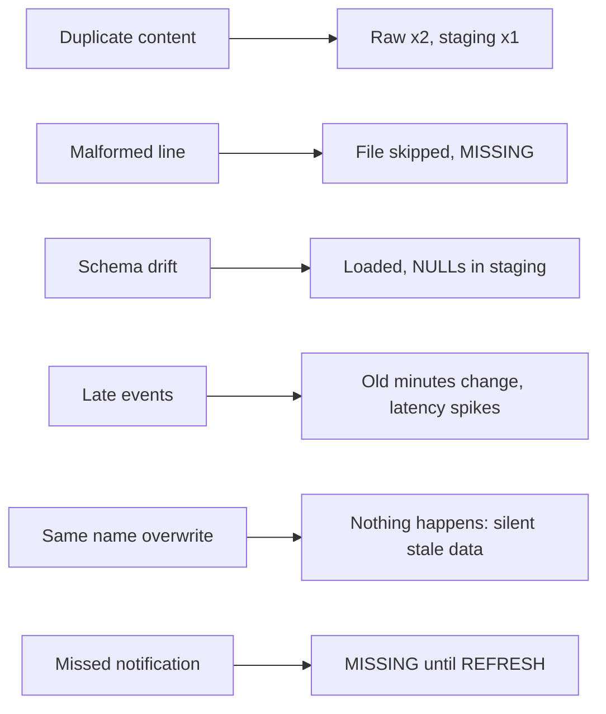

# P04 Failure Drills

Run these drills after the normal pipeline works (milestone M6). Each drill has a prediction step: write down what you expect **before** you run it, then compare. Commands assume you are in `06_solution/producer/` with the same sink arguments you use for the producer (examples use Azure).

```bash
SINK="--sink azure --azure-account-url https://<storage-account>.blob.core.windows.net"
```



## D1 Duplicate Content Under New Names

```bash
python chaos.py duplicate-content --rows 100 $SINK
```

- **Observe:** `COPY_HISTORY` shows two loaded files; reconciliation shows both `OK`; the last query in `tests/data_quality_checks.sql` shows raw rows exceeding distinct events by 100.
- **Expected:** staging grows by 100, not 200. `stg_duplicate_event_id` stays 0.
- **Lesson:** Snowpipe's protection is per file name. Event-level deduplication is your `MERGE`.

## D2 Malformed Line

```bash
python chaos.py malformed --rows 100 $SINK
```

- **Observe:** `COPY_HISTORY` status `LOAD_FAILED` with a JSON parse error; `VALIDATE_PIPE_LOAD` returns the error; reconciliation shows `PENDING`, then `MISSING` after 15 minutes.
- **Expected:** no rows from that file in raw, because `ON_ERROR = SKIP_FILE`.
- **Recover:** produce a corrected file under a **new** name (run `python chaos.py plain --rows 100 $SINK` to simulate it). Document the missing file as resolved.
- **Discuss:** what would `ON_ERROR = CONTINUE` have done to the reconciliation?

## D3 Schema Drift

```bash
python chaos.py schema-drift --rows 100 $SINK
```

- **Observe:** the file loads (`VARIANT` accepts it); `stg_null_is_bot` and `stg_null_namespace` rise by 100.
- **Recover:** decide whether `"unknown"` should map to `NULL` or to a new category; update staging logic; reprocess the affected rows from raw (raw still has the original values).
- **Lesson:** drift became a data quality signal instead of a pipeline outage.

## D4 Late Events

```bash
python chaos.py late --rows 100 $SINK
```

- **Observe:** after the next dynamic table refresh, the minute three hours ago gains 100 changes; `V_LATENCY_LAST_HOUR` p95 jumps.
- **Discuss:** should latency metrics exclude events older than a threshold? Should the dashboard show event time or load time? There is no single right answer; write down your choice.

## D5 Same Name, New Content

```bash
python chaos.py same-name --rows 100 --wait-seconds 180 $SINK
```

- **Observe:** the first version loads. The overwrite triggers a new storage event, but Snowpipe skips the file because its name is already in the pipe's load metadata. Raw does not change.
- **Expected:** silent stale data. Nothing fails.
- **Lesson:** immutable, unique file names are part of the ingestion contract. Corrections are new files.
- **Discuss:** how would you detect this in production? (Hint: compare checksums, or monitor storage events against `COPY_HISTORY`.)

## D6 Missed Notification

Simulate a lost event by delivering a file while event delivery is disabled.

Azure:

```bash
az eventgrid event-subscription delete --name p04-landing-blob-created \
  --source-resource-id "$(az storage account show -n "$P04_STORAGE_ACCOUNT" -g "$P04_RG" --query id -o tsv)"
python chaos.py plain --rows 100 $SINK
# then re-run the event subscription command from azure/01_provision.sh
```

AWS: temporarily remove the bucket notification, upload with `chaos.py plain --sink s3`, then restore it with `aws/02_connect_snowflake.sh`.

- **Observe:** neither the data file nor its manifest loads. Reconciliation cannot flag a file whose manifest is also missing. This is the gap.
- **Recover:**

  ```sql
  ALTER PIPE RAW.WIKI_RECENTCHANGE_PIPE REFRESH PREFIX = 'wiki/dt=<yyyy-mm-dd>/hour=<hh>/';
  ALTER PIPE OPS.PRODUCER_MANIFEST_PIPE REFRESH PREFIX = 'wiki_manifest/dt=<yyyy-mm-dd>/hour=<hh>/';
  ```

  `REFRESH` queues files staged within the last 7 days that are not in the pipe's load metadata.
- **Discuss:** how could you detect the gap without relying on Snowflake at all? (Hint: compare a storage listing with `COPY_HISTORY` on a schedule, or have the producer report file counts somewhere independent.)

## Drill Log Template

| Drill | Prediction | Observed | Detected by | Time to detect | Recovery | Follow-up change |
| --- | --- | --- | --- | --- | --- | --- |
| D1 | | | | | | |
| D2 | | | | | | |
| D3 | | | | | | |
| D4 | | | | | | |
| D5 | | | | | | |
| D6 | | | | | | |
