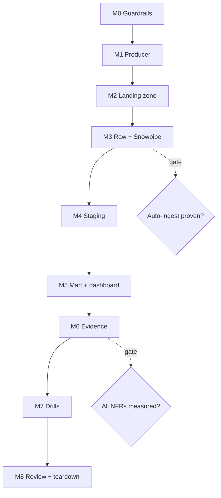

# 7. Build It Yourself

## Brief

You join a data platform team. Community operations wants a live view of edit activity across all Wikimedia projects, with proof that no delivered data is lost or double-counted. Your job is to design, build, operate, and break a near-real-time Snowflake pipeline, then present it.

You build everything yourself: the producer, the cloud landing zone, the Snowflake objects, the observability, and the drills. This brief tells you **what** must exist and **how it will be checked**. It does not tell you how to write it.

## Rules

| You may use | Only when stuck | Only after the milestone passes |
| --- | --- | --- |
| [01](01_problem.md) to [04](04_alternative_stacks.md) of this project, `_shared/`, the module's learning materials, official documentation | [05_snowflake_step_by_step.md](05_snowflake_step_by_step.md) | [06_solution/](06_solution/README.md) |

- Use the naming and layout in [conventions](../_shared/conventions.md).
- Every lab session ends with your own pause script.
- Keep a project log (template at the end). Write numbers, not impressions.

## Milestone Map

---

## M0 Guardrails

**Goal:** an account you cannot accidentally overspend in, with a role model you will keep for the whole project.

**Deliverables**

- Snowflake account on Azure in a named region
- Owner and reader roles, two XS warehouses, a daily resource monitor, project database
- Azure budget alert
- A pause script skeleton (you will extend it in every milestone)

**Acceptance criteria**

- [ ] No project object is owned by `ACCOUNTADMIN`
- [ ] Both warehouses: XS, auto-suspend 60 s, statement timeout set, monitor attached
- [ ] You can explain in one sentence why the resource monitor does not protect you from Snowpipe costs

**Hints:** look up which account-level privileges tasks, serverless tasks, and alerts need.

---

## M1 Producer

**Goal:** a Python program that turns the Wikimedia `recentchange` stream into immutable micro-batch files plus manifests.

**Deliverables**

- Producer with a pluggable sink (local folder first)
- A synthetic source with the same event shape, for offline work and drills
- At least two automated tests that run without network
- Measured event rate and gzipped bytes per minute, written in your log

**Acceptance criteria**

- [ ] File names are unique, never reused, and partitioned by delivery time (`dt=`/`hour=`)
- [ ] One manifest per data file with at least: file name, row count, checksum, first and last event time, write time
- [ ] The manifest is written only after its data file
- [ ] Batches flush on time **or** size, whichever comes first
- [ ] The producer stops by itself after a required duration, and flushes the open batch on interrupt
- [ ] Canary events are filtered; reconnects resume with the last event id
- [ ] A descriptive `User-Agent` is sent

**Hints:** Server-Sent Events are plain text lines over a long-lived HTTP response. Think about what happens to events in the open batch when the process is killed.

---

## M2 Landing Zone

**Goal:** a cloud landing zone that emits an event for every new file, with no keys anywhere.

**Deliverables**

- Script that provisions: resource group, storage account with hierarchical namespace, private container, queue, Event Grid subscription filtered to blob creation in your container
- Your producer writing to the container using your Entra ID identity

**Acceptance criteria**

- [ ] Public blob access disabled; TLS 1.2 minimum
- [ ] Event messages appear in the queue for each new file, and only for your container
- [ ] One command deletes everything

**Hints:** decide which identity needs which data-plane role. Peek at the queue to see what Snowflake will receive.

---

## M3 Raw Layer and Snowpipe

**Goal:** every file that lands is loaded into a raw table automatically, with full traceability.

**Deliverables**

- Storage integration and notification integration with consent and role assignments
- File format, external stage, raw table, manifest table
- Two auto-ingest pipes: data and manifests
- A short note: how you loaded files that existed before the pipes

**Acceptance criteria**

- [ ] Raw keeps the full payload and the source file name, row number, file modification time, and load time
- [ ] A new file appears in `COPY_HISTORY` without any manual command
- [ ] A file with a broken line is skipped as a whole, not partially loaded
- [ ] You measured file-write-to-load time for at least 10 files

**Gate G1:** do not continue until auto-ingest works without `REFRESH`. Debugging staging on top of a broken notification path wastes hours.

**Hints:** check access in layers: list the stage, query staged files directly, then load. The pipe needs to know which notification integration to listen to.

---

## M4 Staging

**Goal:** a typed table with exactly one row per event, built incrementally and safely re-runnable.

**Deliverables**

- Change capture on raw, a scheduled job that consumes it, typed staging table
- A note explaining why your job's compute type fits a one-minute schedule

**Acceptance criteria**

- [ ] Duplicate events inside one batch and across batches are both removed
- [ ] Re-processing the same raw rows twice does not change staging
- [ ] A bad value in one field becomes `NULL`; it does not fail the job
- [ ] Minutes without new data cost nothing

**Hints:** there are two different duplicate problems. One is inside the rows you are about to insert; the other is between those rows and what is already there.

---

## M5 Mart and Dashboard

**Goal:** consumer-ready minute aggregates and a live dashboard used through the reader role.

**Deliverables**

- Minute-level aggregate by wiki, change type, and bot flag, refreshed declaratively
- "Last hour" views: hot pages, bot share
- Snowsight dashboard with at least four tiles, built as the reader role
- Your chosen refresh lag, with its cost justification in one paragraph

**Acceptance criteria**

- [ ] The aggregate refreshes incrementally; you can show it in the refresh history
- [ ] No time-relative logic sits inside an incrementally refreshed object
- [ ] The reader role cannot select from raw

**Hints:** what does a one-minute lag do to a warehouse with a 60-second auto-suspend?

---

## M6 Evidence

**Goal:** prove every non-functional requirement with a query.

**Deliverables**

- Per-file reconciliation with statuses at least: OK, pending, missing, row count mismatch, unexpected file
- Freshness per layer, latency percentiles per hop
- A freshness alert that emails you
- A data quality check script that returns PASS or FAIL per check
- Credits per running hour, by component

**Acceptance criteria**

- [ ] p95 event-to-staging latency measured and compared with the 5-minute target
- [ ] The alert fired once in a test and stopped after recovery
- [ ] All data quality checks pass after a normal run

**Gate G2:** every row of the NFR table in [01_problem.md](01_problem.md#non-functional-requirements) has a measured value in your log.

---

## M7 Failure Drills

**Goal:** break the pipeline on purpose and show that you can detect and recover from each failure.

**Deliverables**

- Extend your synthetic tooling to produce: duplicate content under new names, a malformed line, schema drift, late events, a same-name overwrite with new content
- Simulate a missed storage notification
- Filled drill log: prediction, observation, detection, time to detect, recovery, follow-up change

**Acceptance criteria**

- [ ] Every drill has a prediction written **before** it ran
- [ ] At least one drill produced a result different from your prediction, and you explain why
- [ ] You can name the drill your current design does **not** detect, and propose a detector

---

## M8 Review and Teardown

**Goal:** present the system and leave nothing running.

**Deliverables**

- One-page architecture note: diagram, key decisions with rejected alternatives, measured latency and cost, failure handling
- A five-minute walkthrough you could give in an interview
- Teardown script, executed

**Acceptance criteria**

- [ ] The note answers: why files, why Snowpipe, why your staging approach, why your lag
- [ ] After teardown, no `P04_` objects exist and the cloud resource group is gone

---

## Stretch Goals

- **Batch window experiment:** run 15 s, 60 s, and 300 s windows for equal periods; chart latency against credits. This is the most valuable stretch goal.
- **Triggered task:** replace the scheduled staging task with a task that runs when the stream has data, and compare latency and cost.
- **Snowpipe REST variant:** have the producer notify Snowpipe directly; compare complexity and security.
- **AWS variant:** rebuild the landing zone on S3 with SQS auto-ingest.
- **Streamlit in Snowflake:** replace the dashboard with a small app using the reader role.
- **Incremental reconciliation:** replace the full-scan reconciliation with a table maintained incrementally.
- **Infrastructure as code:** Bicep or Terraform for the Azure side; Snowflake objects through a migration tool.
- **CI:** a GitHub Actions workflow that runs producer tests and SQL linting on every push (see `04-github-actions`).

## Final Review Checklist

- [ ] Every requirement in `01_problem.md` maps to an object and a measured result
- [ ] Every ADR in `02_architecture_decisions.md` is either confirmed or replaced with your own, with the reason
- [ ] No secrets in Git; data folders ignored
- [ ] Pause script stops every scheduled and event-driven object
- [ ] Numbers recorded in [PROGRESS.md](../PROGRESS.md)
- [ ] Compared with [06_solution](06_solution/README.md) and listed three differences with a verdict on each

## Portfolio and Interview

**Resume bullet examples** (replace with your numbers):

- Built an event-driven Snowflake pipeline on Azure (ADLS, Event Grid, Snowpipe) ingesting a live public stream of about N events per minute with p95 event-to-warehouse latency of M minutes.
- Designed file-level reconciliation and event-level deduplication that kept staging at zero duplicates across six failure drills, including lost notifications and replayed events.
- Reduced cost per running hour by X % by replacing warehouse-scheduled work with serverless tasks and choosing refresh lags from measured business need.

**Questions you should be able to answer:**

1. Why is Snowpipe not enough to guarantee exactly-once events?
2. What happens if a corrected file is uploaded with the same name?
3. How do you detect a file whose storage event was lost?
4. Why is your aggregate a dynamic table and your hot-pages logic a view?
5. What does your design cost per hour, and which knob changes that most?
6. What would you change at 100 times the volume?
7. When would you choose Snowpipe Streaming or Kafka instead?

## Project Log Template

| Date | Milestone | What I did | Measured numbers | Problems and fixes | Credits used |
| --- | --- | --- | --- | --- | --- |
| | | | | | |
