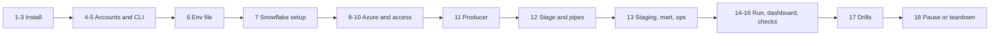

# P04 Quickstart

The whole project as a numbered list of commands, from an empty laptop to a running, measured, and paused pipeline. It runs the reference solution in `06_solution/`. To build your own, follow the same order with [07_build_it_yourself.md](07_build_it_yourself.md) and use this list as a checklist.

Every step ends with **Done when**. Do not start the next step until it is true. If a step fails, the linked section of [05_snowflake_step_by_step.md](05_snowflake_step_by_step.md) explains it in detail.



## Install

### 1. Workstation basics

Follow [Workstation](../../../../shared/environments/setup-guide/01_workstation_macos.md) sections 1, 3, 4, 5, and 8 (Homebrew, Git, VS Code, Python, utilities).

**Done when:** `python3.12 --version`, `git --version`, `jq --version`, `dot -V` all print versions.

### 2. Azure CLI and Snowflake CLI

```bash
brew install azure-cli pipx
pipx ensurepath && pipx install snowflake-cli
```

**Done when:** `az version` and `snow --version` print versions.

### 3. Clone and open the project

```bash
cd rs-data-platform-roadmap/16-cloud-databases/01-snowflake/end-to-end-projects/P04_wikimedia_snowpipe_realtime_dwh/06_solution
```

**Done when:** `ls` shows `core/ azure/ aws/ producer/ tests/ run_sql.sh`.

## Accounts and Access

### 4. Open the accounts

- Snowflake trial on **Azure**, in your chosen region (for example West Europe); enroll in MFA.
- Azure free account; create a budget with alerts in Cost Management.

Details: [Snowflake trial account](../../../../shared/environments/setup-guide/accounts/snowflake.md) and [Azure free account](../../../../shared/environments/setup-guide/accounts/azure.md), step by step.

**Done when:** you can log in to Snowsight and the Azure portal, and an Azure budget exists.

### 5. Connect the CLIs

```bash
az login
az account set --subscription "<your subscription>"
```

Create the Snowflake key pair, register it with `ALTER USER ... SET RSA_PUBLIC_KEY`, and add a `[connections.p04]` block to `~/.snowflake/config.toml` exactly as in [Snowflake CLI](../../../../shared/environments/setup-guide/02_cli_tools_and_auth.md#snowflake-cli).

**Done when:**

```bash
az account show --query name -o tsv
snow sql -c p04 -q "SELECT CURRENT_USER(), CURRENT_ROLE(), CURRENT_REGION()"
```

both succeed, and the region starts with `AZURE_`.

### 6. Project env file

```bash
cp p04.env.example p04.env
# edit p04.env: P04_STORAGE_ACCOUNT (globally unique, lowercase), P04_ALERT_EMAIL, WIKI_USER_AGENT
set -a; source p04.env; set +a
```

**Done when:** `echo $P04_STORAGE_ACCOUNT $P04_ALERT_EMAIL` prints your values. `p04.env` is ignored by Git (`git check-ignore p04.env` prints its name).

## Build

### 7. Snowflake account setup and raw tables

```bash
./run_sql.sh core/00_account_setup.sql core/01_schemas_and_raw.sql
```

**Done when:** `snow sql -c p04 -q "SHOW WAREHOUSES LIKE 'P04_%'"` lists two XS warehouses with `P04_RM`.
Details: [step 0.3](05_snowflake_step_by_step.md#03-account-setup-script), [step 3.1](05_snowflake_step_by_step.md#31-schemas-and-raw-tables).

### 8. Azure landing zone

```bash
./azure/01_provision.sh
# copy the printed tenant id into p04.env as AZURE_TENANT_ID, then:
set -a; source p04.env; set +a
```

**Done when:** the script prints the stage URL and queue URI.
Details: [step 2.1](05_snowflake_step_by_step.md#21-provision-azure-resources).

### 9. Integrations and consent

```bash
./run_sql.sh azure/10_integrations.sql
for int in P04_AZURE_STORAGE_INT P04_AZURE_QUEUE_INT; do
  echo "== $int"
  snow sql -c p04 -q "DESC INTEGRATION $int" --format json \
    | jq -r '.[] | select((.property // .PROPERTY) | test("AZURE_CONSENT_URL|AZURE_MULTI_TENANT_APP_NAME"))
             | "\(.property // .PROPERTY) = \(.property_value // .PROPERTY_VALUE)"'
done
```

Open both consent URLs in a browser and accept.

**Done when:** both consents are accepted and you have both app names.

### 10. Grant Snowflake access in Azure

```bash
./azure/02_grant_snowflake_access.sh <storage app name> <queue app name>
```

Wait a few minutes for role assignments to propagate.

**Done when:** the script prints "Granted".
Details: [step 3.2](05_snowflake_step_by_step.md#32-integrations-and-consent).

### 11. Producer: test locally, then write a few files to Azure

```bash
cd producer
python3.12 -m venv .venv && source .venv/bin/activate
pip install -r requirements.txt
python -m pytest -q test_producer.py
python producer.py --source synthetic --rate 20 --batch-seconds 30 --duration-minutes 2 --sink azure
cd ..
```

**Done when:** tests pass and `az storage blob list --account-name "$P04_STORAGE_ACCOUNT" -c landing --auth-mode login --prefix wiki/ -o table` lists files.
Details: [step 2.2](05_snowflake_step_by_step.md#22-write-a-few-files-to-azure).

### 12. Stage and pipes

```bash
./run_sql.sh azure/11_stage_and_pipes.sql
snow sql -c p04 -q "SELECT COUNT(*) FROM P04_WIKI_RT.RAW.WIKI_RECENTCHANGE_RAW"
```

**Done when:** the `LIST` in the script shows your files and the raw count is above zero (allow a minute after the `REFRESH`).
Details: [steps 3.3 to 3.5](05_snowflake_step_by_step.md#33-stage-and-smoke-tests).

**Gate:** write two more files (`python producer/producer.py --source synthetic --batch-seconds 20 --duration-minutes 1 --sink azure`) and confirm they load **without** running `REFRESH`. If not, fix the notification path before continuing.

### 13. Staging, mart, operations

```bash
./run_sql.sh core/20_staging.sql core/30_mart.sql core/40_ops.sql
```

**Done when:**

```bash
snow sql -c p04 -q "SELECT COUNT(*), COUNT(DISTINCT EVENT_ID) FROM P04_WIKI_RT.STG.WIKI_CHANGE"
snow sql -c p04 -q "SELECT RECON_STATUS, COUNT(*) FROM P04_WIKI_RT.OPS.V_FILE_RECONCILIATION GROUP BY 1"
```

show equal counts and only `OK` or `PENDING`.

## Run and Measure

### 14. Real stream, bounded

```bash
source producer/.venv/bin/activate
python producer/producer.py --source wikimedia --batch-seconds 60 --duration-minutes 60 --sink azure
```

**Done when:** the producer prints `done: files=... events=...`.

### 15. Dashboard

In Snowsight, create a dashboard with one tile per query from the "Dashboard tiles" section of `core/50_dashboard_and_ops_queries.sql`, using role `P04_READER` and warehouse `P04_BI_WH`.

**Done when:** all tiles render as the reader role. Take screenshots into `../assets/`.

### 16. Checks and numbers

```bash
./run_sql.sh tests/data_quality_checks.sql
snow sql -c p04 -q "SELECT * FROM P04_WIKI_RT.OPS.V_LATENCY_LAST_HOUR"
snow sql -c p04 -q "SELECT * FROM P04_WIKI_RT.OPS.V_FILE_LATENCY_LAST_HOUR"
```

Run the credits query at the end of `core/50_dashboard_and_ops_queries.sql`.

**Done when:** all checks `PASS`, and latency percentiles and credits are written into [PROGRESS.md](../PROGRESS.md).

### 17. Failure drills

Follow [tests/failure_drills.md](06_solution/tests/failure_drills.md). Write the prediction before each drill.

**Done when:** the drill log has six filled rows.

## Stop

### 18. Pause after every session, teardown at the end

```bash
./run_sql.sh core/90_pause.sql              # end of every session
./run_sql.sh core/91_resume.sql             # start of the next session

./run_sql.sh teardown.sql                   # end of project
az group delete --name "$P04_RG" --yes
```

**Done when:** `snow sql -c p04 -q "SHOW WAREHOUSES LIKE 'P04_%'"` returns nothing after teardown, and the resource group no longer appears in `az group list -o table`.

## AWS Variant

Replace steps 8 to 12 with: `aws/01_provision.sh`, `./run_sql.sh aws/10_integration.sql`, `aws/11_stage_and_pipes.sql` up to `SHOW PIPES`, `aws/02_connect_snowflake.sh <iam user arn> <external id> <sqs arn>`, then the rest of `aws/11`. Set `AWS_PROFILE`, `AWS_ACCOUNT_ID`, `P04_BUCKET`, `P04_REGION` in `p04.env`, and run the producer with `--sink s3`. Your Snowflake account must then be on AWS in the same region.
