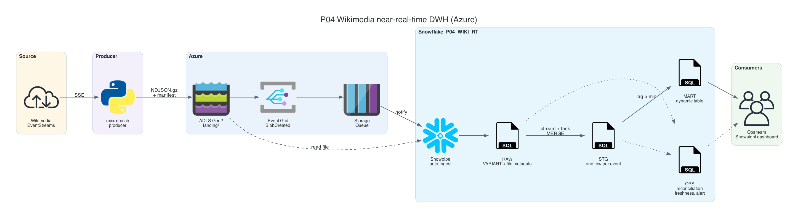
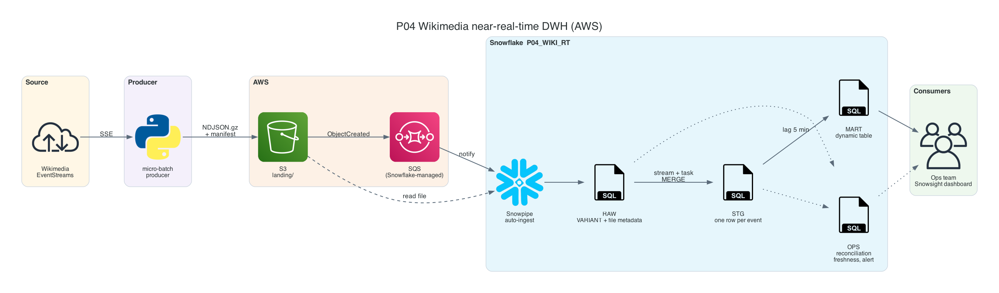
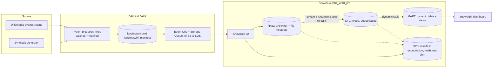

# P04 Wikimedia Snowpipe Near-Real-Time DWH

Build a near-real-time warehouse on a live public event stream. A Python producer turns the Wikimedia `recentchange` stream into immutable micro-batch files in cloud storage. Snowpipe loads each file as soon as a storage event arrives. Snowflake then deduplicates, models, and serves the data to a dashboard. Every file is reconciled against a producer manifest, and latency is measured at every hop.

This is the ProjectPro "Real-Time Data Warehouse" idea, rebuilt with a real live source, honest latency numbers, and the operational parts that the original leaves out.

## Target Architecture

Own diagram, generated from [assets/architecture.py](assets/architecture.py). Icons: vendor architecture icon sets bundled with the <a href="https://diagrams.mingrammer.com">diagrams</a> library.

AWS variant

Own diagram, generated from [assets/architecture.py](assets/architecture.py).

Text version (Mermaid)

### Reference From the Source Article

The closest original design is the ProjectPro Twitter feed pipeline: files to Blob Storage, Azure Queue, Snowpipe, Snowflake. P04 keeps that skeleton and adds manifests, reconciliation, deduplication, a serving layer, and failure drills.

Source: ProjectPro, <a href="https://www.projectpro.io/article/snowflake-projects/1168">13 End-to-End Snowflake Projects That Build Job-Ready Skills</a>. Linked for personal study, not copied into this repository.

## Skills

| Skill | Where you practice it |
| --- | --- |
| Storage and notification integrations, no secrets in Snowflake | Milestones M2, M3 |
| Snowpipe auto-ingest, `SYSTEM$PIPE_STATUS`, `COPY_HISTORY`, `ALTER PIPE REFRESH` | M3, M7 |
| Schema-on-read with `VARIANT` and file metadata columns | M3 |
| Idempotent incremental loading with streams, serverless tasks, and `MERGE` | M4 |
| Dynamic tables and the cost of a short target lag | M5 |
| Manifest-based reconciliation and latency measurement | M6 |
| Failure drills: duplicates, malformed files, missed events, schema drift | M7 |
| Cost model of near-real-time on Snowflake | M5, M8 |

## Prerequisites

- Read [Data Loading Patterns](../../learning-materials/deep-dives/03_data_loading_patterns.md) and [Incremental Processing](../../learning-materials/deep-dives/04_incremental_processing.md)
- Read [Dynamic Tables](../../learning-materials/deep-dives/Snowflake_dynamic_tables.md)
- A Snowflake trial account on Azure (or AWS for the `aws/` variant), an Azure subscription with `az` CLI, Snowflake CLI, Python 3.10+. Installation and account setup: [setup guide](../../../../shared/environments/setup-guide/README.md)
- Read [cost guardrails](../_shared/cost_guardrails.md). A near-real-time pipeline left running overnight can consume a large part of a trial's credits.

## Navigation

| Part | File |
| --- | --- |
| Quickstart: numbered commands from install to teardown | [QUICKSTART.md](QUICKSTART.md) |
| 1. Problem | [01_problem.md](01_problem.md) |
| 2. Architecture and decisions | [02_architecture_decisions.md](02_architecture_decisions.md) |
| 3. Snowflake approach | [03_snowflake_approach.md](03_snowflake_approach.md) |
| 4. Alternative stacks and roadmap | [04_alternative_stacks.md](04_alternative_stacks.md) |
| 5. Step by step on Snowflake | [05_snowflake_step_by_step.md](05_snowflake_step_by_step.md) |
| 6. Solved reference | [06_solution/README.md](06_solution/README.md) |
| 7. Build it yourself | [07_build_it_yourself.md](07_build_it_yourself.md) |

Recommended route: 1, 2, 3, 4, then **7** (build). Use 5 when stuck. Compare with 6 at the end.

## Related Projects

- [P14 Kafka connector streaming](../README.md) and [P15 Kafka to lake to Snowpipe](../README.md) use the same data, so the three ingestion designs can be compared with measured numbers.
- [P05 Streams and tasks CDC](../README.md) goes deeper into change processing.
