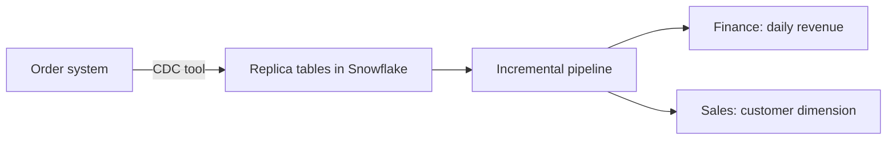

# 1. Problem

## Business Context

A wholesale distributor runs its order system on an operational database. A CDC tool already replicates the order tables into Snowflake every few minutes. Finance wants daily revenue that matches the order system, including what changes after the fact: late discount corrections, cancellations, and fulfilment status. Sales wants a customer dimension that reflects the current segment and balance.

The previous team rebuilt everything nightly. That no longer fits: the numbers are a day old, and the full rebuild grows with history. The new pipeline must process only what changed and still be provably correct.

## Source Data

| Table | Rows at start | Changes per simulated day |
| --- | --- | --- |
| `SRC.CUSTOMER` | 150,000 | About 100 balance or segment edits |
| `SRC.ORDERS` | About 230,000 (all of 1997) | About 600 new orders, up to 200 fulfilled, 5 cancelled |
| `SRC.LINEITEM` | About 900,000 | About 2,400 new lines, about 50 discount corrections on the last 60 days, lines of cancelled orders deleted |

The data comes from `SNOWFLAKE_SAMPLE_DATA.TPCH_SF1`. `OPS.SIMULATE_DAY` replays the next real day of TPC-H orders after the current maximum and adds the edits. TPC-H ends on 1998-08-02, which leaves about 210 days to simulate.

Revenue follows the TPC-H definition: `L_EXTENDEDPRICE * (1 - L_DISCOUNT)`.

## Functional Requirements

1. `CORE.DIM_CUSTOMER`: one row per customer, current attributes, soft delete flag.
2. `CORE.FACT_ORDER`: one row per existing order with its line totals; cancelled orders disappear.
3. `MART.DAILY_REVENUE`: per order date, orders, open orders, lines, gross and net revenue.
4. A change to a line of an old order updates that order and its day.
5. Processing starts automatically within five minutes of a change and does nothing when nothing changed.
6. Every run is logged; every run ends with a reconciliation count.

## Non-Functional Requirements

| Requirement | Target |
| --- | --- |
| Correctness | `OPS.V_RECONCILIATION` empty after every run |
| Idempotency | Rerunning a step on the same changes gives the same result |
| Atomicity | A failed step leaves its stream unconsumed |
| Freshness | Mart reflects a change within 10 minutes |
| Cost | No compute when the source did not change |

## Out of Scope

- Building the CDC tool itself (Openflow, Fivetran, Debezium land the replica; see [04](04_alternative_stacks.md))
- History of customer attributes (SCD2 is P06)
- Late-arriving dimension members (P06)
