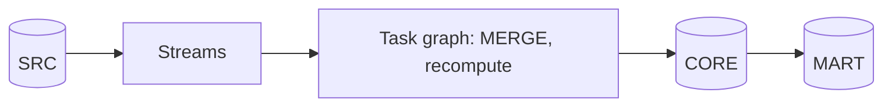
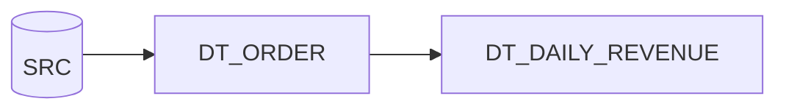
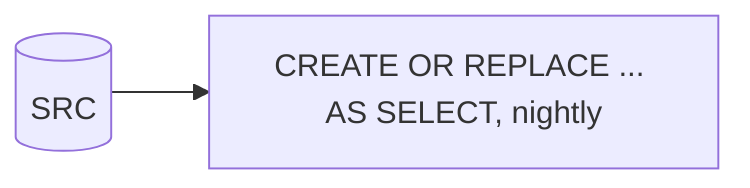
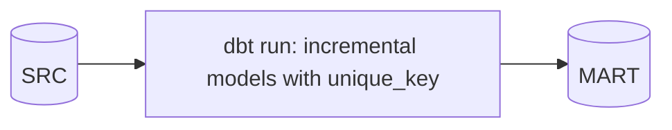

# 2. Architecture and Decisions

## Requirements That Drive the Design

| Driver | Consequence |
| --- | --- |
| Only changes should be processed | Streams on every source table |
| One fact depends on two source tables | Collect affected order keys from both streams, recompute those orders |
| Old orders change (corrections, cancellations) | Mart recomputes affected dates, not "today" |
| Retries happen | Recompute from current state, never add deltas |
| No compute when idle | Root task `WHEN SYSTEM$STREAM_HAS_DATA` |
| Must be provably correct | Reconciliation view against a full recompute, checked by a finalizer |

## Options

### Option 1: Streams plus a serverless task graph (chosen)

### Option 2: Dynamic tables (built as the comparison)

### Option 3: Nightly full rebuild

### Option 4: dbt incremental models on a schedule

## Trade-Offs

| Criterion | 1 Streams and tasks | 2 Dynamic tables | 3 Full rebuild | 4 dbt incremental |
| --- | --- | --- | --- | --- |
| Work per run | Changed rows only | Changed rows if incremental refresh applies | Everything | Rows selected by your filter |
| Correct for late changes and deletes | Yes, by design | Yes, engine handles it | Yes | Only if the filter and `unique_key` are right |
| Control (transactions, logging, custom rules) | Full | Little | Full | Medium |
| Code volume | Highest | Lowest | Low | Medium |
| Idle cost | None (`WHEN` check) | Refresh checks on a warehouse | None between runs | Orchestrator plus warehouse |
| Freshness | Schedule, here 5 minutes | Target lag | Daily | Schedule |
| Best when | Custom logic, auditability, many consumers | Declarative transformations with standard SQL | Small data, simple needs | Team already on dbt, batch cadence |

## Why / Why Not

**Why streams and not timestamp filters?**
Source rows have no reliable "updated at" column, and deletes leave no row to filter on. A stream records inserts, updates, and deletes since its offset, including the old image of changed rows.

**Why recompute affected orders instead of applying deltas?**
A delta approach adds "new minus old" to the fact. Run it twice and the fact is wrong. Recomputing the affected orders from the current source state gives the same answer however often it runs. The cost is reading the lines of the affected orders, which is small.

**Why one statement that reads both streams?**
The order fact changes when either the order or its lines change. Reading both streams in one `INSERT` inside a transaction advances both offsets at the same commit. Two separate statements in autocommit mode could advance one and fail on the other.

**Why a stream on the fact table?**
The mart needs to know which dates changed, including the old date of a deleted order. A stream on the fact gives exactly that, so the mart task does not need to repeat the order logic.

**Why skip no-op updates in the fact `MERGE`?**
Every updated row, even with identical values, appears in the fact stream and makes the mart recompute its date. Comparing values first keeps downstream work proportional to real changes.

**Why a soft delete in the customer dimension?**
Facts may still reference a deleted customer. A flag keeps joins working and makes the deletion visible.

**Why all tasks in one schema `PIPE`?**
Snowflake requires all tasks of a graph to share the owner and the schema. Keeping tasks apart from data also makes permissions and monitoring simpler.

**Why a finalizer?**
It runs after every graph run that started, successful or not. Reconciliation and logging belong there, not in the last child that does not run when an earlier task fails.

**Why build dynamic tables too?**
They are the declarative answer to the same problem. Building both on the same source turns "which is better" into measured freshness, cost, and control.

## Architecture Decision Records

### ADR-001: One stream per consumer

- **Decision:** `CUSTOMER_STREAM` for the dimension, `ORDERS_STREAM` and `LINEITEM_STREAM` for the fact, `FACT_ORDER_STREAM` for the mart.
- **Consequences:** no consumer can advance another consumer's offset; adding a consumer means adding a stream.

### ADR-002: Affected-keys recompute for multi-table facts

- **Decision:** union of keys from all contributing streams, recompute from `CORE.V_ORDER_CURRENT`, `MERGE` with delete when the order no longer exists.
- **Consequences:** idempotent; the same view defines bootstrap, incremental runs, and reconciliation.

### ADR-003: Explicit transactions in multi-statement tasks

- **Decision:** work tables, `MERGE`, and logging inside `BEGIN ... COMMIT` with rollback on error.
- **Consequences:** a failed run leaves streams unchanged; the next run reprocesses the same changes.

### ADR-004: Serverless tasks with a conditional root

- **Decision:** root every 5 minutes with `WHEN SYSTEM$STREAM_HAS_DATA(...)`; serverless compute for all tasks.
- **Consequences:** no warehouse to size or keep warm; idle periods cost nothing; per-run cost visible in `SERVERLESS_TASK_HISTORY`.

## Failure Modes

| Failure | Detection | Recovery |
| --- | --- | --- |
| Task error | `COMPLETE_TASK_GRAPHS` state `FAILED`, first error task | Fix and rerun; streams still hold the changes |
| Second consumer on a stream | Reconciliation differences | Rebuild fact from SRC; give the consumer its own stream |
| Graph paused past stream staleness | `stale = true` in `SHOW STREAMS` | Recreate streams, rebuild from SRC |
| Source table replaced (`CREATE OR REPLACE`) | Stream becomes invalid | Recreate stream, rebuild |
| Root suspended after repeated failures | `SUSPEND_TASK_AFTER_NUM_FAILURES` reached | Fix cause, `SYSTEM$TASK_DEPENDENTS_ENABLE` |

## Cost Model

| Component | Driver |
| --- | --- |
| Serverless tasks | Seconds per graph run, only when the source changed |
| Root `WHEN` checks | Cloud services, negligible |
| Dynamic tables | Warehouse time per refresh; at least one minute of `P05_WH` each time it resumes |
| Simulator | `P05_WH`, a few seconds per day simulated |
| Storage | About 100 MB plus time travel on changed tables |
