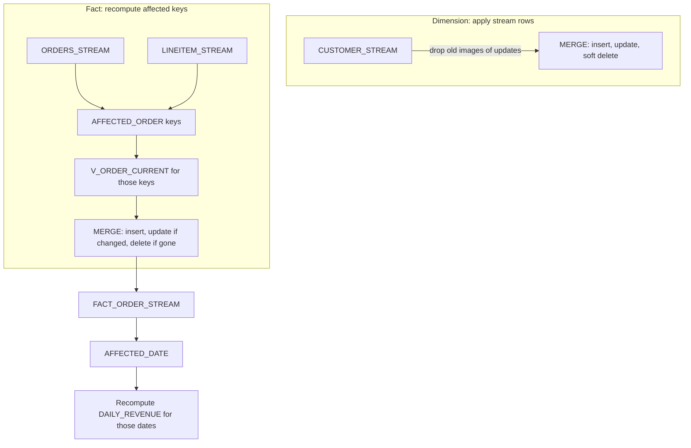
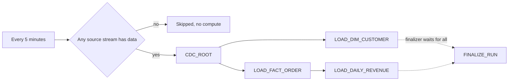
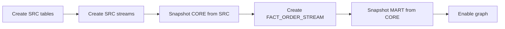

# 3. Snowflake Approach

## What a Standard Stream Returns

A stream returns the **net change** between its offset and now, with three metadata columns.

| Source change since offset | Rows in the stream | `METADATA$ACTION` | `METADATA$ISUPDATE` |
| --- | --- | --- | --- |
| Insert | New row | `INSERT` | `FALSE` |
| Update | Old image and new image | `DELETE` and `INSERT` | `TRUE` and `TRUE` |
| Delete | Old image | `DELETE` | `FALSE` |
| Insert, then update | New row (latest values) | `INSERT` | `FALSE` |
| Insert, then delete | Nothing | | |

Three rules follow:

- Reading a stream in a `SELECT` does not move its offset. Only a DML statement that reads it does, when that statement's transaction commits.
- Inside an explicit transaction all streams read by its statements advance together at `COMMIT`, or not at all.
- A stream must be consumed within the source table's data retention (extended up to `MAX_DATA_EXTENSION_TIME_IN_DAYS`), or it becomes stale.

## Two Techniques in One Project

- **Apply stream rows** fits a table that mirrors one source table.
- **Recompute affected keys** fits anything built from several tables or with aggregation.

## Object Inventory

| Object | Type | Purpose |
| --- | --- | --- |
| `SRC.CUSTOMER`, `SRC.ORDERS`, `SRC.LINEITEM`, `SRC.NATION` | Tables | Replica of the order system |
| `SRC.*_STREAM` | Standard streams | One per consumer |
| `OPS.SIMULATE_DAY` | Stored procedure (Snowflake Scripting) | One business day of changes in one transaction |
| `CORE.V_ORDER_CURRENT` | View | The single definition of an order's state |
| `CORE.DIM_CUSTOMER`, `CORE.FACT_ORDER` | Tables | Current-state model |
| `CORE.FACT_ORDER_STREAM` | Stream | Changed orders for the mart |
| `CORE.AFFECTED_ORDER`, `MART.AFFECTED_DATE` | Transient work tables | Keys and dates of the current run |
| `MART.DAILY_REVENUE` | Table | Task-maintained mart |
| `MART.DT_ORDER`, `MART.DT_DAILY_REVENUE` | Dynamic tables | Declarative comparison |
| `PIPE.CDC_ROOT`, `PIPE.LOAD_*`, `PIPE.FINALIZE_RUN` | Serverless task graph | The pipeline |
| `OPS.RUN_LOG`, `OPS.V_RECONCILIATION` | Table, view | Evidence |

## Task Graph

- The two children of the root run in parallel; a failure in one does not stop the other.
- The finalizer runs after all others reach a final state, also after a failure.
- `SYSTEM$TASK_RUNTIME_INFO('CURRENT_TASK_GRAPH_RUN_GROUP_ID')` ties all log rows of one run together.
- `EXECUTE TASK PIPE.CDC_ROOT` runs the graph now; changing any task requires suspending the root first.

## Bootstrap Order

Streams before snapshots: a change in between is processed twice, which the idempotent logic absorbs. The other order would silently lose it.

## Dynamic Tables in Brief

- `TARGET_LAG` sets how stale the table may be; `DOWNSTREAM` refreshes only when a dependent table needs it.
- `REFRESH_MODE = INCREMENTAL` fails at creation if the query cannot be refreshed incrementally; `AUTO` would silently choose full refresh.
- Refreshes run on the named warehouse; each refresh that resumes it pays at least one minute.
- `DYNAMIC_TABLE_REFRESH_HISTORY` shows each refresh, its action (incremental, full, no data), and duration.

## What This Project Teaches About Snowflake

- Streams are offsets on table versions; DML plus commit moves them.
- Transactions make multi-stream consumption atomic.
- Task graphs need one owner and one schema, and have finalizers for cleanup and checks.
- Conditional roots make frequent schedules cheap.
- Dynamic tables trade control for less code; the comparison is measurable.
