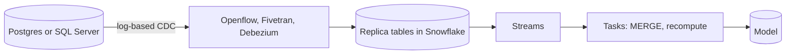
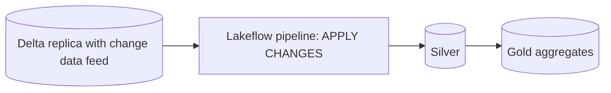
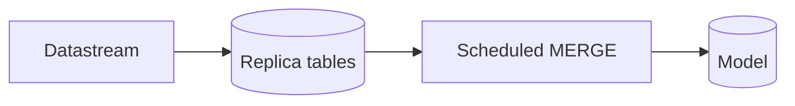
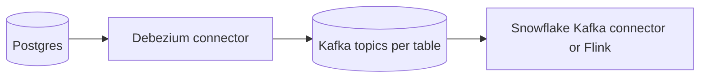
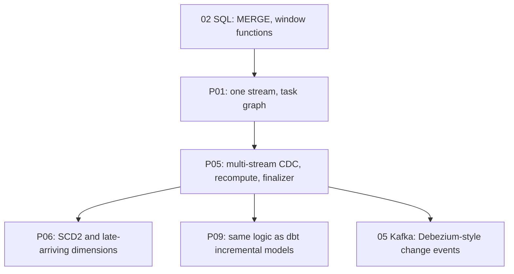

# 4. Alternative Stacks and Roadmap

The problem: keep a model derived from several changing tables correct and fresh without rebuilding it.

## Component Mapping

| Concern | Snowflake (this project) | Databricks | BigQuery | Open source |
| --- | --- | --- | --- | --- |
| Getting changes out of the OLTP database | Openflow, Fivetran, or a partner tool landing a replica | Lakeflow Connect, Debezium to Kafka | Datastream | Debezium to Kafka |
| Change feed on a table | Stream | Change data feed on Delta | Change history (`APPENDS`, `CHANGES` functions) | Debezium topics, Iceberg incremental reads |
| Apply changes | `MERGE` in a task | `MERGE INTO` or `APPLY CHANGES` in Lakeflow pipelines | `MERGE` in scheduled queries | Spark or Flink `MERGE` into Iceberg |
| Orchestration | Task graph | Workflows or Lakeflow pipelines | Scheduled queries, Dataform | Airflow, Dagster |
| Declarative alternative | Dynamic tables | Materialized views, streaming tables | Materialized views, continuous queries | Materialize, RisingWave |

## The Full CDC Chain

P05 starts at the replica. Log-based CDC (reading the database's write-ahead log) is preferred over query-based extraction because it captures deletes and does not load the source.

## Databricks

- `APPLY CHANGES INTO` handles ordering and deletes declaratively, close to dynamic tables in spirit.
- Wins when changes already flow through Kafka and Spark.

## BigQuery

- Datastream can apply changes directly into BigQuery tables; downstream incremental logic is your own.

## Local Open Source: Postgres, Debezium, Kafka

- The `shared/docker/local-stacks/` Postgres and Kafka stacks are enough to see real change events with before and after images, the same idea as a stream's `DELETE` and `INSERT` pair.

## When Each Alternative Wins

| Situation | Better choice |
| --- | --- |
| Custom rules, auditable runs, many targets from one change set | Streams and tasks (this project) |
| Standard SQL transformations, small team | Dynamic tables |
| Changes already in Kafka with Spark skills | Databricks Lakeflow |
| Small tables, daily freshness | Full rebuild |

## Learning Roadmap

| Step | Module | Focus |
| --- | --- | --- |
| SQL | [02-sql](../../../../02-sql/README.md) | `MERGE`, set operations, window functions |
| Kafka | [05-confluent-kafka](../../../../05-confluent-kafka/README.md) | Change events before they reach Snowflake |
| dbt | [12-dbt](../../../../12-dbt/README.md) | Incremental models, `unique_key`, `is_incremental()` |
| Airflow | [11-airflow](../../../../11-airflow/README.md) | When orchestration spans systems |

### Suggested Exercise

Rebuild `FACT_ORDER` as a dbt incremental model whose filter selects orders touched since the last run. Then run `OPS.SIMULATE_DAY` and find which change your filter misses (hint: deletes). Write down how streams avoid that problem.
