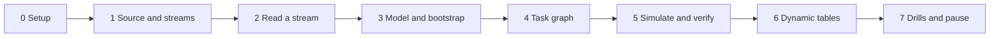

# 5. Step by Step on Snowflake

Every step: **what**, **why**, **verify**, **common errors**. Scripts are in [06_solution](06_solution/README.md).



---

## Phase 0: Setup

- **What:** `./run_sql.sh core/00_account_setup.sql`.
- **Why:** roles, XS warehouse with monitor, database, access to the sample data, privileges for serverless tasks.
- **Verify:** `SELECT COUNT(*) FROM SNOWFLAKE_SAMPLE_DATA.TPCH_SF1.ORDERS;` as `P05_OWNER` returns 1,500,000.
- **Common errors:** "Database SNOWFLAKE_SAMPLE_DATA does not exist": uncomment the `CREATE DATABASE ... FROM SHARE` line.

---

## Phase 1: Source and Streams

- **What:** `./run_sql.sh core/01_source.sql`.
- **Why:** copies of 1997 orders and lines, all customers; then a stream per consumer.
- **Verify:** about 230,000 orders from 1997-01-01 to 1997-12-31; `SHOW STREAMS IN SCHEMA SRC;` lists three.

---

## Phase 2: Read a Stream by Hand

```sql
UPDATE P05_CDC.SRC.CUSTOMER SET C_ACCTBAL = C_ACCTBAL + 1 WHERE C_CUSTKEY = 1;
SELECT C_CUSTKEY, C_ACCTBAL, METADATA$ACTION, METADATA$ISUPDATE FROM P05_CDC.SRC.CUSTOMER_STREAM;
SELECT C_CUSTKEY, C_ACCTBAL, METADATA$ACTION, METADATA$ISUPDATE FROM P05_CDC.SRC.CUSTOMER_STREAM;
```

- **Why:** see the update as a `DELETE` plus `INSERT` pair, and see that `SELECT` does not consume.
- **Try:** update the same row again; the stream still shows one pair, with the original old value and the latest new value.

---

## Phase 3: Model and Bootstrap

- **What:** `./run_sql.sh core/10_core_mart.sql core/20_simulator.sql`.
- **Why:** one view defines an order's state; the fact and mart are snapshots of it; the fact stream is created after the fact snapshot; the simulator is ready.
- **Verify:** fact rows equal source orders; `SELECT COUNT(*) FROM P05_CDC.OPS.V_RECONCILIATION;` returns 0.

---

## Phase 4: Task Graph

- **What:** `./run_sql.sh core/30_task_graph.sql`.
- **Why:** conditional root, two parallel children, a chained child, and a finalizer, all in `PIPE`.
- **Verify:** `SHOW TASKS IN SCHEMA P05_CDC.PIPE;` shows five tasks, all `started`.
- **Common errors:**
  - An error when adding a predecessor from another schema: every task of the graph must be in `PIPE`.
  - "Unable to update graph ... root task is not suspended": run the script again; it suspends the root first.

---

## Phase 5: Simulate and Verify

```bash
./simulate.sh 3
snow sql -c p05 -q "USE ROLE P05_OWNER; EXECUTE TASK P05_CDC.PIPE.CDC_ROOT AWAIT"
./run_sql.sh core/40_ops.sql tests/data_quality_checks.sql
```

- **Why:** `AWAIT` waits for the whole graph, including the finalizer.
- **Verify:** the run log shows each task with row counts; all checks `PASS`; the finalizer logged 0 reconciliation differences.
- **Then:** leave the graph resumed and call `./simulate.sh 1` a few times over 15 minutes; watch scheduled runs pick up the changes.

---

## Phase 6: Dynamic Tables

- **What:** `./run_sql.sh core/60_dynamic_tables.sql`, then `./simulate.sh 5 120` and `./run_sql.sh tests/compare_tasks_vs_dt.sql`.
- **Why:** same numbers through a declarative path.
- **Verify:** the first query of the comparison returns no rows once both sides caught up; refresh history shows `INCREMENTAL`.
- **Common errors:** creation fails with an incremental refresh error: read the message, simplify the query, or try `REFRESH_MODE = AUTO` and look at `refresh_mode_reason`.

---

## Phase 7: Drills and Pause

- Work through [tests/failure_drills.md](06_solution/tests/failure_drills.md).
- Pause: `./run_sql.sh core/90_pause.sql`. Teardown at the end: `./run_sql.sh teardown.sql`.
