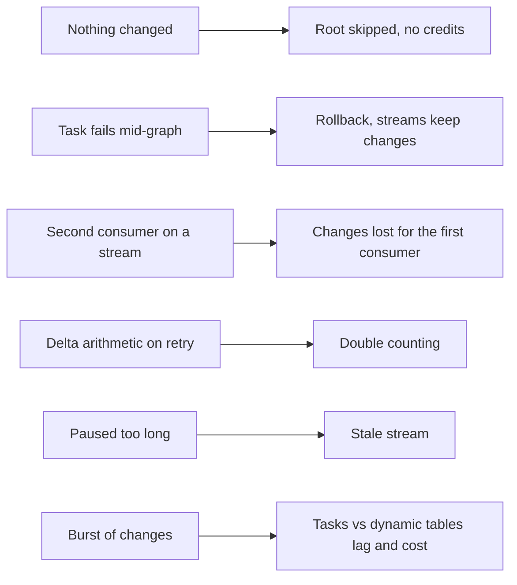

# P05 Failure Drills

Each drill breaks one assumption of incremental processing. Predict, run, observe, restore. After each drill, `tests/data_quality_checks.sql` must pass again.



## D1 Nothing Changed

Do not simulate anything for 30 minutes while the graph is resumed.

- **Observe:** `TASK_HISTORY` for `CDC_ROOT` shows `SKIPPED`; `SERVERLESS_TASK_HISTORY` shows no new credits.
- **Lesson:** `SYSTEM$STREAM_HAS_DATA` in `WHEN` is checked without starting compute. A five-minute schedule is cheap when nothing happens.

## D2 Task Fails in the Middle

Suspend the root, recreate `PIPE.LOAD_FACT_ORDER` with `SELECT 1/0;` right after the `INSERT INTO CORE.AFFECTED_ORDER`, re-enable the graph, then `./simulate.sh 1` and `EXECUTE TASK P05_CDC.PIPE.CDC_ROOT;`.

- **Observe:** the graph run is `FAILED` with `FIRST_ERROR_TASK_NAME = LOAD_FACT_ORDER`; `LOAD_DAILY_REVENUE` did not run; `LOAD_DIM_CUSTOMER` succeeded; `FINALIZE_RUN` still wrote a log row; `ORDERS_STREAM` still has data.
- **Restore:** rerun `core/30_task_graph.sql`, execute the root again. Reconciliation returns to zero.
- **Lesson:** the explicit transaction made the stream offset and the fact change one unit. Independent branches of the graph fail independently.

## D3 A Second Consumer on the Same Stream

```sql
CREATE TABLE OPS.SCRATCH AS SELECT * FROM SRC.ORDERS_STREAM WHERE 1 = 0;
CALL OPS.SIMULATE_DAY();
INSERT INTO OPS.SCRATCH SELECT * FROM SRC.ORDERS_STREAM;   -- consumes the offset
EXECUTE TASK PIPE.CDC_ROOT;
```

- **Observe:** new orders whose lines also changed still arrive through `LINEITEM_STREAM`, but status changes (orders only) are missing; `OPS.V_RECONCILIATION` shows differences and the open order counts are wrong.
- **Restore:** rerun `core/10_core_mart.sql` (full rebuild of the fact), execute the root.
- **Lesson:** a stream is a cursor owned by one consumer. Each consumer gets its own stream, and `SELECT` from a stream does not consume it, only DML does.

## D4 Delta Arithmetic and Retries

Give the drill its own stream (never borrow the pipeline's, see D3), simulate a day, then apply one batch of line changes as deltas twice, as a retried step would:

```sql
CREATE STREAM OPS.DRILL_LINE_STREAM ON TABLE SRC.LINEITEM;
CALL OPS.SIMULATE_DAY();

CREATE OR REPLACE TABLE OPS.LINE_DELTA AS
SELECT L_ORDERKEY AS ORDER_KEY,
       SUM(IFF(METADATA$ACTION = 'INSERT', 1, -1) * L_EXTENDEDPRICE * (1 - L_DISCOUNT)) AS DELTA
FROM OPS.DRILL_LINE_STREAM
GROUP BY 1;

CREATE OR REPLACE TABLE OPS.FACT_COPY CLONE CORE.FACT_ORDER;
UPDATE OPS.FACT_COPY f SET NET_REVENUE = f.NET_REVENUE + d.DELTA FROM OPS.LINE_DELTA d WHERE f.ORDER_KEY = d.ORDER_KEY;
UPDATE OPS.FACT_COPY f SET NET_REVENUE = f.NET_REVENUE + d.DELTA FROM OPS.LINE_DELTA d WHERE f.ORDER_KEY = d.ORDER_KEY;  -- the retry
```

- **Observe:** compare `OPS.FACT_COPY` with `CORE.V_ORDER_CURRENT` for the affected orders: each is off by exactly one delta. Then run the graph and compare `CORE.FACT_ORDER`: correct, and running the recompute `MERGE` again changes nothing.
- **Lesson:** recomputing affected keys from the current state is idempotent; applying deltas is not. Retries, replays, and duplicate deliveries are normal in pipelines.
- **Clean up:** `DROP STREAM OPS.DRILL_LINE_STREAM; DROP TABLE OPS.LINE_DELTA; DROP TABLE OPS.FACT_COPY;`

## D5 Paused Too Long (Discussion and Check)

```sql
SHOW STREAMS IN DATABASE P05_CDC;   -- column stale_after
SHOW PARAMETERS LIKE 'MAX_DATA_EXTENSION_TIME_IN_DAYS' IN TABLE SRC.ORDERS;
```

- **Discuss:** if the graph stays suspended past `stale_after`, the stream becomes stale and cannot be read. Recovery is recreating the stream and rebuilding the fact from SRC (the bootstrap).
- **Lesson:** a pause is not free of risk. Monitor `stale_after`, or keep consuming.

## D6 Burst of Changes

With the dynamic tables from `core/60_dynamic_tables.sql` running: `./simulate.sh 10 30`, then `tests/compare_tasks_vs_dt.sql` every few minutes.

- **Observe:** how long each side lags behind the source, how many task runs versus dynamic table refreshes happened, and the credits on each side.
- **Lesson:** both approaches reach the same numbers. They differ in control (transactions, logging, custom logic) and in what you pay for (serverless seconds versus warehouse minutes).

## Drill Log Template

| Drill | Prediction | Observed | Lesson in one sentence |
| --- | --- | --- | --- |
| D1 | | | |
| D2 | | | |
| D3 | | | |
| D4 | | | |
| D5 | | | |
| D6 | | | |
