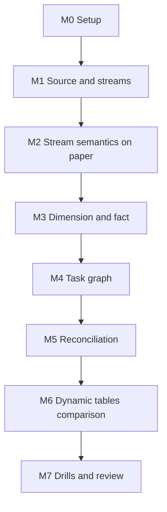

# 7. Build It Yourself

## Brief

A distributor's order tables are replicated into Snowflake. Build a pipeline that keeps a customer dimension, an order fact, and daily revenue in sync with every insert, update, and delete, processes only what changed, survives failures and retries, and proves after each run that its numbers equal a full recompute. Then build the same mart with dynamic tables and decide, with measurements, which one you would run.

## Rules

| You may use | Only when stuck | Only after the milestone passes |
| --- | --- | --- |
| [01](01_problem.md) to [04](04_alternative_stacks.md), `_shared/`, Snowflake documentation | [05](05_snowflake_step_by_step.md) | [06_solution/](06_solution/README.md) |

You may reuse `OPS.SIMULATE_DAY` as the source of changes. Everything downstream is yours.

## Milestones

### M0 Setup
- [ ] Owner and reader roles, XS warehouse with monitor, serverless task privileges, sample data access

### M1 Source and Streams
- [ ] Source copies; streams created before any snapshot, one per consumer

### M2 Stream Semantics on Paper
- [ ] A table predicting stream rows for: insert, update, update twice, delete, insert then delete. Verify each by hand.

### M3 Dimension and Fact
- [ ] Dimension `MERGE` handles inserts, updates, and deletes
- [ ] Fact changes when either an order or one of its lines changes; cancelled orders disappear
- [ ] Running the fact step twice on the same changes gives the same result

**Hint:** how many statements read the two source streams, and in which transaction?

### M4 Task Graph
- [ ] Conditional root that uses no compute when nothing changed
- [ ] Parallel children, chained mart step, finalizer
- [ ] Every log row carries the graph run id

### M5 Reconciliation
- [ ] A view that lists days where the mart differs from a full recompute; empty after every run
- [ ] Late discount corrections change the revenue of the right past days

### M6 Dynamic Tables Comparison
- [ ] Same mart as dynamic tables with incremental refresh
- [ ] Table: freshness, credits per hour, lines of code, what you can and cannot control

### M7 Drills and Review
- [ ] Drills: idle, failure mid-graph, second consumer, delta retry, staleness, burst
- [ ] One page: design, decisions with rejected alternatives, comparison table, recommendation
- [ ] Pause or teardown

## Stretch Goals

- **SCD2 customers:** keep history of segment changes and attribute revenue to the segment at order time (prepares P06).
- **Append-only stream** on lines for an audit log of every line ever inserted, next to the standard stream.
- **Triggered task:** replace the schedule with a triggered task on the stream and compare latency and cost.
- **Alerts:** a Snowflake alert when reconciliation is not empty or a stream is close to stale.
- **Real CDC:** feed `SRC` from Postgres through Debezium and Kafka (local stacks in `shared/docker/local-stacks/`).

## Portfolio and Interview

**Resume bullet example:** Built an incremental CDC pipeline in Snowflake with streams and a serverless task graph that maintains a multi-table order fact and daily revenue under inserts, updates, deletes, and late corrections, with transactional stream consumption, a reconciliation finalizer, and a measured comparison against dynamic tables.

**Questions you should be able to answer:**
1. What does a standard stream return for a row updated three times since the offset?
2. When exactly does a stream's offset move?
3. Why recompute affected keys instead of applying deltas?
4. Why does the mart need a stream on the fact table, and what does it give for deleted orders?
5. When would you choose dynamic tables over this design, and when not?
