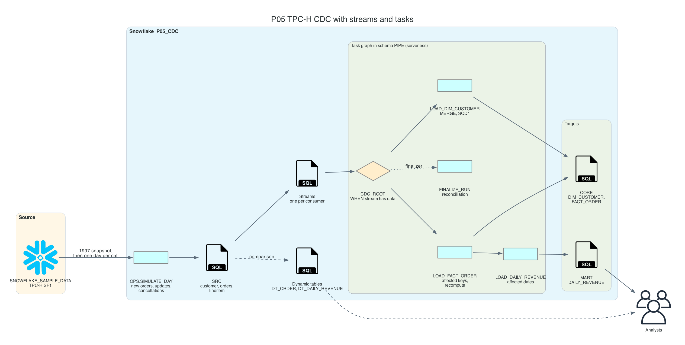
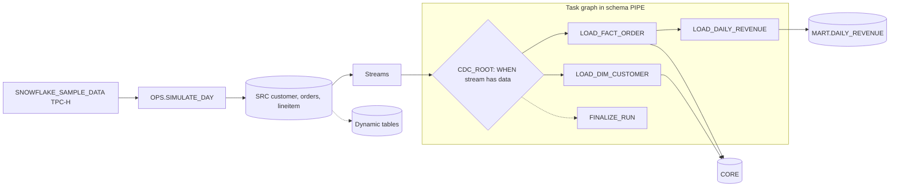

# P05 TPC-H Streams and Tasks CDC

Keep a dimensional model in sync with a changing order system, incrementally and correctly. The source is TPC-H data that ships with every Snowflake account; a stored procedure turns it into a living system that receives new orders, fulfils old ones, corrects discounts on past orders, edits customers, and cancels orders. Streams capture every change, a serverless task graph applies them, and reconciliation proves the result equals a full recompute. A second implementation with dynamic tables produces the same numbers so you can compare control, freshness, and cost.

No cloud account besides Snowflake and no local data: everything runs inside the account.

## Target Architecture

Own diagram, generated from [assets/architecture.py](assets/architecture.py). Icons: vendor architecture icon sets bundled with the <a href="https://diagrams.mingrammer.com">diagrams</a> library.

Text version (Mermaid)

### Reference From the Source Article

ProjectPro lists this idea as "Build a Real-Time ETL Data Pipeline with Snowflake Medallion Architecture", with an implementation by HarshinneeRavichandran on GitHub ([Snowflake_ETL_SQL_Project](https://github.com/HarshinneeRavichandran/Snowflake_ETL_SQL_Project)). P05 keeps streams and tasks as the core, and focuses on what makes CDC correct: update and delete semantics, multi-table changes, idempotent recomputation, transactions, a finalizer, reconciliation, and a measured comparison with dynamic tables.

Source: ProjectPro, <a href="https://www.projectpro.io/article/snowflake-projects/1168">13 End-to-End Snowflake Projects That Build Job-Ready Skills</a>.

## Skills

| Skill | Milestone |
| --- | --- |
| Streams: standard mode, `METADATA$ACTION`, `METADATA$ISUPDATE`, offsets | M2 |
| `MERGE` with inserts, updates, soft deletes | M3 |
| Affected-keys recompute: changes from two tables into one fact | M3 |
| Transactions that tie stream offsets to writes | M3 |
| Task graphs: `WHEN`, children, finalizer, one schema per graph | M4 |
| Chained streams: fact stream drives the mart | M4 |
| Reconciliation against a full recompute | M5 |
| Dynamic tables: target lag, incremental refresh, cost comparison | M6 |

## Prerequisites

- [Streams and tasks material in this module](../../README.md)
- Snowflake trial and Snowflake CLI: [setup guide](../../../../shared/environments/setup-guide/README.md)
- P01 recommended: it introduces a single-stream task graph
- [Cost guardrails](../_shared/cost_guardrails.md): suspend the graph and the dynamic tables after each session

## Navigation

| Part | File |
| --- | --- |
| Quickstart: numbered commands from install to teardown | [QUICKSTART.md](QUICKSTART.md) |
| 1. Problem | [01_problem.md](01_problem.md) |
| 2. Architecture and decisions | [02_architecture_decisions.md](02_architecture_decisions.md) |
| 3. Snowflake approach | [03_snowflake_approach.md](03_snowflake_approach.md) |
| 4. Alternative stacks and roadmap | [04_alternative_stacks.md](04_alternative_stacks.md) |
| 5. Step by step on Snowflake | [05_snowflake_step_by_step.md](05_snowflake_step_by_step.md) |
| 6. Solved reference | [06_solution/README.md](06_solution/README.md) |
| 7. Build it yourself | [07_build_it_yourself.md](07_build_it_yourself.md) |

Recommended route: 1, 2, 3, 4, then **7** (build). Use 5 when stuck. Compare with 6 at the end.
