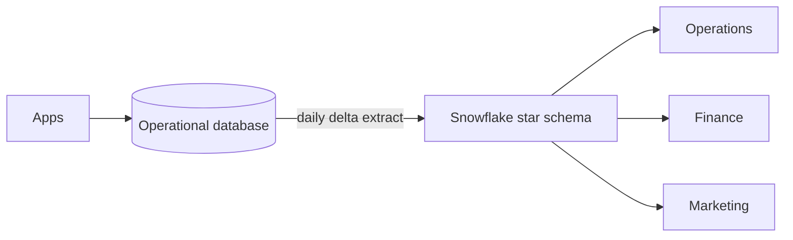

# 1. Problem

## Business Context

A food delivery platform operates in four Ukrainian cities. Its operational database serves the apps; once a day it produces a delta extract with every row created or changed that day. Three teams need the warehouse:

- **Operations:** delivery times and cancellations by city and cuisine, per day.
- **Finance:** revenue per day, reconcilable with the order system.
- **Marketing:** revenue by loyalty tier, both "tier at the time of the order" and "tier today".

The previous warehouse overwrote customer and restaurant attributes, so last month's revenue by city changed every time a customer moved. Nobody trusted the numbers.

## Source Data

One CSV per table per day under `day=YYYY-MM-DD/`. Day 0 is a full extract.

| Table | Day 0 rows | Rows per later day | What changes |
| --- | --- | --- | --- |
| `customers` | About 3,000 | About 70 | City, loyalty tier; new sign-ups |
| `restaurants` | 150 | 3 to 4 | Price tier, cuisine, rating, deactivation; occasional new restaurant |
| `menu_items` | About 1,500 | About 40 | Price |
| `couriers` | 200 | 2 | Vehicle |
| `orders` | About 2,000 | About 2,100 | Status and milestone timestamps |
| `order_items` | About 5,000 | About 5,000 | Insert only |

Problems the extracts contain on purpose:

| Problem | Frequency |
| --- | --- |
| Customer record arrives one day after the customer's first order | Every tenth new sign-up |
| Order still in progress at extract time, finished in the next extract | Orders placed shortly before midnight |
| Exact duplicate order rows | About 5 per extract |
| Only end-of-day state per row: two changes on one day show as one | Always |

## Functional Requirements

1. Customer city, loyalty tier, and deletion keep history; name and email are corrected in place.
2. Restaurant city, cuisine, price tier, and active flag keep history; name and rating are corrected in place.
3. Menu items and couriers keep only their current state.
4. Each order is one fact row whose milestones fill in as extracts arrive; its dimension references reflect the moment it was placed.
5. Each order line is one fact row with the price actually paid.
6. An order whose customer is not known yet still loads and later shows the real customer attributes.
7. Daily KPIs per restaurant city and cuisine; revenue by tier as-was and as-is.

## Non-Functional Requirements

| Requirement | Target |
| --- | --- |
| Idempotency | Uploading or loading a day twice changes nothing |
| Cadence independence | Loading two days at once gives the same model as loading them one by one |
| Integrity | All checks in `OPS.V_MODEL_CHECKS` at 0 after every run |
| Atomicity | A failed build leaves no partial batch |

## Out of Scope

- Intraday history (the extract shows only end-of-day state)
- Courier assignment history (couriers are SCD1)
- Real-time order tracking (P04, P14 cover streaming)
