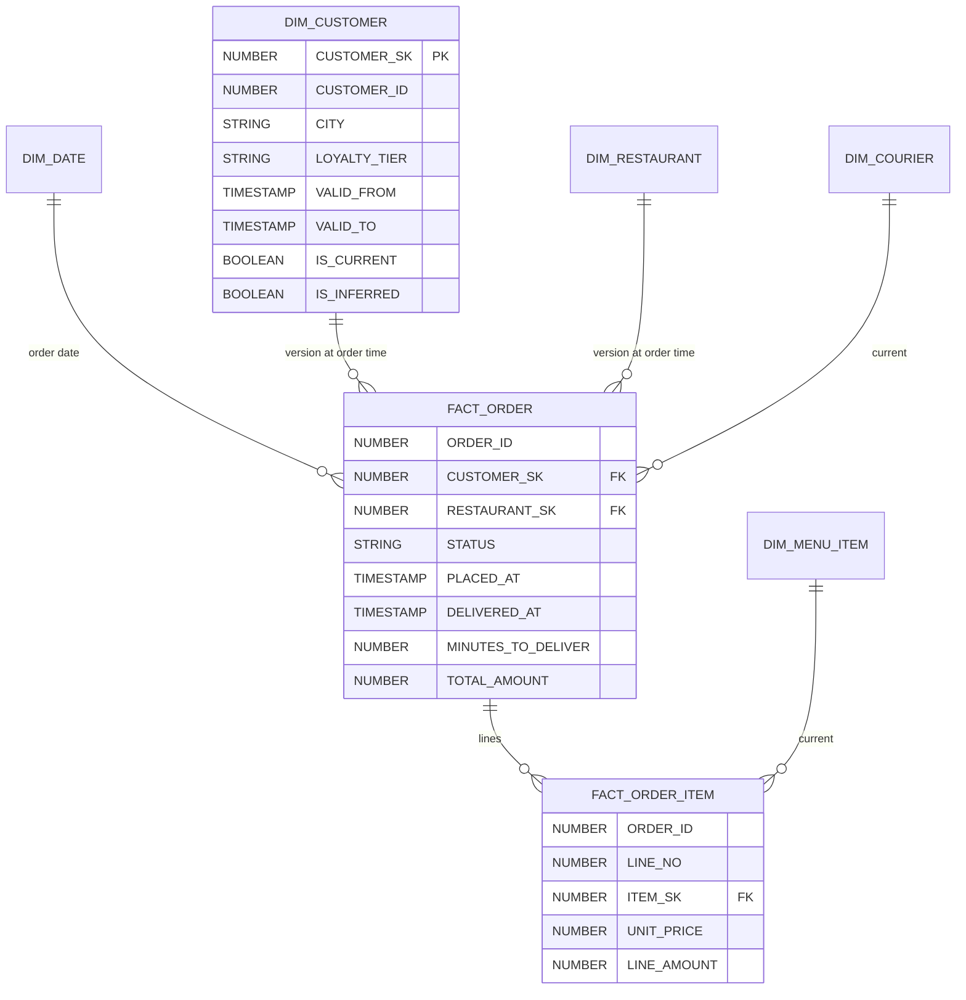
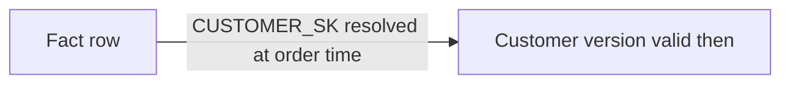
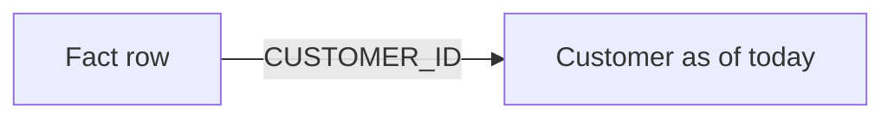
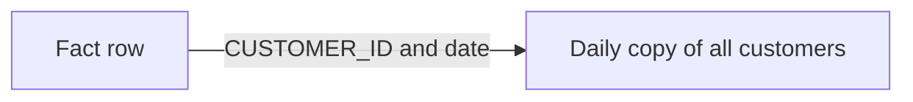
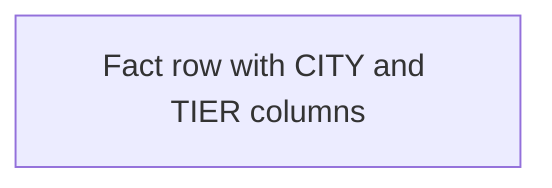

# 2. Architecture and Decisions

## Requirements That Drive the Design

| Driver | Consequence |
| --- | --- |
| Reports must not change when a customer moves | SCD2 on tracked attributes, facts point to versions |
| Corrections to names and ratings should apply everywhere | SCD1 on those attributes, across all versions |
| Orders finish after the extract | Accumulating snapshot fact, merged by order id |
| Customers can arrive after their orders | Inferred members, completed in place |
| Several days may load in one run | Version ordering inside the batch |
| The price paid matters, not today's price | Price on the order line fact; menu item is SCD1 |

## The Model

## Options for Keeping History

### Option 1: SCD2 dimensions with surrogate keys (chosen)

### Option 2: SCD1 everywhere

### Option 3: Snapshot dimensions

### Option 4: Attributes copied onto the fact

## Trade-Offs

| Criterion | 1 SCD2 | 2 SCD1 | 3 Daily snapshots | 4 Attributes on fact |
| --- | --- | --- | --- | --- |
| As-was reporting | Yes | No | Yes | Yes, for copied attributes only |
| As-is reporting | Yes, via current version | Yes | Yes, latest snapshot | Needs a join anyway |
| Storage | Versions only | Smallest | Grows with days times rows | Grows with facts |
| Load complexity | Highest | Lowest | Low | Low |
| New attribute later | Applies from now on | Simple | Applies from now on | Requires fact backfill |
| Best when | Attributes change slowly and history matters | History does not matter | Dimensions are small, changes frequent | One or two attributes, fixed |

## Why / Why Not

**Why a surrogate key?**
A customer id identifies a person; a surrogate key identifies a version of that person. Facts store the version, so a join gives the attributes valid at order time without a date predicate.

**Why detect changes with a hash?**
Comparing one hash of the tracked attributes is simpler and less error-prone than comparing each column, and makes "is this a new version?" a single condition. SCD1 attributes are not in the hash, so a name correction does not create a version.

**Why is the first version valid from 1900?**
A fact can be older than the first time the warehouse saw the customer (initial load, late arrival). Opening the first version at the beginning of time means every fact finds a version.

**Why complete an inferred member in place instead of versioning it?**
Facts that arrived early already point to the inferred row. Updating it gives those facts the real attributes. A new version would leave them on "Unknown".

**Why skip changes older than the current version?**
Inserting a version in the middle of history means splitting a range and re-pointing facts already resolved into it. That is possible but expensive and rare here, so it is counted and skipped, and a drill discusses when to do the full rebuild instead.

**Why an accumulating snapshot for orders?**
Questions are about the order's lifecycle: time to deliver, cancellation. One row per order with milestone columns answers them directly. A transaction fact per status event would need pivoting for every query.

**Why resolve dimension keys only when the order is first seen?**
The order was placed at one moment. Re-resolving on each later update could move it to a newer customer version, which would change history.

**Why one procedure in one transaction?**
Facts depend on dimensions loaded in the same batch. If dimensions committed and facts failed, the next run would see dimension changes as already applied while the streams for facts would still hold data. One transaction keeps the batch atomic.

**Why a dynamic table for KPIs and views for the rest?**
The KPI table is queried often and aggregates the whole fact; incremental refresh keeps it cheap. The other views are thin joins and read only what the query needs.

## Architecture Decision Records

### ADR-001: SCD2 by attribute hash, versions ordered inside the batch

- **Decision:** per key, keep rows whose hash differs from the previous row in the batch or from the current version; close the current version at the first new one; chain the new versions with `LEAD`.
- **Consequences:** load cadence does not change history; intraday changes are invisible because the extract shows end-of-day state.

### ADR-002: Inferred members for late-arriving customers

- **Decision:** before the fact `MERGE`, insert an inferred row for every unknown customer id; complete it in place when the record arrives.
- **Consequences:** no fact is ever dropped or pointed at "Unknown" permanently; inferred rows are visible and checked.

### ADR-003: Late attribute changes are skipped and counted

- **Decision:** a change older than the current version is not applied; the count is logged per run.
- **Consequences:** simple, safe default; a real requirement for back-dated changes would need a per-key history rebuild.

### ADR-004: Unknown members with surrogate key -1

- **Decision:** every dimension has a row with key -1; facts never hold NULL keys.
- **Consequences:** inner joins never lose facts; a check counts facts on -1.

## Failure Modes

| Failure | Detection | Recovery |
| --- | --- | --- |
| Overlapping versions | `customer_version_gap_or_overlap`; fact `MERGE` fails as nondeterministic | Repair ranges, rerun |
| Inferred customer never completed | `inferred_customer_with_arrived_record` | Investigate the batch; rerun |
| Extract delivered twice | `PUT` and `COPY` both skip | None needed |
| Extract with a new column | `MATCH_BY_COLUMN_NAME` ignores it | Add the column to RAW when it is needed |
| Build fails | Graph run `FAILED`; streams keep the batch | Fix and rerun |

## Cost Model

| Component | Driver |
| --- | --- |
| Serverless tasks | Seconds per daily batch |
| Dynamic table | One refresh per hour at most, only when facts changed |
| Storage | A few MB per day of extracts plus versions |
