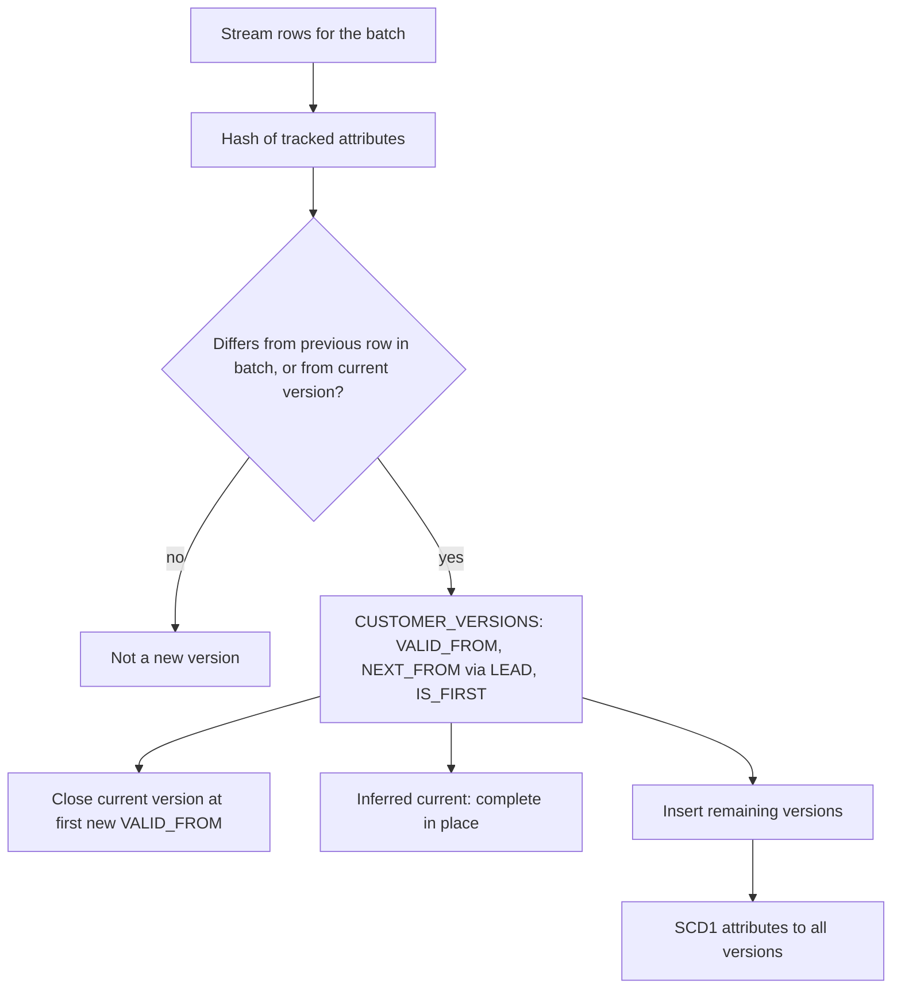
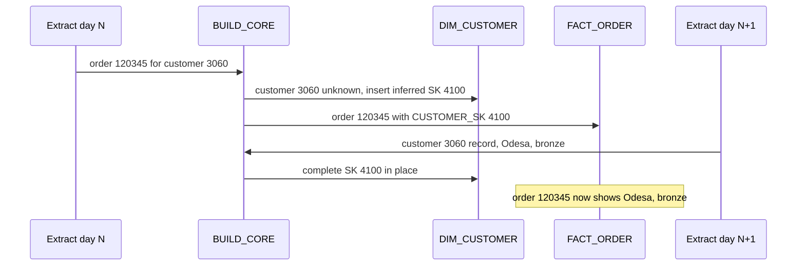

# 3. Snowflake Approach

## Loading Extracts by Column Name

```sql
COPY INTO RAW.CUSTOMERS FROM @RAW.EXTRACT_STAGE
  PATTERN = '.*customers[.]csv[.]gz'
  MATCH_BY_COLUMN_NAME = CASE_INSENSITIVE
  INCLUDE_METADATA = (SRC_FILE = METADATA$FILENAME, LOADED_AT = METADATA$START_SCAN_TIME)
  ON_ERROR = SKIP_FILE;
```

- `PARSE_HEADER = TRUE` in the file format plus `MATCH_BY_COLUMN_NAME` maps CSV headers to columns, so reordered or added columns do not break the load.
- `INCLUDE_METADATA` adds lineage columns without a transformation query.
- RAW keeps every row of every extract. It is the replay source if the model must be rebuilt.

## SCD2 Step by Step



Example for one customer across three extracts:

| Extract | City | Tier | Result in `DIM_CUSTOMER` |
| --- | --- | --- | --- |
| Day 0 | Kyiv | bronze | SK 17: Kyiv, bronze, 1900-01-01 to 9999-12-31, current |
| Day 3 | Lviv | bronze | SK 17 closed at day 3 10:12; SK 3051: Lviv, bronze, from day 3 10:12, current |
| Day 5 | Lviv | bronze, name corrected | No new version; name updated on SK 17 and SK 3051 |

## Point-in-Time Join

```sql
LEFT JOIN CORE.DIM_CUSTOMER c
  ON  c.CUSTOMER_ID = b.CUSTOMER_ID
  AND b.PLACED_AT >= c.VALID_FROM
  AND b.PLACED_AT <  c.VALID_TO
```

Half-open ranges (`>=` and `<`) make adjacent versions meet without overlap. Exactly one version matches if the ranges have no gaps and no overlaps, which the checks verify. If two versions matched, the `MERGE` would fail with a nondeterministic merge error instead of silently picking one.

## Late-Arriving Customer



## Object Inventory

| Object | Type | Purpose |
| --- | --- | --- |
| `RAW.EXTRACT_STAGE` | Internal stage | Daily extracts |
| `RAW.<table>` and `RAW.<table>_STREAM` | Tables, append-only streams | Every extracted row; new rows since last build |
| `CORE.SP_BUILD_CORE` | Stored procedure | One batch into dimensions and facts, one transaction |
| `CORE.DIM_CUSTOMER`, `CORE.DIM_RESTAURANT` | SCD2 dimensions | History of tracked attributes |
| `CORE.DIM_MENU_ITEM`, `CORE.DIM_COURIER` | SCD1 dimensions | Current state |
| `CORE.DIM_DATE` | Date dimension | 2024 to 2026 |
| `CORE.FACT_ORDER` | Accumulating snapshot | One row per order |
| `CORE.FACT_ORDER_ITEM` | Transaction fact | One row per order line |
| `STG.*_CHANGES`, `STG.*_VERSIONS`, `STG.*_BATCH` | Transient work tables | The current batch |
| `PIPE.LOAD_RAW`, `PIPE.BUILD_CORE`, `PIPE.FINALIZE_RUN` | Task graph | Daily pipeline |
| `OPS.V_MODEL_CHECKS` | View | Integrity rules |
| `MART.V_ORDER`, `MART.V_REVENUE_BY_TIER`, `MART.DT_DAILY_KPI` | Views, dynamic table | Analyst layer |

## Why Append-Only Streams Here

RAW only receives inserts. An append-only stream ignores updates and deletes, so it is cheaper to compute and its semantics are simpler: every row in the stream is a row that arrived.

## Why a Stored Procedure Behind the Task

- It can be called by hand while developing: `CALL CORE.SP_BUILD_CORE('manual');`
- The task stays one line, so changing the logic does not require suspending the graph.
- Caveat: a graph run uses the procedure as it is at call time, not as it was when the graph version was set.

## What This Project Teaches About Snowflake

- `COPY` by column name with metadata columns for schema-tolerant raw loading.
- Append-only streams for insert-only sources.
- Multi-statement transactions inside procedures that consume several streams.
- Nondeterministic `MERGE` errors as a free integrity check.
- Dynamic tables on top of a hand-built model.
