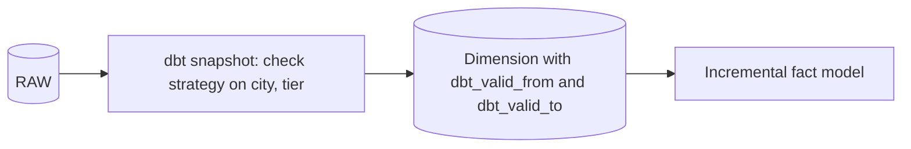
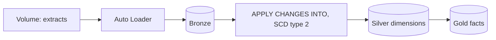
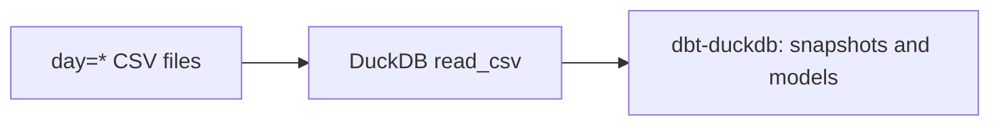
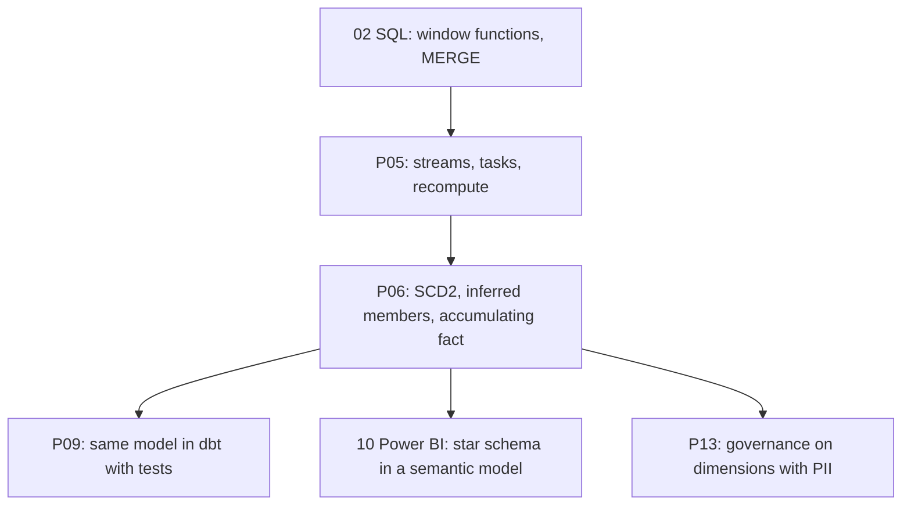

# 4. Alternative Stacks and Roadmap

The problem: turn daily OLTP extracts into a star schema that keeps history correctly and tolerates late and repeated data.

## Component Mapping

| Concern | Snowflake (this project) | dbt (on any warehouse) | Databricks | BigQuery |
| --- | --- | --- | --- | --- |
| Raw landing | Stage, `COPY` by column name | Sources | Auto Loader into bronze Delta | Load jobs |
| SCD2 | Hand-written in a procedure | `snapshot` with `check` or `timestamp` strategy | `APPLY CHANGES ... STORED AS SCD TYPE 2` | Hand-written `MERGE` |
| Inferred members | Insert before fact load | Custom macro or pre-hook | Custom | Custom |
| Accumulating fact | `MERGE` by order id | Incremental model with `unique_key` | `MERGE INTO` | `MERGE` |
| Orchestration | Task graph | dbt Cloud jobs, Airflow | Workflows | Dataform, Composer |

## dbt Snapshots

- dbt generates the SCD2 logic shown in this project. Knowing what it does matters when it fails, for example on duplicate keys in one run.
- dbt snapshots compare against the latest state at run time; several days in one batch collapse into one version unless the source keeps history.

## Databricks

- Declarative SCD2 with sequencing by a column handles out-of-order changes, which this project skips.

## Local Open Source: DuckDB and dbt

- The generator output works unchanged; this is the fastest way to compare a dbt snapshot with your hand-written SCD2.

## When Each Alternative Wins

| Situation | Better choice |
| --- | --- |
| Full control, unusual rules (inferred members, skip late changes) | Hand-written SQL (this project) |
| Team already on dbt, standard SCD2 | dbt snapshots |
| Out-of-order change events, streaming sources | Databricks `APPLY CHANGES` or a sequenced `MERGE` |
| Very small dimensions with frequent changes | Daily snapshot dimensions |

## Learning Roadmap

| Step | Module | Focus |
| --- | --- | --- |
| SQL | [02-sql](../../../../02-sql/README.md) | `LAG`, `LEAD`, `QUALIFY`, `MERGE` |
| dbt | [12-dbt](../../../../12-dbt/README.md) | Snapshots, incremental models, tests |
| Power BI | [10-powerbi-fabric](../../../../10-powerbi-fabric/README.md) | Star schema relationships, role-playing dates |
| Airflow | [11-airflow](../../../../11-airflow/README.md) | Extract scheduling from the source side |

### Suggested Exercise

Rebuild `DIM_CUSTOMER` as a dbt snapshot over `RAW.CUSTOMERS` with `strategy: check` on `city`, `loyalty_tier`, `is_deleted`. Load two days at once and compare the number of versions with this project's dimension. Explain the difference.
