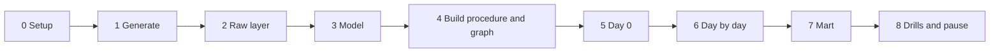

# 5. Step by Step on Snowflake

Every step: **what**, **why**, **verify**, **common errors**. Scripts are in [06_solution](06_solution/README.md).



---

## Phase 0: Setup

- **What:** `./run_sql.sh core/00_account_setup.sql`.
- **Verify:** `SHOW GRANTS TO ROLE P06_OWNER;` includes `EXECUTE MANAGED TASK`.

---

## Phase 1: Generate

```bash
cd generator && python -m pytest -q test_food_oltp.py && python food_oltp.py --out "$P06_DATA_DIR" --days 14 && cd ..
```

- **Why:** deterministic extracts (seed 6), 14 days, about 30,000 orders.
- **Verify:** 14 `day=` folders, six CSV files each; open one `orders.csv` and find an order with an empty `delivered_at`.

---

## Phase 2: Raw Layer

- **What:** `./run_sql.sh core/01_raw.sql`.
- **Why:** typed raw tables with lineage columns, CSV format that parses headers, append-only streams.
- **Verify:** `SHOW STREAMS IN SCHEMA P06_FOOD.RAW;` lists six streams with mode `APPEND_ONLY`.

---

## Phase 3: Model

- **What:** `./run_sql.sh core/10_model.sql`.
- **Why:** dimensions with unknown members, facts, date dimension, work tables, integrity view.
- **Verify:** `SELECT * FROM P06_FOOD.CORE.DIM_CUSTOMER;` shows only the unknown member with key -1.

---

## Phase 4: Build Procedure and Task Graph

- **What:** `./run_sql.sh core/20_build_procedure.sql core/30_task_graph.sql`.
- **Verify:** three tasks in `PIPE`, all `started`.
- **Common errors:** a compilation error in the procedure appears only when it is called; call it once by hand after the first upload to see it early.

---

## Phase 5: Day 0

```bash
./upload_day.sh 2025-03-03
snow sql -c p06 -q "USE ROLE P06_OWNER; EXECUTE TASK P06_FOOD.PIPE.LOAD_RAW AWAIT"
./run_sql.sh tests/data_quality_checks.sql
```

- **Verify:** about 3,000 customer versions, 150 restaurants, about 2,000 facts; all checks `PASS`.

---

## Phase 6: Day by Day

```bash
for d in 04 05 06 07; do ./upload_day.sh 2025-03-$d; snow sql -c p06 -q "USE ROLE P06_OWNER; EXECUTE TASK P06_FOOD.PIPE.LOAD_RAW AWAIT"; done
```

- **Watch after each day:**

  ```sql
  SELECT NOTE FROM P06_FOOD.OPS.RUN_LOG WHERE STEP = 'BUILD_CORE' ORDER BY RUN_AT DESC LIMIT 1;
  SELECT CUSTOMER_ID, COUNT(*) FROM P06_FOOD.CORE.DIM_CUSTOMER GROUP BY 1 HAVING COUNT(*) > 1 LIMIT 5;
  SELECT CUSTOMER_SK, CUSTOMER_ID, IS_INFERRED FROM P06_FOOD.CORE.DIM_CUSTOMER WHERE IS_INFERRED;
  ```

- **Verify:** customers with several versions appear; inferred customers appear after day N and are completed after day N+1; checks stay at 0.
- **Then:** upload two days at once (`./upload_day.sh 2025-03-08 2025-03-09`) and run once.

---

## Phase 7: Mart

- **What:** `./run_sql.sh core/40_mart.sql`.
- **Why:** wide order view, as-was versus as-is revenue, KPI dynamic table, dashboard tiles.
- **Verify:** the as-was versus as-is query returns rows: some revenue moved tiers.

---

## Phase 8: Drills and Pause

- Work through [tests/failure_drills.md](06_solution/tests/failure_drills.md).
- Pause: `./run_sql.sh core/90_pause.sql`. Teardown at the end: `./run_sql.sh teardown.sql`.
